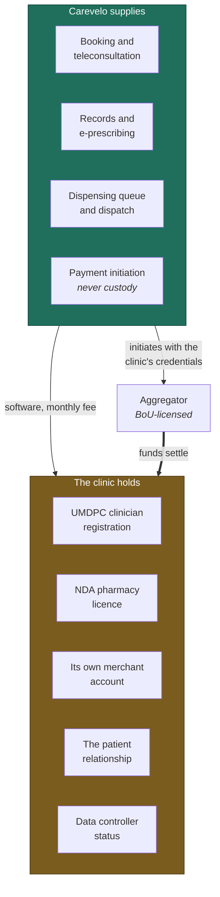
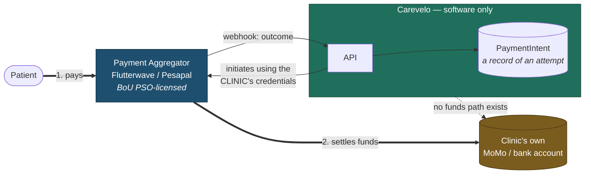
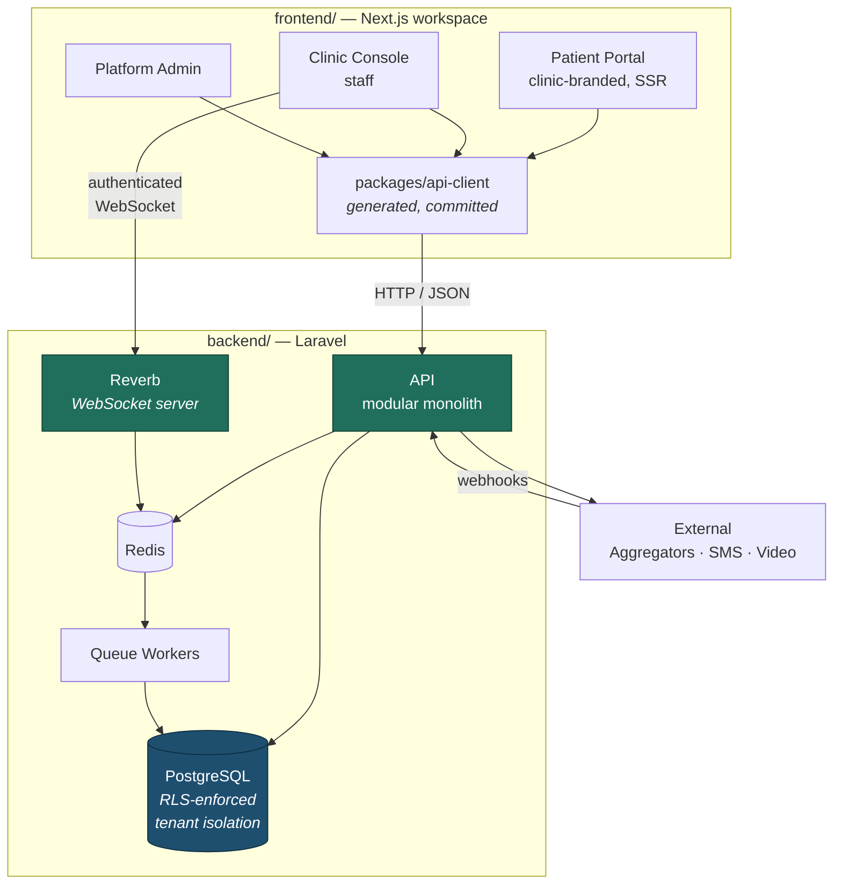

# Carevelo

**White-label digital health software for Uganda's licensed private clinics.**

Carevelo gives an independent clinic its own branded digital front door — patient booking, teleconsultation, e-prescribing, dispensing handoff to the clinic's own pharmacy, delivery dispatch, and mobile-money collection — running under the clinic's own brand and, critically, under the clinic's own regulatory licences.

> **Status: pre-implementation.** This repository currently holds the commercial and technical documentation the system will be built from — 58 documents, 67 diagrams. No application code yet. See [Roadmap](#roadmap).

**Contents:** [The problem](#the-problem) · [Strategy](#the-strategy--arms-dealer-not-combatant) · [The three boundaries](#the-three-permanent-boundaries) · [What it does](#what-it-does) · [Architecture](#architecture) · [Repository layout](#repository-layout) · [Stack](#stack) · [Key decisions](#key-decisions) · [Regulatory position](#regulatory-position) · [Roadmap](#roadmap) · [Documentation](#documentation) · [Working here](#working-here)

---

## The problem

Uganda's private-for-profit sector runs roughly **3,856 facilities** and carries the majority of care-seeking: about **80% of doctors** and **60% of clinical officers** practise privately, financed overwhelmingly out of pocket — around **34% of current health expenditure**, against formal health-insurance coverage of about **1.1% of the population**.

These clinics hold everything that matters: premises, an NDA-licensed pharmacy, UMDPC-registered clinicians, and the trust of a neighbourhood built over years.

What they do not have is a digital front door. Records are on paper. Payment is cash, or an unreconciled personal mobile-money number. There is no way to consult a patient who cannot travel, no way to take a refill order, no way to deliver.

Meanwhile vertically-integrated telemedicine providers — Rocket Health foremost, with 25,000+ patients and US$6.2m raised — offer 24/7 teleconsultation, medicine delivery and home sample collection, and are steadily taking the convenience-seeking urban patient away from the neighbourhood clinic.

**The clinic is losing patients to a capability, not to better medicine.**

*Figures from the [business plan](docs/00-overview/business-plan.md) §B and §E, where each is attributed to its source.*

## The strategy — "arms dealer, not combatant"

Carevelo sells the capability to the clinics rather than competing with them. The clinic keeps the patient relationship, the licences, the revenue and the clinical responsibility. Carevelo supplies software and is paid a subscription.

This is not modesty; it is the load-bearing structural decision. A small team cannot replicate a vertically-integrated provider's clinicians, pharmacy, fleet and capital. But it can arm the hundreds of clinics that already have all of those things.



Everything regulated sits in the amber box. Everything Carevelo does sits in the teal one — and the only thick arrow, money, bypasses it entirely.

**Positioning note.** Carevelo is deliberately *not* sold as "clinic management software". That category is contested — ClinicMaster, Stre@mline, EasyClinic and Helium Health all occupy it, some with a decade of installed base and US$42m raised. The pitch is the un-served bundle: *your clinic's own Rocket Health — teleconsult, pay by mobile money, medicine delivered, on your brand.* We compete on workflow, price, local support and Ugandan data residency. See [Vision & Scope](docs/00-overview/vision-and-scope.md).

## The three permanent boundaries

Carevelo is a **software supplier and data processor only**. Three prohibitions follow, and each avoids a separate licensing regime. They are absolute, they are architectural, and no amount of customer demand relaxes them.

### 1. Never employs or contracts clinicians

Every clinical act is performed by a clinician registered with the UMDPC, the Allied Health Professionals Council or the Nurses & Midwives Council, engaged by *the clinic*.

**Avoids:** UMDPC provider licensing, and liability for clinical outcomes.
**In code:** `Clinician` exists only within a tenant. There is no platform-level clinician. Prescriptions carry the clinician's own name and registration number, snapshotted at issue.

### 2. Never holds or dispenses drugs

Medicines are held, priced, dispensed and handed over by the clinic's own NDA-licensed pharmacy, by its own licensed staff.

**Avoids:** NDA licensing and NDPA Act Cap 206 obligations.
**In code:** no platform stock ledger. Dispensing is always recorded against a named pharmacist of the tenant. Controlled substances are excluded from the delivery flow entirely, with no override.

### 3. Never takes custody of patient funds

Payment is initiated against the clinic's **own** merchant account at a Bank of Uganda-licensed aggregator, using the clinic's **own** credentials. Funds settle directly to the clinic.

**Avoids:** NPS Act 2020 payment-service-provider and e-money-issuer licensing — UGX 250m–10bn in capital.
**In code:** there is no `wallet`, `balance`, `float`, `escrow`, `payout` or `settlement` entity anywhere. **Their absence is a compliance control**, enforced by a CI check that fails the build on those identifiers.

→ [Non-Goals](docs/10-product/non-goals.md) · [Compliance Responsibility Matrix](docs/50-security-compliance/compliance-responsibility-matrix.md)

## What it does

The MVP is five flows. Each has a full specification with its happy path, every exception branch, and acceptance criteria.

| Flow | What it covers |
|---|---|
| **[H1 — Clinic onboarding](docs/10-product/prd-h1-clinic-onboarding.md)** | Tenant creation and isolation, branding, staff invitations, services and prices, connecting the clinic's own payment credentials. Target: **under one day** |
| **[H2 — Patient registration & consent](docs/10-product/prd-h2-patient-registration-consent.md)** | DPPA-compliant consent capture with an immutable record, OTP verification, guardian consent for minors, and a decline path that leaves no clinical footprint |
| **[H3 — Teleconsultation](docs/10-product/prd-h3-teleconsultation.md)** | Book → pay → consult by video/voice/chat → clinical notes → e-prescription issued under the clinician's own registration |
| **[H4 — Prescription, dispensing & delivery](docs/10-product/prd-h4-prescription-dispensing-delivery.md)** | Routing to the clinic's own pharmacy, stock check and pricing, clinician-approved substitutions, dispatch and delivery tracking |
| **[H5 — Payments](docs/10-product/prd-h5-payments-non-custodial.md)** | Non-custodial mobile-money and card collection settling directly to the clinic, with reconciliation of *records* rather than money |

Supported throughout by multi-tenant administration, role-scoped access, SMS/WhatsApp notification, realtime updates and an immutable audit trail.

**Deliberately deferred:** pharmacy inventory, laboratory integration, EFRIS fiscal receipting, NHIS claims, USSD access. Reasons and phase gates in [Phase 2 & 3 Outline](docs/10-product/phase-2-3-outline.md).

## Architecture

### Money never touches us

The clearest single explanation of the non-custodial design. **Follow the thick line — it never enters the Carevelo box.**



Thick arrows are money; thin arrows are instructions and records. The dotted line is the most important element in the diagram, and it is an absence. → [Payments Regulatory Boundary](docs/50-security-compliance/payments-regulatory-boundary.md)

### Containers

Two deployables, with the API and authenticated WebSocket frames as the only channels between them.



### Tenant isolation is enforced by the database

Each clinic is a separate **data controller** of special-category health data, and our tenants are frequently each other's local competitors. A cross-tenant leak is a notifiable breach affecting two controllers at once.

So isolation lives in PostgreSQL **row-level security**, not in application code. The application connects as a non-owner role holding `NOBYPASSRLS`; tenant context is set per transaction. Every one of these bypasses an Eloquent global scope — and every one is stopped by the policy:

```php
DB::table('patients')->get();          // query builder ignores Eloquent scopes
DB::select('select * from patients');  // raw SQL
Model::withoutGlobalScopes()->get();   // occasionally legitimate
Patient::find($idFromRequest);         // ← looks completely normal
```

Missing tenant context yields **zero rows, never all rows**. Every tenant-scoped model carries a cross-tenant isolation test, and an isolation-test failure blocks release. → [Multi-Tenancy](docs/30-architecture/multi-tenancy.md) · [ADR-0002](docs/70-decisions/0002-postgresql-rls-shared-schema-tenancy.md)

### `backend/` and `frontend/` never touch

They communicate **only** over the versioned HTTP API and authenticated WebSocket frames. No shared source files, no cross-directory imports, no build coupling, no Blade views for product surfaces, no PHP in the Next.js tree.

The API contract is published as [openapi.yaml](docs/40-api/openapi.yaml), from which the frontend's TypeScript client is **generated and committed** — so the contract is a document both sides read, not a dependency one has on the other. → [ADR-0007](docs/70-decisions/0007-separate-backend-frontend-trees.md)

## Repository layout

```
carevelo/
├── AGENTS.md              guidance for AI agents — read before writing code
├── README.md              this file
├── docs/                  the system of record. Belongs to neither half
│   ├── 00-overview/       business plan, vision, glossary, personas, roadmap
│   ├── 10-product/        PRDs for H1–H5, branding, notifications, non-goals
│   ├── 20-domain/         ubiquitous language, domain model, state machines
│   ├── 30-architecture/   context, multi-tenancy, backend, frontend, realtime
│   ├── 40-api/            conventions, auth, endpoints, webhooks, openapi.yaml
│   ├── 50-security-compliance/  threat model, RBAC, DPPA, audit, payments
│   ├── 60-operations/     onboarding runbook, support, releases, backups
│   ├── 70-decisions/      ADRs 0001–0008
│   └── 80-quality/        test strategy, definition of done, coding standards
├── backend/               Laravel API. Never contains frontend code
│   ├── app/Modules/       Tenancy, Identity, Scheduling, Consultations,
│   │                      Prescriptions, Dispensing, Delivery, Payments,
│   │                      Notifications, Broadcasting, Compliance
│   └── routes/            api.php · channels.php
└── frontend/              Next.js workspace. Never contains PHP
    ├── apps/              patient-portal · clinic-console · platform-admin
    └── packages/          ui · api-client (generated) · realtime (Echo)
```

`backend/` and `frontend/` do not exist yet — they arrive with the implementation pass.

## Stack

| Layer | Choice | Why |
|---|---|---|
| API | **Laravel 11+**, PHP 8.3+ | Queues, scheduling, policies and testing as coherent first-party pieces; deepest local hiring pool ([ADR-0001](docs/70-decisions/0001-laravel-nextjs-stack.md)) |
| Database | **PostgreSQL 16+** | Row-level security makes tenant isolation a database guarantee ([ADR-0002](docs/70-decisions/0002-postgresql-rls-shared-schema-tenancy.md)) |
| Frontend | **Next.js**, React | Server-rendered tenant branding with no flash of unbranded content |
| Realtime | **Laravel Reverb** | Self-hosted, so frames stay in region; reuses the same policies as the REST API ([ADR-0008](docs/70-decisions/0008-laravel-reverb-for-realtime.md)) |
| Queue / cache | **Redis 7+**, Horizon | Separate queues by urgency — an SMS backlog must not delay a payment webhook |
| Auth | **Laravel Sanctum** | Cookie sessions; no token in local storage on pages rendering health data |
| Payments | **Flutterwave / Pesapal** | BoU PSO-licensed. Each clinic uses **its own** merchant account |
| Structure | **Modular monolith** | One person cannot operate a distributed system ([ADR-0005](docs/70-decisions/0005-modular-monolith-over-microservices.md)) |

## Key decisions

| ADR | Decision | In one line |
|---|---|---|
| [0001](docs/70-decisions/0001-laravel-nextjs-stack.md) | Laravel + Next.js + PostgreSQL | Founder capacity is the binding risk; pick the stack that is productive on day one |
| [0002](docs/70-decisions/0002-postgresql-rls-shared-schema-tenancy.md) | Shared schema, RLS-enforced tenancy | Application scoping is one forgotten call from a leak; the database fails closed |
| [0003](docs/70-decisions/0003-non-custodial-payment-architecture.md) | Non-custodial payments | Custody triggers licensing we cannot meet — and clinics trust it more |
| [0004](docs/70-decisions/0004-video-provider-selection.md) | Video transport — **open** | Managed provider first, self-hosted later; recorded with the trigger to flip |
| [0005](docs/70-decisions/0005-modular-monolith-over-microservices.md) | Modular monolith | Microservices solve organisational scaling; we have one person |
| [0006](docs/70-decisions/0006-audit-log-immutability.md) | Append-only audit log | Enforced by database grants, so code execution cannot cover its tracks |
| [0007](docs/70-decisions/0007-separate-backend-frontend-trees.md) | Separate `backend/`/`frontend/` | A frontend change must be structurally unable to alter tenant isolation |
| [0008](docs/70-decisions/0008-laravel-reverb-for-realtime.md) | Laravel Reverb | Realtime payloads stay in region; no per-message cost |

## Regulatory position

Uganda-specific, and it shapes nearly every design decision.

| Regime | Who holds it | Carevelo's position |
|---|---|---|
| **UMDPC** — clinician and facility licensing | The clinic | We record references as the clinic's **unverified attestation**. We have no register access and never imply verification |
| **NDA / NDPA Act Cap 206** — pharmacy and dispensing | The clinic's pharmacy | We route a work item and track a status. We never touch a medicine |
| **DPPA 2019** — data protection | **Clinic = controller, Carevelo = processor** | PDPO registration, named DPO, in-region hosting, immutable consent records. Health data is special-category |
| **NPS Act 2020** — payments | The aggregator | Non-custodial by design. No platform fee until a **written BoU no-objection** |
| **NHIS** | — | Bill passed 2021, unassented and stalled. We build nothing against it |

**Two genuinely open items**, tracked rather than assumed away:

- **There is no enacted telemedicine law in Uganda.** MoH is drafting telemedicine and AI regulations. Remote prescribing currently rests entirely on existing clinician licensure — which is why the architecture keeps the clinical act on the clinic's clinician, the best available hedge.
- **A Bank of Uganda no-objection is required before any transaction fee.** Non-custodial design defeats the custody-triggered PSP and e-money categories, but the PSO "aggregator/integrator" definitions are **activity-based**, so non-custodial is necessary and possibly not sufficient. Until answered, payments are a free convenience feature.

→ [Compliance Responsibility Matrix](docs/50-security-compliance/compliance-responsibility-matrix.md) · [Data Protection](docs/50-security-compliance/data-protection-dppa.md)

## Roadmap

Every phase carries an explicit **go** and an explicit **kill** criterion. The kill criteria are the point.

| Phase | Months | Goal | Go | Kill |
|---|---|---|---|---|
| **0 — Validation** | 0–1.5 | 25–30 clinic-owner interviews. **No code** | ≥3 pilot commitments, ≥10 willing to pay ≥UGX 150k/month | <2 willing to pilot |
| **1 — MVP** | 1.5–6 | Build H1–H5, register with PDPO, deploy to design partners | Onboarding <1 day; ≥3 clinics running weekly teleconsults; ≥1 paying | No clinic will pay after the pilot |
| **2 — Paid beachhead** | 6–18 | Referral engine, EFRIS, inventory, lab. **UGX 10m/month** (~33 clinics) | MRR growth ≥15%/month; churn <5% | Churn >10% sustained |
| **3 — Depth** | 18–36 | Analytics, referrals, USSD, transaction-fee test. **UGX 50m/month** | ≥150 active clinics **and** measurable payment flow → consider raising | — |

**The honest assessment:** the single biggest reason this fails is that clinics will not pay enough, soon enough. Willingness to pay is the binding constraint — not technology, not regulation, not competition. The product implication governs every prioritisation argument: **if a feature does not visibly help the clinic earn or retain revenue, it is not MVP.**

→ [Roadmap](docs/00-overview/roadmap.md) · [Business Plan §M](docs/00-overview/business-plan.md)

## Documentation

`docs/` is the system of record — 58 documents, 67 diagrams. **Where this README and a document disagree, the document wins.**

New here? The [six-document reading order](docs/README.md#reading-order-for-a-new-engineer) takes about an hour. When you finish you should be able to answer three questions without looking anything up: **who holds the money, who issues the prescription, and what stops clinic A reading clinic B's patients.**

| Section | Contents |
|---|---|
| **[00 — Overview](docs/README.md#00--overview)** | [Business plan](docs/00-overview/business-plan.md) · [Vision & scope](docs/00-overview/vision-and-scope.md) · [Glossary](docs/00-overview/glossary.md) · [Personas](docs/00-overview/personas-and-actors.md) · [Roadmap](docs/00-overview/roadmap.md) |
| **[10 — Product](docs/README.md#10--product)** | PRDs [H1](docs/10-product/prd-h1-clinic-onboarding.md)–[H5](docs/10-product/prd-h5-payments-non-custodial.md) · [White-labeling](docs/10-product/white-labeling-and-branding.md) · [Notifications](docs/10-product/notifications-sms-whatsapp.md) · [Non-goals](docs/10-product/non-goals.md) |
| **[20 — Domain](docs/README.md#20--domain)** | [Ubiquitous language](docs/20-domain/ubiquitous-language.md) · [Domain model](docs/20-domain/domain-model.md) · [State machines](docs/20-domain/state-machines.md) · [Identifiers](docs/20-domain/identifiers-and-numbering.md) |
| **[30 — Architecture](docs/README.md#30--architecture)** | [System context](docs/30-architecture/system-context.md) · [Multi-tenancy](docs/30-architecture/multi-tenancy.md) · [Backend](docs/30-architecture/backend-laravel.md) · [Frontend](docs/30-architecture/frontend-nextjs.md) · [Realtime](docs/30-architecture/realtime-broadcasting.md) · [Data residency](docs/30-architecture/data-residency-and-hosting.md) |
| **[40 — API](docs/README.md#40--api)** | [Conventions](docs/40-api/api-conventions.md) · [Auth](docs/40-api/authentication-and-sessions.md) · [Endpoints](docs/40-api/endpoint-catalogue.md) · [Webhooks](docs/40-api/webhooks.md) · [openapi.yaml](docs/40-api/openapi.yaml) |
| **[50 — Security & compliance](docs/README.md#50--security--compliance)** | [Threat model](docs/50-security-compliance/threat-model.md) · [RBAC](docs/50-security-compliance/rbac-matrix.md) · [DPPA](docs/50-security-compliance/data-protection-dppa.md) · [Audit](docs/50-security-compliance/audit-logging.md) · [Payments boundary](docs/50-security-compliance/payments-regulatory-boundary.md) · [Incidents](docs/50-security-compliance/incident-response.md) |
| **[60 — Operations](docs/README.md#60--operations)** | [Onboarding runbook](docs/60-operations/clinic-onboarding-runbook.md) · [Support & SLA](docs/60-operations/support-and-sla.md) · [Releases](docs/60-operations/release-process.md) · [Backups](docs/60-operations/backup-and-restore.md) |
| **[70 — Decisions](docs/README.md#70--decisions-adrs)** | ADRs [0001](docs/70-decisions/0001-laravel-nextjs-stack.md)–[0008](docs/70-decisions/0008-laravel-reverb-for-realtime.md) |
| **[80 — Quality](docs/README.md#80--quality)** | [Test strategy](docs/80-quality/test-strategy.md) · [Definition of done](docs/80-quality/definition-of-done.md) · [Coding standards](docs/80-quality/coding-standards.md) |

## Working here

**AI agents: read [AGENTS.md](AGENTS.md) first.** It carries the hard rules — the three boundaries, the tenancy invariants, the disclosure rules and the repo-specific failure modes — in the form an agent needs before writing code.

**Documentation conventions.** Every document opens with a status header (`Status`, `Last reviewed`, `Derives from`). Requirements cite their origin — a business-plan section (`§H3`), an ADR, or a named statute. Diagrams are Mermaid, inline, so they stay diffable. **Architecture and compliance documents change by ADR, not by silent edit.**

**Verifying the docs.** Link integrity and Mermaid syntax can be checked with the scripts described in [AGENTS.md](AGENTS.md#verification). Once code exists, CI gates block on style, static analysis, tests, **cross-tenant isolation**, architecture boundaries, schema RLS, the forbidden-identifier check, the tree boundary and API-client sync.

**Before merging anything substantial, three questions:**

1. Does this make Carevelo look like it employs clinicians?
2. Does this make Carevelo look like it handles drugs?
3. Does this make Carevelo hold anyone's money, even briefly?

Any yes stops the change.

## Licence

Apache 2.0 — see [LICENSE](LICENSE).
