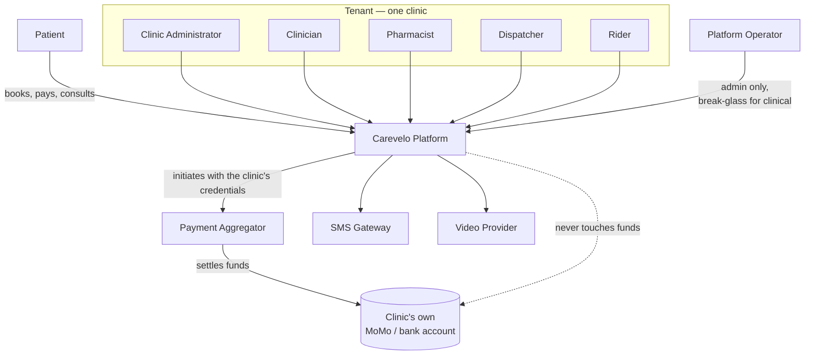

# Personas & Actors

> **Status:** Draft
> **Last reviewed:** 2026-08-13
> **Derives from:** Business Plan §D, §H

Two lists. **Personas** are humans whose motivations shape the product. **Actors** are the entities that appear in flow diagrams and hold roles in the [RBAC Matrix](../50-security-compliance/rbac-matrix.md) — including systems.

The critical column throughout is *what they may see*. Health data is special-category under DPPA 2019, and the strongest privacy control in the system is simply not sending clinical data to people who do not need it.

## Personas

### Dr. Nabbanja — the clinic owner (economic buyer)

Runs a five-staff clinic in Ntinda with an on-site NDA-licensed pharmacy. She is the supervising doctor, the HR department and the finance department. She is often the only decision-maker, which shortens the sales cycle to a single conversation (§D).

She has noticed patients who used to walk in now ordering from Rocket Health. She is not looking for software; she is looking for those patients back.

**Buys on:** demonstrated new revenue, a trusted referral from another clinic owner, and a price that does not frighten her in a thin month. **Not** on features.

**Will churn if:** the subscription cannot be traced to income within a couple of months, or if support is slow when something breaks during clinic hours.

**Design consequence:** the clinic console must surface *money earned through Carevelo* prominently and honestly. This is the single most important screen in the product for retention.

### Ronald — the clinical officer

Sees most of the patients. Comfortable with WhatsApp, impatient with software that adds clicks. Works between rooms on a phone as often as a desktop.

**Design consequence:** consultation notes and prescribing must be genuinely fast on a phone, and must tolerate a dropped connection without losing what was typed. If our note-taking is slower than paper, it will not be used, and an unused clinical record is worse than none.

### Sarah — the patient

Thirty-two, in Kampala, on a mid-range Android phone, on mobile data of variable quality, paying out of pocket. She trusts *this clinic* — she has been going there for years — and that trust is exactly why the white-label matters. A Carevelo-branded experience would feel like a stranger.

She may be on a low-bandwidth connection when she needs the consultation most.

**Design consequence:** the patient surface carries the clinic's brand, not ours. Voice and chat are first-class consultation modes, not degraded fallbacks. Nothing critical requires app installation.

### Grace — the pharmacist

Holds the dispensing responsibility and the personal liability that comes with it. Needs to see the prescription clearly, check stock against it, price it, and record what was actually handed over — which is sometimes not what was prescribed.

**Design consequence:** substitution must be a first-class flow with clinician re-approval, not an edit to the prescription. The prescription is a clinical document and is never mutated by the pharmacy.

### Moses — the rider

Delivers medicine. May be clinic staff, may be a boda rider the clinic uses. He is the least-trusted human actor in the system and needs the least data.

**Design consequence:** he sees a delivery address, a patient name, a contact number and a package reference. He sees no diagnosis, no clinical notes, and no medicine names beyond what is needed to hand over a sealed package. This is a field-level rule enforced in the API, not a UI convention. See [Data Protection](../50-security-compliance/data-protection-dppa.md).

## Actors

### Human actors

| Actor | Scope | May see | Must never see |
|---|---|---|---|
| **Patient** | Own records within one tenant | Own profile, appointments, consultation summaries, prescriptions, payment records, delivery status | Anything belonging to another patient; internal clinician notes marked private |
| **Clinic Administrator** | One tenant, full | Staff, services, prices, branding, aggregator configuration, usage and revenue records, audit log | Aggregator secret keys after entry (write-only); other tenants |
| **Clinician** | One tenant, own and colleagues' clinical records per clinic policy | Patient records, consultation history, prescribing | Aggregator credentials; platform administration |
| **Pharmacist** | One tenant, dispensing queue | Prescriptions routed to the pharmacy, patient name and contact, stock and pricing | Full consultation notes beyond the clinical context needed to dispense safely |
| **Dispatcher** | One tenant, delivery queue | Delivery jobs, addresses, rider assignment, status | Diagnoses, notes, prescription clinical detail |
| **Rider** | One tenant, assigned deliveries only | Assigned delivery address, patient name and phone, package reference, status controls | Medicine names where avoidable, diagnoses, notes, any other delivery |
| **Platform Operator** (Carevelo staff) | Cross-tenant, administrative only | Tenant register, subscription status, system health, non-clinical audit metadata | **Patient clinical data by default.** Access requires an explicit, logged, time-boxed break-glass grant — see below |

### The Platform Operator problem

Carevelo staff can technically reach the database. Legally, each clinic is the **data controller** and Carevelo is the **processor** — we may only process on the controller's instruction.

Therefore:

- Ordinary support tooling must not expose clinical data. Diagnose from metadata, identifiers and audit trails.
- Access to tenant clinical data requires a **break-glass** grant: time-boxed, reason-recorded, tenant-notified, and written to the audit log as a first-class event.
- Break-glass usage is reviewed. A support process that routinely requires it is a broken support process.

Specified in [RBAC Matrix](../50-security-compliance/rbac-matrix.md) and [Audit Logging](../50-security-compliance/audit-logging.md).

### System actors

| Actor | Role | Trust boundary |
|---|---|---|
| **Carevelo Platform** | The Laravel API and Next.js surfaces | Ours |
| **Payment Aggregator** (Flutterwave / Pesapal) | Collects payment on the *clinic's* behalf using the *clinic's* credentials; settles to the clinic | External, licensed. Money crosses here and never comes back to us |
| **SMS Gateway** | Delivers transactional SMS | External. Assume message content is visible to the operator — this is why clinical results are never sent by SMS |
| **WhatsApp Business API** | Delivers notifications where the patient prefers it | External, and hosted outside Uganda — a cross-border transfer consideration |
| **Video/Realtime Provider** | Carries consultation media | External unless self-hosted. See [Realtime & Video](../30-architecture/realtime-and-video.md) and [ADR-0004](../70-decisions/0004-video-provider-selection.md) |

## Relationships

Note the dotted line: it is the most important relationship in the diagram, and it is an absence. Money reaches the clinic without passing through Carevelo.
