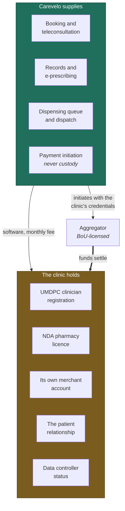

# Vision & Scope

> **Status:** Draft
> **Last reviewed:** 2026-08-13
> **Derives from:** Business Plan §A, §B, §C, §M

## The one-sentence version

Carevelo gives a licensed Ugandan private clinic the digital capability of Rocket Health — teleconsultation, mobile-money payment, e-prescribing, medicine delivery — under the clinic's own brand and its own licences, for a monthly subscription it can afford.

## The problem

Uganda's private-for-profit sector runs roughly 3,856 facilities and carries the majority of care-seeking: about 80% of doctors and 60% of clinical officers practise privately, financed overwhelmingly out of pocket (§B). These clinics hold the assets that matter — premises, an NDA-licensed pharmacy, UMDPC-registered clinicians, and the trust of a neighbourhood.

What they do not have is a digital front door. Records are on paper. Payment is cash or an unreconciled personal mobile-money number. There is no way to consult a patient who cannot travel, no way to take a refill order, no way to deliver.

Meanwhile vertically-integrated telemedicine providers — Rocket Health foremost — offer patients 24/7 teleconsultation, medicine delivery and home sample collection, and are steadily taking the convenience-seeking urban patient away from the neighbourhood clinic (§B).

The clinic is losing patients to a capability, not to better medicine.

## The strategy: arms dealer, not combatant

Carevelo sells the capability to the clinics rather than competing with them. The clinic keeps the patient relationship, the licences, the revenue and the clinical responsibility. Carevelo supplies software and is paid a subscription.

This is not modesty; it is the load-bearing structural decision. A solo or small team cannot replicate a vertically-integrated provider's clinicians, pharmacy, fleet and capital. But it can arm the hundreds of clinics that already have all of those things (§A).

It also has a regulatory consequence that is worth more than the strategic one: by never providing care, never handling drugs and never holding money, Carevelo stays a software supplier and data processor, and avoids three separate licensing regimes.

Everything regulated sits in the amber box. Everything Carevelo does sits in the teal one, and the only thick arrow — money — bypasses it entirely.

## What Carevelo is

A multi-tenant SaaS platform. One deployment, many clinics, each with its own isolated data, its own branding, its own subdomain, and its own payment credentials.

**MVP scope — flows H1 to H5:**

| Flow | Capability |
|---|---|
| [H1](../10-product/prd-h1-clinic-onboarding.md) | Clinic onboarding: tenant creation, branding, staff, services, prices, payment credentials |
| [H2](../10-product/prd-h2-patient-registration-consent.md) | Patient registration with DPPA-compliant consent capture |
| [H3](../10-product/prd-h3-teleconsultation.md) | Booking, payment, video/voice/chat consultation, clinical notes, e-prescription |
| [H4](../10-product/prd-h4-prescription-dispensing-delivery.md) | Prescription to the clinic's own pharmacy, dispensing, delivery dispatch and tracking |
| [H5](../10-product/prd-h5-payments-non-custodial.md) | Non-custodial mobile-money and card collection settling to the clinic's own account |

Supported throughout by multi-tenant administration, role-scoped access, SMS/WhatsApp notification, and an immutable audit trail.

## What Carevelo is not

Three prohibitions. They are absolute, they are architectural, and no commercial pressure justifies relaxing them. Each is repeated in [Non-Goals](../10-product/non-goals.md), in the architecture document that enforces it, and in the [Compliance Responsibility Matrix](../50-security-compliance/compliance-responsibility-matrix.md), because a constraint stated in only one place is not a constraint.

### 1. Carevelo never employs or contracts clinicians

Every clinical act on the platform is performed by a clinician registered with the UMDPC, the Allied Health Professionals Council or the Nurses & Midwives Council, practising under their own annual practising licence, engaged by the *clinic*. Carevelo records what they did; it does not direct it, does not supervise it, and does not stand behind it.

Consequence in code: there is no platform-level clinician. A `Clinician` exists only within a tenant. Prescriptions carry the clinician's name and registration number, never Carevelo's.

Enforced by: [Domain Model](../20-domain/domain-model.md), [RBAC Matrix](../50-security-compliance/rbac-matrix.md).

### 2. Carevelo never holds or dispenses drugs

Medicines are held, priced, dispensed and handed over by the clinic's own NDA-licensed pharmacy, by its own licensed staff, under the National Drug Policy and Authority Act. Carevelo routes a prescription to a queue and tracks a delivery status. It has no inventory of its own and never will.

Consequence in code: there is no platform stock ledger. `DispenseOrder` is always tenant-owned. Controlled substances are flagged for stricter in-person handling rather than routed to delivery.

Enforced by: [H4 PRD](../10-product/prd-h4-prescription-dispensing-delivery.md), [Domain Model](../20-domain/domain-model.md).

### 3. Carevelo never takes custody of patient funds

Payment is initiated against the *clinic's own* merchant account at a Bank of Uganda-licensed aggregator (Flutterwave or Pesapal, both PSO-licensed). Funds settle directly to the clinic. Carevelo records the transaction reference and reconciles *records*, never *money*. There is no wallet, no float, no escrow, no platform settlement account.

Consequence in code: no balance field exists anywhere in the platform's own accounting. Every payment row is a *record of* a transaction that happened between the patient, the aggregator and the clinic.

Enforced by: [Payments Regulatory Boundary](../50-security-compliance/payments-regulatory-boundary.md), [ADR-0003](../70-decisions/0003-non-custodial-payment-architecture.md).

## Deliberately deferred

Not prohibited — simply not now. See [Phase 2 & 3 Outline](../10-product/phase-2-3-outline.md) for the hooks left behind.

- **Pharmacy inventory and ERP.** Established incumbents do this well (§C). Competing on it head-on wastes the scarcest resource, which is founder time. Integrate later.
- **Laboratory integration and hardware.** Capital- and support-heavy. Deferred to Phase 2 as a request/result flow only, with no machine integration.
- **Insurance and NHIS claims.** The National Health Insurance Scheme Bill passed Parliament in 2021 but remains unassented and stalled; private-insurer claim formats are fragmented. Building against unpublished rules is speculation (§C).
- **EFRIS fiscal receipting.** Phase 2. Real, well-specified, and genuinely valuable — just not what closes the first sale.

## Positioning

Carevelo is **not** sold as "clinic management software." That category is contested — ClinicMaster, Stre@mline, EasyClinic and Helium Health all occupy it, some with significant funding and a decade of installed base (§E). Leading with EMR is a fight against entrenched products on their own ground.

The pitch is the un-served bundle: *your clinic's own Rocket Health — teleconsult, pay by mobile money, medicine delivered, on your brand.* Records are table stakes underneath it, not the headline.

We compete on workflow, price, local support and Ugandan data residency.

## What would make this fail

Stated plainly, from §M: **clinics will not pay enough, soon enough.** Willingness to pay is the binding constraint — not technology, not regulation, not competition. Ugandan small clinics run on thin cash, are anchored by free open-source alternatives to the belief that software should be cheap, and buy on relationships and demonstrated new revenue rather than on features.

The product implication is direct and should govern every prioritisation argument: **if a feature does not visibly help the clinic earn or retain revenue, it is not MVP.** The subscription is the first thing cut when it cannot be traced to income.

## Success criteria

From the roadmap gates (§K, see [Roadmap](roadmap.md)):

- Onboarding a new clinic takes under one day.
- At least three clinics running weekly teleconsultations by month six, at least one paying.
- UGX 10m/month recurring (~33 clinics) by roughly month eighteen.
- Monthly churn under 5%; post-pilot conversion to paid above 30%.
