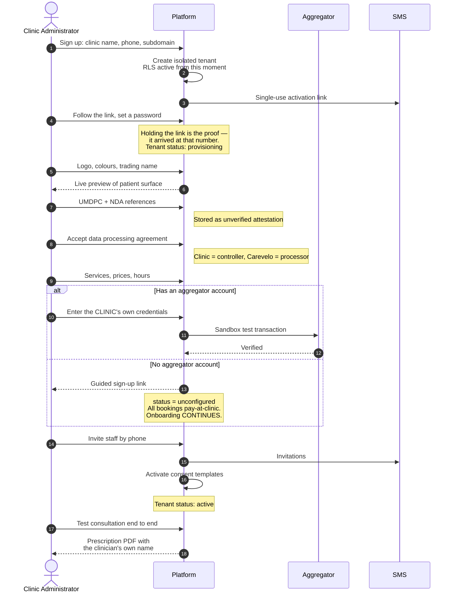

# H1 — Clinic Onboarding

> **Status:** Draft
> **Last reviewed:** 2026-08-13
> **Derives from:** Business Plan §H1, §G, §K

First contact to first consultation. The target from §K is **under one day**, and it is a go/no-go gate for Phase 1 rather than an aspiration — onboarding cost is the main thing that stops a solo founder scaling past a handful of clinics.

## Objective

A clinic administrator signs up and, without a support call, reaches the point of running a real consultation on their own brand.

## Success criteria

Three time targets appear across the documentation and they are a nested hierarchy, not competing numbers:

| Target | Meaning | Source |
|---|---|---|
| **Under one day** | Elapsed, first contact to first consultation. The Phase 1 go/no-go gate | §K, [Roadmap](../00-overview/roadmap.md) |
| **Under 4 hours elapsed** | The self-service path, unassisted, as measured here | This document |
| **Under 2 hours hands-on** | The assisted onboarding session with an administrator | [Runbook](../60-operations/clinic-onboarding-runbook.md) |

Also:

- No step requires Carevelo staff intervention. Staff assistance should be an accelerant, not a dependency.
- A clinic with no aggregator account can still complete onboarding and run consultations on a pay-at-clinic basis.

## Actors

Clinic Administrator (primary), Platform (system), Payment Aggregator (external). See [Personas & Actors](../00-overview/personas-and-actors.md).

## Main flow

The whole path. The dashed branch is the one that decides whether onboarding completes at all — a clinic without a merchant account must not be blocked.

Step 21 is the moment the product proves itself, and it is worth the twenty minutes even when the session is running long.

### 1. Sign-up and tenant provisioning

The administrator supplies clinic name, their own name, phone and email, and a desired subdomain.

The platform creates an **isolated tenant**: a `Tenant` row, a `TenantUser` with the `clinic_admin` role, and the subdomain reservation. Every subsequent row created by this clinic carries its `tenant_id`, and isolation is enforced by PostgreSQL row-level security rather than by application code alone — see [Multi-Tenancy](../30-architecture/multi-tenancy.md).

The administrator's number is proved before the tenant leaves `provisioning`, by a single-use activation link sent to it. **Possession of the link is the proof** — it arrived at that handset — which is the same mechanism as a staff invitation and the only one the platform has: no one-time codes are sent anywhere in the product ([Auth](../40-api/authentication-and-sessions.md), [ADR-0011](../70-decisions/0011-staff-issued-patient-accounts.md)). The administrator sets their own password when they follow it.

- Subdomain is validated against the reserved list and is **immutable afterwards** ([Identifiers](../20-domain/identifiers-and-numbering.md)).
- A 14-day trial starts. No card, no payment details — this market does not have them and demanding them ends the conversation.
- Emits `TenantProvisioned`.

### 2. Branding

Logo upload, primary and secondary colour, trading name, contact details. A live preview of the patient-facing surface shows the effect immediately, because this is the moment the administrator decides whether the product is credible.

Branding is applied through validated design tokens, never through arbitrary CSS or markup — see [White-Labeling & Branding](white-labeling-and-branding.md).

Colour contrast is validated on entry; a clinic that picks pale yellow on white gets a warning and a suggested adjustment rather than an unreadable patient portal.

### 3. Compliance references

The administrator records the supervising clinician's UMDPC registration number and the clinic's NDA pharmacy licence reference.

**These are stored as the clinic's own attestation and are explicitly not verified by Carevelo** (§H1.2). The UI must say so in plain words. Carevelo has no access to the UMDPC or NDA registers and must never imply that a recorded reference has been checked — that implication would be both false and, if relied upon, harmful.

The screen also presents the **data processing agreement** naming the clinic as controller and Carevelo as processor ([Data Protection](../50-security-compliance/data-protection-dppa.md)). Acceptance is recorded with a timestamp and the policy version.

### 4. Services, prices and hours

The administrator defines what the clinic offers: service names, durations, prices in UGX, permitted consultation modes, and which staff roles may deliver each. Then working hours and holidays.

A starter catalogue of common services (general consultation, follow-up, antenatal review) is offered pre-filled and editable. Prices are always blank — guessing a clinic's prices would be presumptuous and wrong.

### 5. Payment connection

The administrator connects the clinic's **own** Flutterwave or Pesapal merchant account by entering that account's API credentials.

This is the step where the non-custodial architecture becomes concrete, and the UI should say plainly what it means: *money goes from your patient to your account. Carevelo never holds it and cannot access it.* That sentence is a sales asset as much as a compliance statement — clinic owners are rightly suspicious of software that touches their money.

- Credentials are envelope-encrypted, write-only, never returned by any API and never logged ([Domain Model](../20-domain/domain-model.md)).
- A test transaction against the sandbox verifies the connection before the account is marked `active`.
- Webhook URL and secret are configured for this tenant's callbacks ([Webhooks](../40-api/webhooks.md)).

**If the clinic has no aggregator account** (§H1.6): offer a guided sign-up link, and let onboarding continue. The tenant proceeds with `AggregatorAccount.status = unconfigured`, and all appointments default to `pay_at_clinic`. Payment is a feature; care is not blocked on it.

### 6. Staff invitations

The administrator invites clinicians, pharmacist, dispatcher, front-desk and riders by phone number. Each receives a single-use, expiring SMS invitation link and **chooses their own password** when they accept it. Holding the token is what proves the number, so acceptance is what marks the account phone-verified — and no colleague ever knows the password.

Roles are assigned at invitation and are role-scoped from first sign-in ([RBAC Matrix](../50-security-compliance/rbac-matrix.md)). Clinical roles additionally capture registration body, registration number and prescribing capability — a clinician cannot issue a prescription without them ([Domain Model](../20-domain/domain-model.md)).

### 7. Consent templates and privacy notice

The platform activates the clinic-branded patient consent text and privacy notice, pre-drafted to DPPA 2019 requirements and versioned. The administrator reviews and may extend, but cannot remove the mandatory elements — the clinic is the data controller and needs a defensible notice, whether or not it wants to think about it today.

### 8. Onboarding checklist and first test consultation

A persistent checklist shows what remains. When branding, at least one service, at least one clinician and consent templates are complete, the tenant moves to `active`.

The administrator is then prompted to run a **test consultation** against a seeded internal patient: joining video, taking a note, issuing a prescription, and seeing the rendered PDF. This is the moment the product proves itself, and it is worth engineering carefully. Test data is clearly marked and excluded from every report.

## Exception paths

| Exception | Handling |
|---|---|
| Desired subdomain taken or reserved | Suggest alternatives; block reserved values |
| Activation or invitation SMS not received | Resend with backoff; correct the number and re-issue, since a single-use link to a wrong number is a link nobody can use; support escalation after three failures |
| No aggregator account (§H1.6) | Guided sign-up link; continue with `unconfigured`; all bookings `pay_at_clinic` |
| Aggregator credentials rejected | Show the aggregator's own error verbatim; keep `pending_verification`; do not block other onboarding |
| Logo upload fails validation | Explain the constraint (format, size, dimensions); offer to proceed with a text wordmark |
| Administrator abandons midway | Tenant stays `provisioning`; resume link by SMS/email at 24h, 3d, 7d; purge unprovisioned tenants after 30 days |
| Clinic declines the data processing agreement | Onboarding cannot proceed. Record the decision; do not soft-launch without a processor agreement in place |
| Clinician has no registration number to hand | Allow saving the profile with `can_prescribe = false`; prompt to complete before prescribing |

## Acceptance criteria

1. A new tenant is created with row-level isolation verified by test before any clinical data can be written.
2. Subdomain is unique, reserved values are rejected, and the value is immutable after provisioning.
3. Aggregator credentials never appear in any API response, log line or exception trace. Covered by an automated test.
4. Compliance references are stored and displayed as *unverified attestations*, with wording to that effect on screen.
5. A tenant without an aggregator account can complete onboarding and hold a consultation.
6. Invited staff receive a single-use, expiring SMS link, set their own password on accepting it, and land with exactly the permissions of their role — no more. A spent or expired token grants nothing.
7. The data processing agreement acceptance is recorded with timestamp and policy version, and appears in the audit log.
8. A test consultation can be completed end to end, including a rendered prescription PDF, and its data is excluded from reports.
9. The full path, exercised by a first-time user, completes in under 4 hours elapsed.

## Out of scope for H1

- Automated verification of UMDPC or NDA licences. No API exists, and implying verification we have not performed would be worse than recording an attestation honestly.
- Migration of historical paper or spreadsheet records. Offered as a paid onboarding service (§F setup fee), performed manually.
- Custom domains beyond the `{slug}.carevelo.app` subdomain — Phase 2.
- Self-service plan selection and billing. Early plans are agreed in conversation, which is how this market buys (§G).
