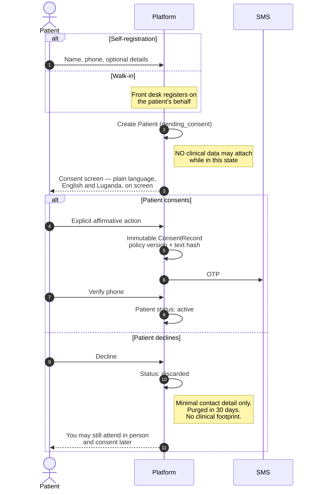

# H2 — Patient Registration & Consent

> **Status:** Draft
> **Last reviewed:** 2026-08-13
> **Derives from:** Business Plan §H2, §I

Registration is where DPPA 2019 compliance either happens or fails. Health data is **special-category data**; processing it without a valid, demonstrable consent is a regulatory breach, and "demonstrable" is the operative word — we must be able to reconstruct, months later, exactly what a patient was shown and what they agreed to.

## Objective

A patient registers with a clinic, understands what happens to their data, and consents — or declines and leaves no clinical footprint.

## Success criteria

- Registration completes in under two minutes on a mid-range Android phone over mobile data.
- The consent screen is genuinely readable by someone with no legal or technical background.
- Every consent decision is reconstructable: what text, what version, when, by whom.

## Actors

Patient (primary), Guardian (for minors), Front Desk staff (for walk-in registration), Platform.

## Main flow

Note where the decline path exits — before any clinical data can attach.

The `delivery_disclosure` consent is deliberately **not** captured here. It is taken at the point the patient chooses delivery ([H4](prd-h4-prescription-dispensing-delivery.md)), because consent must be specific and asking up front for a disclosure that may never happen is not.

### 1. Registration entry

Two routes, and both must exist. Most Ugandan private-clinic patients arrive physically, so a self-service-only design would leave the clinic's actual patient base unregistered.

- **Self-registration** on the clinic-branded patient portal.
- **Staff registration** by front desk for a walk-in patient.

Collected: given name, family name, phone (mandatory), and optionally date of birth, sex, email, address and district. `national_id_number` is optional and stays optional forever — requiring a NIN excludes patients, and exclusion is worse than unverified identity ([Identifiers](../20-domain/identifiers-and-numbering.md)).

The `Patient` record is created in `pending_consent`. **No clinical data may attach while in this state** ([State Machines](../20-domain/state-machines.md)).

### 2. Consent

The consent screen is the most important screen in the product from a compliance standpoint. It must state, in plain language and in the clinic's voice:

- **What is collected** — name, contact, and health information arising from care.
- **That health data is special-category** and treated with additional safeguards.
- **Who processes it** — this clinic is the data controller; Carevelo is its software provider and processor, acting only on the clinic's instructions.
- **Purpose** — providing and administering care. Nothing else. No secondary use, no analytics on identifiable data, no sharing for marketing.
- **Who it is shared with** — the treating clinicians and pharmacy staff of this clinic and, *if the patient chooses delivery*, the assigned rider, who receives only the delivery address, the patient's name and phone, and a package reference — never a diagnosis or medicine list.
- **Retention** — how long, and what happens at the end.
- **Rights** — access, correction, and withdrawal of consent, with the practical mechanics of exercising them.

Consent is **granted by an explicit affirmative action**. No pre-ticked boxes, no consent bundled into a terms-of-service acceptance, no "by continuing you agree". Separate consents are captured separately:

| Consent type | Required for |
|---|---|
| `data_processing` | Any processing at all. Without it, nothing proceeds |
| `telemedicine` | Remote consultation specifically |
| `delivery_disclosure` | Sharing the address with a rider. Captured at the point delivery is chosen, not up front |

Each decision writes an immutable `ConsentRecord` with a timestamp, the policy version, and a hash of the exact text shown ([Domain Model](../20-domain/domain-model.md)). Emits `ConsentGranted`.

The full policy text is available on the same screen — not behind a link that nobody opens — and in English and Luganda at minimum.

### 3. Phone verification

An OTP verifies the patient controls the number. This matters more than usual here, because the phone number is how appointment details, payment prompts and prescription-ready notifications reach them; a mistyped digit sends someone else's health information to a stranger.

On success the patient becomes `active`.

### 4. Minors

A patient under 18 requires **guardian consent**. Guardian name, relationship and phone become mandatory; the `ConsentRecord` records `granted_by = guardian` with those details. The guardian's phone is separately OTP-verified.

Clinic staff may register a minor on a guardian's behalf in person, with the guardian's consent recorded by the staff member as an attested action — itself an audited event.

### 5. Ongoing consent management

The patient can view their consent history and withdraw at any time from the portal. Withdrawal writes a new `ConsentRecord` (never an update) and emits `ConsentWithdrawn`.

Withdrawal halts new processing. It does not automatically erase records the clinic is obliged to retain as a medical record — the clinic is the controller and that retention obligation is theirs. The tension between the right to withdraw and the duty to retain is resolved explicitly in [Retention & Deletion](../50-security-compliance/data-retention-and-deletion.md), and the patient-facing wording must not promise deletion the clinic cannot lawfully perform.

## Exception paths

| Exception | Handling |
|---|---|
| **Patient declines consent** (§H2.4) | Registration halts. Patient moves to `discarded`. Retain only the minimal contact detail needed to explain why service cannot proceed; purge on schedule. No clinical data is stored. The patient is told they may still attend in person and consent later |
| OTP not received | Resend with backoff; voice-call fallback; front desk may verify identity in person and attest, as an audited action |
| Phone already registered at this tenant | Offer sign-in or recovery. Never confirm or deny that a specific number is registered to an unauthenticated caller — that alone would disclose that a person is a patient of this clinic |
| Patient has no phone | Front desk registers against a next-of-kin number with explicit consent from both; flag the record so notifications are handled in person |
| Guardian consent unavailable for a minor | Registration cannot complete. In-person care proceeds under the clinic's own paper processes |
| Patient withdraws mid-consultation | Consultation may complete on clinical grounds; no new processing beyond it. Flag for the clinic to handle as controller |
| Duplicate patient (same person, two records) | Front desk may merge within a tenant, as an audited action. Never merge across tenants — the isolation boundary is absolute |

## Acceptance criteria

1. A patient in `pending_consent` cannot have any clinical record attached. Enforced at the database level and covered by test.
2. Consent requires an explicit affirmative action; no pre-ticked boxes and no bundling with terms acceptance.
3. Every `ConsentRecord` is immutable and stores the policy version and a hash of the exact text shown.
4. Withdrawal creates a new record and never mutates the prior grant.
5. Declining consent results in `discarded` with no clinical data retained.
6. Minors cannot reach `active` without a verified guardian consent record.
7. Consent text is available in English and Luganda, on screen rather than behind a link.
8. The rider-disclosure consent is captured at the point of choosing delivery, not pre-emptively at registration.
9. All consent events appear in the audit log with actor, timestamp and tenant.

## Out of scope for H2

- Cross-tenant patient identity. Deliberately absent; see [Ubiquitous Language](../20-domain/ubiquitous-language.md).
- NIRA/NIN verification against the national register. Optional field only.
- Biometric identification.
- Patient-initiated data-portability export — Phase 2. Access requests in the MVP are handled by the clinic as controller, with platform support tooling.
