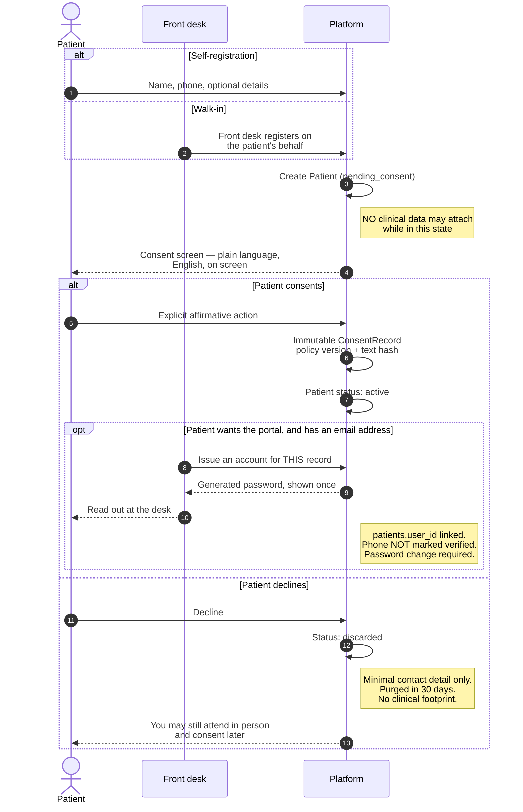

# H2 — Patient Registration & Consent

> **Status:** Draft
> **Last reviewed:** 2026-08-13
> **Derives from:** Business Plan §H2, §I

Registration is where DPPA 2019 compliance either happens or fails. Health data is **special-category data**; processing it without a valid, demonstrable consent is a regulatory breach, and "demonstrable" is the operative word — we must be able to reconstruct, months later, exactly what a patient was shown and what they agreed to.

## Objective

A patient registers with a clinic, understands what happens to their data, and consents — or declines and leaves no clinical footprint.

## Success criteria

- Registration — producing the record — completes in under two minutes on a mid-range Android phone over mobile data. Issuing the account at the desk adds under a minute on top.
- The consent screen is genuinely readable by someone with no legal or technical background.
- Every consent decision is reconstructable: what text, what version, when, by whom.

## Actors

Patient (primary), Guardian (for minors), Front Desk staff (for walk-in registration and for issuing the patient's account), Platform.

## Main flow

Note where the decline path exits — before any clinical data can attach.

The `delivery_disclosure` consent is deliberately **not** captured here. It is taken at the point the patient chooses delivery ([H4](prd-h4-prescription-dispensing-delivery.md)), because consent must be specific and asking up front for a disclosure that may never happen is not.

### 1. Registration entry

Two routes, and both must exist. Most Ugandan private-clinic patients arrive physically, so a self-service-only design would leave the clinic's actual patient base unregistered.

- **Self-registration** on the clinic-branded patient portal.
- **Staff registration** by front desk for a walk-in patient.

Both routes create a **record**. Neither creates an account: the login that lets a patient see their own data is issued separately, by staff, from the record (§3).

Collected: given name, family name, phone (mandatory), and optionally date of birth, sex, email, address and district. `national_id_number` is optional and stays optional forever — requiring a NIN excludes patients, and exclusion is worse than unverified identity ([Identifiers](../20-domain/identifiers-and-numbering.md)).

The `Patient` record is created in `pending_consent`. **No clinical data may attach while in this state** ([State Machines](../20-domain/state-machines.md)).

### 2. Consent

The consent screen is the most important screen in the product from a compliance standpoint. It must state, in plain language and in the clinic's voice:

- **What is collected** — name, contact, and health information arising from care.
- **That health data is special-category** and treated with additional safeguards.
- **Who processes it** — this clinic is the data controller; Carevelo is its software provider and processor, acting only on the clinic's instructions.
- **Purpose** — providing and administering care. Nothing else. No secondary use, no analytics on identifiable data, no sharing for marketing.
- **Who it is shared with** — the treating clinicians and pharmacy staff of this clinic and, *if the patient chooses delivery*, the assigned rider, who receives only the delivery address, the patient's name and phone, and a package reference — never a diagnosis or medicine list.
- **Retention** — how long, and what happens at the end.
- **Rights** — access, correction, and withdrawal of consent, with the practical mechanics of exercising them.

Consent is **granted by an explicit affirmative action**. No pre-ticked boxes, no consent bundled into a terms-of-service acceptance, no "by continuing you agree". Separate consents are captured separately:

| Consent type | Required for |
|---|---|
| `data_processing` | Any processing at all. Without it, nothing proceeds |
| `telemedicine` | Remote consultation specifically |
| `delivery_disclosure` | Sharing the address with a rider. Captured at the point delivery is chosen, not up front |

Each decision writes an immutable `ConsentRecord` with a timestamp, the policy version, and a hash of the exact text shown ([Domain Model](../20-domain/domain-model.md)). Emits `ConsentGranted`.

The full policy text is available on the same screen — not behind a link that nobody opens — in English.

**Luganda was published here and has been withdrawn. That is a downgrade, and it is recorded rather than quietly dropped.** The translation reached roughly 7% across the patient portal: 186 of the 201 keys held the English string verbatim under a Luganda label, waiting on a review by a native speaker that did not arrive. On most screens that is shabby. On this one it is a compliance problem, because consent is valid only if it is *informed* — and wording that announces itself as the patient's language while being someone else's does not inform a patient, it persuades them that they understood. English, presented honestly as English, is the better of two poor options until a reviewed translation exists.

Two things were deliberately left standing so that reversing this is small. The portal keeps its `next-intl` structure ([Frontend](../30-architecture/frontend-nextjs.md)), and `GET /v1/consent-policies/current` keeps returning the policy as a **map keyed by language code** rather than collapsing to a bare string. Restoring Luganda is therefore a message file and one more entry in the policy text — not a change to the response contract and every consumer of it.

One consequence is worth stating plainly, because it is the kind of thing that is discovered too late. The text hash pinned on each `ConsentRecord` is taken over the **whole** policy document, every published language concatenated, so removing a language changes the hash of a policy whose version string has not moved. Withdrawing Luganda therefore took a **policy version bump** like any other wording change. Without one, re-deriving the hash for the old version would disagree with the hash stored beside decisions already made, which is exactly the signal this design uses to mean the wording behind a record was tampered with.

### 3. The account

Granting `data_processing` consent makes the record `active`. That is the whole of registration — a record a clinic can treat against.

An **account** is a separate thing, and it is issued by clinic staff rather than claimed by the patient. A `clinic_admin`, `front_desk` or `clinician` creates it from the record: `POST /v1/patients/{patient}/account` ([Auth](../40-api/authentication-and-sessions.md)).

- Staff supply an **email address**, which becomes the patient's only identifier.
- **The platform generates the password** and shows it once, on screen, for the staff member to read out. Staff do not choose it — a desk creating twenty accounts a day would type the same word twenty times, and then every patient account at that clinic is guessable by anyone who was ever given one.
- Nothing is sent by SMS. There is no code and no link anywhere in this flow.
- The call links `patients.user_id` for the record named in the URL and writes `patient.account_created`, naming the staff member who did it.
- The patient must replace the password at first sign-in; until they do, the session can reach nothing else.

The trust basis is a staff member identifying the person in front of them — the same basis the exception table below has always sanctioned for in-person attestation, and the reasoning is recorded in [ADR-0011](../70-decisions/0011-staff-issued-patient-accounts.md).

**The phone number is not verified by any of this**, and the documents no longer claim it is. The number still carries appointment details, payment prompts and prescription-ready notifications, and a mistyped digit still sends someone else's health information to a stranger — so front desk **reads the number back to the patient** and corrects it there. `phone_verified_at` stays null on both the record and the account: describing a desk visit as phone verification would leave a clinic administrator unable to tell a checked number from a typed one, which is the only thing that field is good for.

### 4. Minors

A patient under 18 requires **guardian consent**. Guardian name, relationship and phone become mandatory; the `ConsentRecord` records `granted_by = guardian` with those details. The guardian is identified in person by the staff member taking the consent, who attests to it as an audited action — there is no code sent to a guardian's handset, and a guardian's contact number is recorded as given rather than as verified.

Clinic staff may register a minor on a guardian's behalf in person, with the guardian's consent recorded by the staff member as an attested action — itself an audited event.

Where the guardian is to hold the account, one login carries several records — and each is linked by a staff member naming that record explicitly, so a guardian gains sight of a child's record only by a deliberate, audited act ([ADR-0010](../70-decisions/0010-patient-account-link.md)).

### 5. Ongoing consent management

The patient can view their consent history and withdraw at any time from the portal — or, having no account, at the desk, where a staff member records the withdrawal for them as an audited action. Withdrawal writes a new `ConsentRecord` (never an update) and emits `ConsentWithdrawn`.

Withdrawal halts new processing. It does not automatically erase records the clinic is obliged to retain as a medical record — the clinic is the controller and that retention obligation is theirs. The tension between the right to withdraw and the duty to retain is resolved explicitly in [Retention & Deletion](../50-security-compliance/data-retention-and-deletion.md), and the patient-facing wording must not promise deletion the clinic cannot lawfully perform.

## Exception paths

| Exception | Handling |
|---|---|
| **Patient declines consent** (§H2.4) | Registration halts. Patient moves to `discarded`. Retain only the minimal contact detail needed to explain why service cannot proceed; purge on schedule. No clinical data is stored. The patient is told they may still attend in person and consent later |
| **Patient has no email address** | No account, and therefore no portal. The record stands, care is unaffected, notifications still reach them by SMS and clinical detail is shown at the desk. A real exclusion in a market where many patients have no reliably-checked address, accepted with its eyes open in [ADR-0011](../70-decisions/0011-staff-issued-patient-accounts.md) |
| Patient forgets the initial password before first sign-in | Nothing can be resent — there is no code, no link and no self-service reset. Front desk identifies the patient in person and issues a fresh password, which re-arms the forced change. Audited exactly as issuing the account was |
| Account issued but the patient never signs in | The password the staff member read out stays valid and stays known to them. The clinic reviews `patient.account_created` events; the risk and its bound are stated in the [Threat Model](../50-security-compliance/threat-model.md) |
| Phone already registered at this tenant | Offer sign-in; recovery is an in-person act at the desk. Never confirm or deny that a specific number is registered to an unauthenticated caller — that alone would disclose that a person is a patient of this clinic |
| Patient has no phone | Front desk registers against a next-of-kin number with explicit consent from both; flag the record so notifications are handled in person |
| Guardian consent unavailable for a minor | Registration cannot complete. In-person care proceeds under the clinic's own paper processes |
| Patient withdraws mid-consultation | Consultation may complete on clinical grounds; no new processing beyond it. Flag for the clinic to handle as controller |
| Duplicate patient (same person, two records) | Front desk may merge within a tenant, as an audited action. Never merge across tenants — the isolation boundary is absolute |

## Acceptance criteria

1. A patient in `pending_consent` cannot have any clinical record attached. Enforced at the database level and covered by test.
2. Consent requires an explicit affirmative action; no pre-ticked boxes and no bundling with terms acceptance.
3. Every `ConsentRecord` is immutable and stores the policy version and a hash of the exact text shown.
4. Withdrawal creates a new record and never mutates the prior grant.
5. Declining consent results in `discarded` with no clinical data retained.
6. Minors cannot reach `active` without a verified guardian consent record.
7. Consent text is on screen rather than behind a link, in full, in every language the policy is published in — English alone, Luganda having been withdrawn rather than shipped at 7% translated (§2). Adding or removing a language changes the policy text hash and therefore requires a new policy version.
8. The rider-disclosure consent is captured at the point of choosing delivery, not pre-emptively at registration.
9. All consent events appear in the audit log with actor, timestamp and tenant.
10. A patient account is created only from an existing patient record, only by clinic staff, and the same call links that record and writes `patient.account_created` naming the staff member.
11. The initial password is generated by the platform, shown once, and appears in no log, no audit event and no message on any channel.
12. Issuing an account leaves `phone_verified_at` null on both the record and the account, and no screen describes it as verifying the number.
13. A patient whose first password change is outstanding can reach nothing but their own profile, the password endpoint and sign-out.

## Out of scope for H2

- Cross-tenant patient identity. Deliberately absent; see [Ubiquitous Language](../20-domain/ubiquitous-language.md).
- NIRA/NIN verification against the national register. Optional field only.
- Biometric identification.
- Patient-initiated data-portability export — Phase 2. Access requests in the MVP are handled by the clinic as controller, with platform support tooling.
