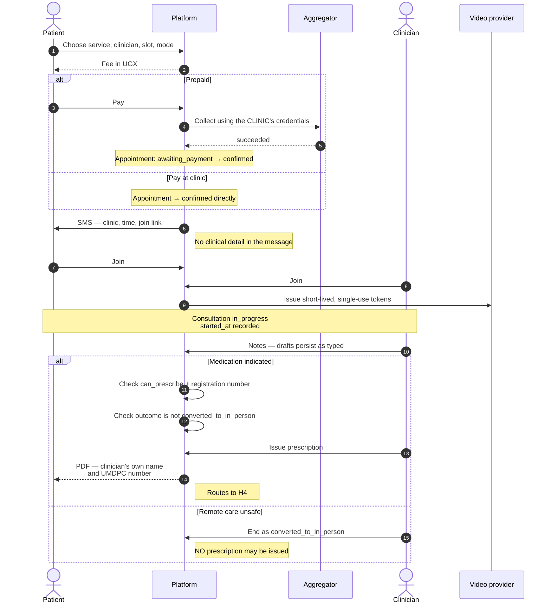
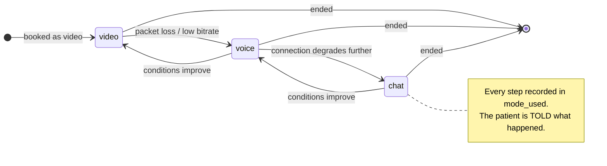

# H3 — Teleconsultation

> **Status:** Draft
> **Last reviewed:** 2026-08-13
> **Derives from:** Business Plan §H3, §C

Book → pay → consult → notes → prescription. This is the flow the clinic is actually buying: the capability it is currently losing patients over.

## Objective

A patient books and pays for a remote consultation with a clinician *of that clinic*, the consultation happens reliably on a variable mobile connection, and it produces a clinical record and, where indicated, a prescription issued by the clinician.

## Success criteria

- A consultation completes successfully on a 3G-class connection.
- Clinical notes are never lost to a dropped connection.
- A clinician can take notes and issue a prescription on a phone without it being slower than paper.

## Actors

Patient, Clinician, Front Desk (assisted booking), Platform, Payment Aggregator, Video Provider.

## Main flow

Book → pay → consult → notes → prescription, with the two hard preconditions on prescribing marked.

Both checks before "Issue prescription" are **enforced, not warned**. They are what keeps Carevelo a recorder rather than an issuer.

### 1. Selection

The patient browses the clinic's services, sees the price in UGX, picks a clinician and an available slot. Availability derives from working hours, the clinician's roster and existing confirmed appointments; a clinician cannot hold two overlapping confirmed appointments.

Mode — video, voice or chat — is chosen here. **Voice and chat are first-class modes, not degraded fallbacks.** A patient on a poor connection, which in this market is a large share of them at any given moment, must be able to *choose* voice deliberately rather than fight a failing video call.

Front desk can book on the patient's behalf for someone who telephones the clinic. Most bookings in the first year will be made this way.

### 2. Payment expectation

The fee is shown before commitment. The patient either pays now (see [H5](prd-h5-payments-non-custodial.md)) or selects pay-at-clinic where the tenant allows it.

- Prepaid: `Appointment` is created in `awaiting_payment` and the slot is held for **15 minutes**, after which `appointments:release-unpaid` expires the booking and gives the slot back. The window matches the aggressive phase of the payment poll schedule, which checks every minute for the first fifteen — so the slot is released at the moment the system stops expecting an imminent mobile-money confirmation. Most prompts are never completed, and availability excludes a held slot, so a hold nothing releases removes a slot from the clinic's calendar permanently.
- Pay-at-clinic: `Appointment` goes straight to `confirmed`.
- Tenant with no aggregator configured: only pay-at-clinic is offered (§H1.6).

### 3. Confirmation

On payment success — or an explicit, audited staff deferral (§H3.3) — the appointment confirms. SMS and, where the patient prefers it, WhatsApp go to the patient; the clinician sees it in their schedule. Reminders follow at 24 hours and 1 hour.

Notification content carries the clinic's name, the time and the join link. **It never carries clinical detail** ([Notifications](notifications-sms-whatsapp.md)) — SMS is not a confidential channel and the reason for the appointment is health information.

Emits `AppointmentBooked`.

### 4. The consultation

Both parties join through a link; no app install is required, because requiring one loses patients at exactly the moment they need care.

The platform records `started_at` when the clinician joins, and creates the `Consultation`. If the connection degrades, the session steps down — video to voice, voice to chat — and the step-down is **recorded truthfully** in `mode_used` ([State Machines](../20-domain/state-machines.md)). A consultation that fell back to chat should not be reported as a video consultation; the clinic deserves an honest picture of what its patients actually experience.

The clinician has the patient's history within this tenant, the note editor and the prescribing form on one screen. `ended_at` and an outcome are recorded at the end.

Recording the step-down truthfully matters twice over: clinically, because a consultation conducted by text is a different encounter from one conducted by video; and commercially, because it is the only honest measure of what patients on Ugandan mobile data actually experience.

Media handling and provider choice are in [Realtime & Video](../30-architecture/realtime-and-video.md) and [ADR-0004](../70-decisions/0004-video-provider-selection.md). **Consultations are not recorded** in the MVP: recording special-category data materially raises breach exposure and consent complexity for a benefit no clinic has asked for.

### 5. Clinical notes

Structured but not rigid: subjective, objective, assessment, plan — with free text throughout, because over-structuring a note is the fastest way to make clinicians abandon a system.

- **Drafts persist continuously as they are typed.** A lost connection must never lose clinical text. This is a hard requirement, and it is the single most likely cause of a clinician abandoning the product.
- Notes are never destructively edited. Corrections are addenda with `supersedes_note_id`; the original stays ([Domain Model](../20-domain/domain-model.md)).

### 6. E-prescription

Where medication is indicated, the clinician issues a prescription: medicine, form, strength, quantity, directions per item, with controlled substances flagged.

The rendered PDF carries the **clinician's own name, registration body and registration number**, snapshotted at the moment of issue, plus the clinic's branding and a timestamp. Carevelo's name appears nowhere on it as an issuer.

This is the flow's central legal point, and it is worth stating precisely: **the prescription is a clinical act by a licensed clinician of the clinic.** Uganda has no enacted telemedicine statute; remote prescribing rests entirely on existing UMDPC/AHPC licensure (§I). Carevelo renders and stores what the clinician decided. It does not decide, suggest, validate or endorse.

Hard preconditions, enforced rather than warned:

- Clinician has `can_prescribe = true` and a registration number.
- The consultation outcome is not `converted_to_in_person`.

Emits `PrescriptionIssued`; routes to [H4](prd-h4-prescription-dispensing-delivery.md).

### 7. Summary

The patient receives a visit summary and the prescription in the portal. **Clinical content is shown in-app under authentication, never sent by SMS.**

## Exception paths

All from §H3.6.

| Exception | Handling |
|---|---|
| **Patient no-show** | After a grace period the appointment auto-marks `no_show`. Refund follows the *clinic's* policy, executed by the clinic through its own aggregator. Carevelo records the outcome; it cannot refund, holding no funds |
| **Clinician no-show** | Flag to the administrator, notify the patient, offer rebooking. Prompt for refund at the clinic's discretion |
| **Dropped call** | Both parties get a resume link and the consultation holds `interrupted` for a configurable window. Notes are retained regardless. Beyond the window it ends with outcome `technical_failure` |
| **Connection too poor for video** | Automatic step-down to voice, then chat. Recorded in `mode_used`. The patient is told what happened rather than left guessing |
| **Clinician judges remote care unsafe** | Outcome `converted_to_in_person`. **No prescription may be issued.** The patient is given in-person guidance and, where clinically urgent, referral advice. The clinic decides on refund |
| **Payment succeeds after cancellation** | Reconciliation flags it; the clinic administrator resolves as refund or credit. Never auto-actioned by us |
| **Clinician's practising licence has expired** | Warn prominently, do not hard-block, write an `AuditEvent`. Licence currency is the clinic's regulatory responsibility, and blocking care on our possibly-stale data would be the worse error |
| **Patient joins from a second device** | Latest session wins; the earlier one is notified and closed |
| Emergency presentation | The interface carries persistent, clinic-configurable emergency guidance. Carevelo makes no triage decision and must never appear to |

## Acceptance criteria

1. A prescription cannot be issued by a clinician lacking `can_prescribe` or a registration number.
2. A prescription cannot be issued on a consultation with outcome `converted_to_in_person`.
3. The prescription PDF shows the clinician's snapshotted name and registration number; Carevelo does not appear as issuer.
4. Notes persist across a deliberate mid-consultation disconnection, verified by test.
5. `mode_used` reflects the mode actually used after any step-down.
6. No SMS or WhatsApp message contains clinical content.
7. A consultation completes end to end on a throttled 3G-class connection.
8. Overlapping confirmed appointments for one clinician are rejected.
9. No consultation media is recorded or retained.

## Out of scope for H3

- Consultation recording.
- Any clinical decision support, differential suggestion, drug-interaction checking or AI triage. Each would move Carevelo toward practising medicine, and drug-interaction checking specifically implies a duty of care we cannot discharge. Revisit only with explicit clinical governance and, likely, regulatory clearance.
- Group or multi-clinician consultations.
- Cross-tenant referral — Phase 3.
- Prescription transmission to a *third-party* pharmacy. MVP routes only to the clinic's own pharmacy.
