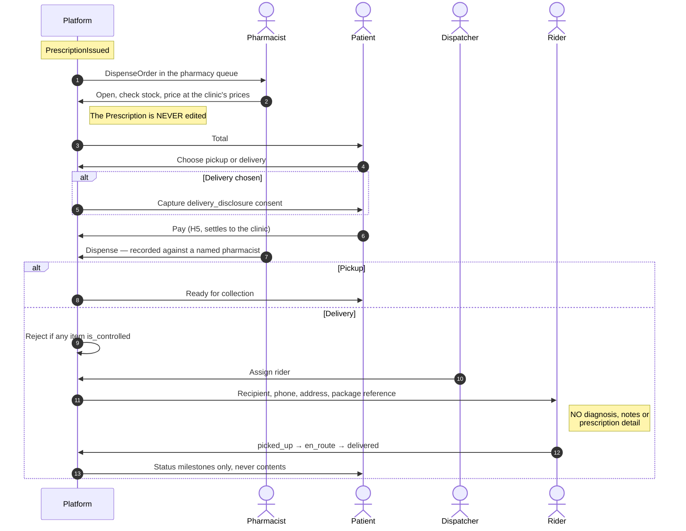
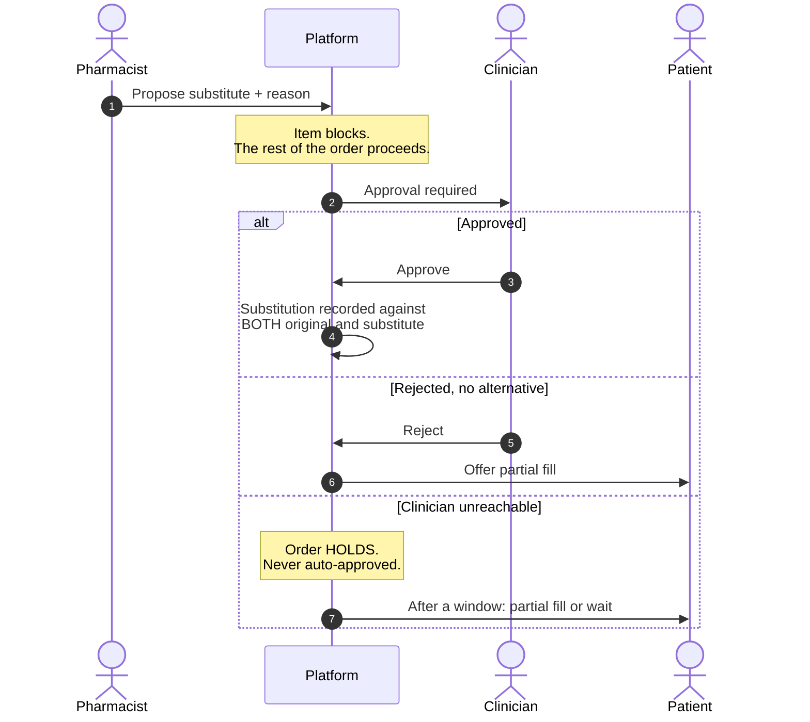

# H4 — Prescription, Dispensing & Delivery

> **Status:** Draft
> **Last reviewed:** 2026-08-13
> **Derives from:** Business Plan §H4, §I

From an issued prescription to medicine in the patient's hands. This is the half of the bundle that competitors do not offer and that patients actually feel — and it is also where the drug-handling boundary must hold absolutely.

**The boundary, stated once and enforced throughout: medicines are held, priced, dispensed and handed over by the clinic's own NDA-licensed pharmacy, by its own licensed staff, under the NDPA Act Cap 206. Carevelo routes a work item and tracks a status. It has no inventory, touches no medicine, and takes no margin on one.**

## Objective

A prescription reaches the clinic's pharmacy, is checked and priced, is paid for, and is collected or delivered — with substitutions handled safely and controlled substances excluded from delivery.

## Success criteria

- A pharmacist can process an order in under two minutes.
- No controlled substance is ever dispatched for delivery.
- A rider never sees a diagnosis, a clinical note, or (where avoidable) a medicine name.

## Actors

Pharmacist, Clinician (for substitution approval), Dispatcher, Rider, Patient, Platform.

## Main flow

Prescription to the patient's door. Note that the prescription itself is never touched after issue — everything the pharmacy does happens on the `DispenseOrder`.

### 1. Routing

On `PrescriptionIssued` a `DispenseOrder` is created in `received` and appears in the pharmacy queue. It routes only to **the clinic's own pharmacy** — same tenant, always ([Domain Model](../20-domain/domain-model.md)). The pharmacist is notified.

**The pharmacy queue and the dispatch board are live views.** A pharmacist watching the screen sees an order arrive without reloading, over a tenant-scoped Reverb channel ([Realtime Broadcasting](../30-architecture/realtime-broadcasting.md)). The frame carries only an order identifier and its state; the client re-fetches the detail through the authorised API.

If realtime is unavailable the view falls back to polling. It refreshes less promptly — **it never blocks dispensing**.

### 2. Review and pricing

The pharmacist opens the order (`under_review`), sees the prescription with the prescribing clinician's name and registration number, checks stock, and prices each item at the clinic's own prices.

**The prescription is never edited.** It is a clinical document. Everything the pharmacy does happens on the `DispenseOrder`, which is why the two are separate aggregates — what was prescribed and what was dispensed are different facts and both must survive.

Priced order → `priced`; the patient is notified of the total.

### 3. Fulfilment choice and payment

The patient chooses pickup or delivery, and pays for medicines plus any delivery fee via [H5](prd-h5-payments-non-custodial.md), settling — as always — to the clinic's own account. Cash at the pharmacy is recorded by staff attestation, itself an audited action.

If delivery is chosen, `delivery_disclosure` consent is captured **at this point**, not pre-emptively at registration ([H2](prd-h2-patient-registration-consent.md)).

### 4. Dispensing

The pharmacist dispenses and records what was actually handed over, against their own name. `dispensed_at` is set; emits `OrderDispensed`.

Pickup → `ready_for_pickup`. Delivery → `out_for_delivery`.

### 5. Delivery dispatch

The dispatcher assigns a rider. The rider's view carries **only**: recipient name, recipient phone, delivery address with any landmark, the package reference, and the status controls.

It carries no diagnosis, no clinical notes, and no prescription detail. This is enforced in the API resource layer and covered by an explicit test — not left to the UI to remember ([Data Protection](../50-security-compliance/data-protection-dppa.md)).

Status thread: `assigned` → `picked_up` → `en_route` → `delivered`. Each transition writes a `DeliveryEvent` and updates the patient's tracking view. Patient-facing notifications say a package from the clinic is on its way; they never name contents.

### 6. Completion

On delivery the order reaches `completed`. The patient sees the full record — what was dispensed, at what price — in the portal, under authentication.

## Exception paths

All from §H4.6, and this flow has more of them than any other, which is itself the reason pharmacies find generic software useless.

### Out of stock → substitution

A substitution is never an edit to the prescription and never a pharmacist's unilateral decision. The pharmacist proposes a substitute with a reason. The order moves to `awaiting_substitution` and **the affected item blocks; the rest of the order proceeds.** A single missing item must not stall everything, or pharmacists will work around the system.

The prescribing clinician is notified and must **approve or reject**. A `Substitution` takes effect only on approval — it is never an edit to the prescription, and never a pharmacist's unilateral decision.

- Approved → item substituted, recorded against both the original and the substitute, order continues to `priced`.
- Rejected with no alternative → item removed; the patient is offered a partial fill.
- Clinician unreachable → the order holds; after a configurable window the patient is offered a partial fill or a wait. It is never auto-approved.

### Partial fill

The patient accepts what is available. `partially_priced`; unfilled items are recorded as unfulfilled, with the reason, so the clinician can see it later.

### Controlled substances

Items with `is_controlled = true` are **flagged for in-person handling and are excluded from the delivery flow entirely** (NDPA Act Cap 206). An order containing them either splits — controlled items for collection, the rest deliverable — or is marked collection-only. The system does not offer the clinic a way to override this.

### Failed delivery

`failed`, with a reason from a fixed list — recipient unreachable, address incorrect, refused, rider unable to complete — then `returned_to_pharmacy`. The medicine returns to the licensed premises; it never sits with a rider overnight.

The patient is offered a reschedule or a refund. **Refunds are executed by the clinic through its own aggregator**; the `refund_pending` state exists to make the obligation visible, not to discharge it, because Carevelo holds nothing to refund from.

### Others

| Exception | Handling |
|---|---|
| Prescription cancelled after dispensing began | Notify pharmacist immediately; halt if not yet dispensed; if already dispensed, record and escalate to the clinician |
| Patient never pays for a priced order | Reminder, then expiry after a configurable window; stock is released |
| Rider goes unreachable mid-delivery | Dispatcher may reassign; the original assignment is retained in the event history |
| Wrong item dispensed, discovered later | Recorded as a correction event on the order, never a silent edit; escalated to the administrator |
| Patient wants delivery outside the clinic's service area | Delivery unavailable; pickup offered. Service areas are tenant-configured |
| No rider available | Order holds at `dispensed`; the patient is told and offered pickup |

## Acceptance criteria

1. A `DispenseOrder` always belongs to the same tenant as its prescription, enforced by composite foreign key.
2. A prescription is never mutated by any dispensing action.
3. A substitution requires clinician approval before taking effect; auto-approval does not exist.
4. A pending substitution blocks only its own item.
5. **An order containing a controlled item cannot enter `out_for_delivery`.** Covered by test.
6. A rider API response contains no diagnosis, clinical note or prescription detail. Covered by test.
7. A rider can retrieve only their own assigned deliveries.
8. Failed delivery returns the order to the pharmacy and never silently closes.
9. `delivery_disclosure` consent exists before any address reaches a rider.
10. Delivery notifications never name medicines.
11. Dispensing is always recorded against a named pharmacist of the tenant.

## Out of scope for H4

- **Pharmacy inventory management.** Deferred to Phase 2; incumbents already do this well (§C). MVP stock checking is the pharmacist looking at their shelf.
- **Third-party pharmacy fulfilment.** Only the clinic's own pharmacy. Routing to another pharmacy would raise questions we are not ready to answer about who dispensed under whose licence.
- **Carevelo-operated delivery fleet.** Riders are the clinic's own arrangement; the platform dispatches and tracks. Operating a fleet would make us a logistics company handling pharmaceuticals.
- Live rider GPS tracking — Phase 2. Status milestones are sufficient and cheaper.
- Drug-interaction or dosage checking. See the out-of-scope note in [H3](prd-h3-teleconsultation.md); the same duty-of-care reasoning applies.
