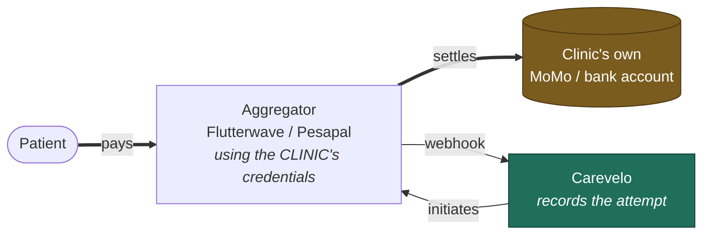
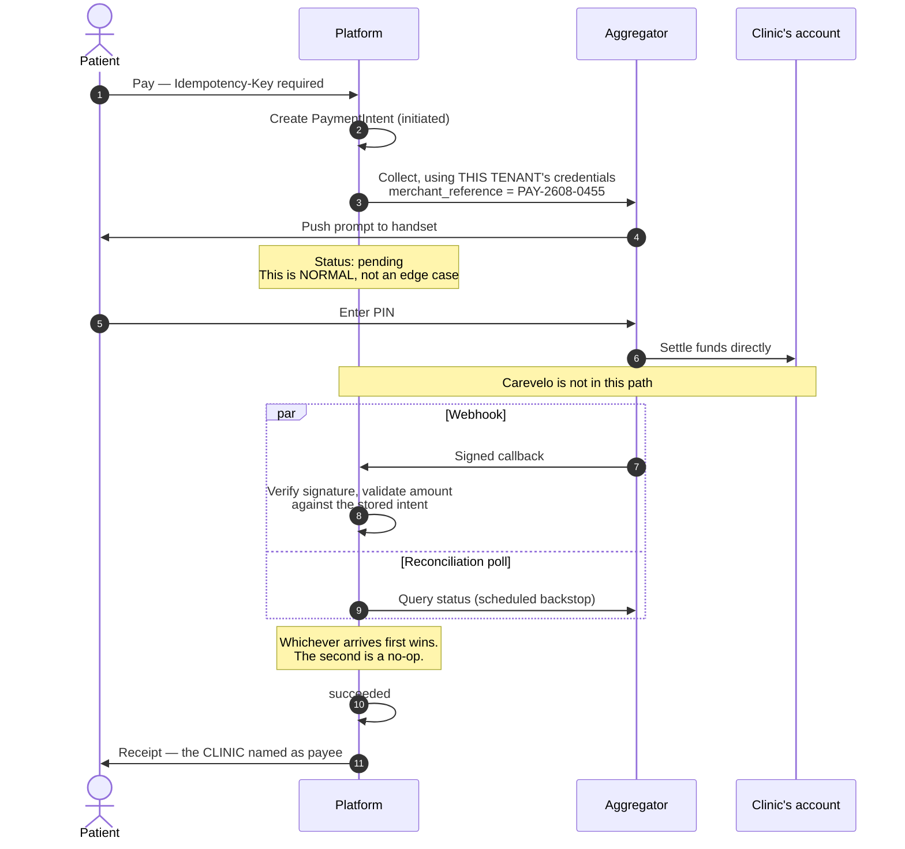
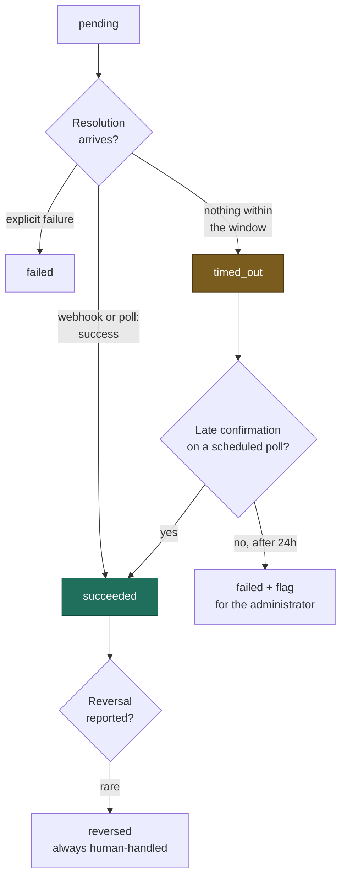

# H5 — Payments (Non-Custodial)

> **Status:** Draft
> **Last reviewed:** 2026-08-13
> **Derives from:** Business Plan §H5, §F, §I

How a patient pays a clinic through Carevelo without Carevelo ever holding the money.

The regulatory reasoning lives in [Payments Regulatory Boundary](../50-security-compliance/payments-regulatory-boundary.md) and [ADR-0003](../70-decisions/0003-non-custodial-payment-architecture.md). This document is the product behaviour.

## The shape of it

**Carevelo reconciles records, not money** (§H5.4). There is no wallet, no float, no escrow, no settlement account, and no balance field anywhere in the platform.

## Objective

A patient pays for a consultation or a medicine order by mobile money or card, the clinic receives the funds directly, and both parties can see reliably whether the payment worked.

## Success criteria

- Payment state is always knowable — never an indefinite "processing".
- No patient is ever charged twice for one thing.
- A clinic can match every Carevelo payment record to a line on its own aggregator dashboard without asking us.

## Actors

Patient, Clinic Administrator, Platform, Payment Aggregator (external, licensed).

## Main flow

Mobile money is genuinely asynchronous — the patient has to pick up their handset and enter a PIN, and they may not.

The `par` block is not redundancy for its own sake. **Missed webhooks are ordinary in this market**, and an intent stuck in `pending` forever is a patient who does not know whether they paid.

### 1. Initiation

The patient chooses a method: MTN MoMo, Airtel Money, card, or cash at the clinic.

The platform creates a `PaymentIntent` in `initiated`, carrying the amount, the payable (an `Appointment` or a `DispenseOrder`), and an **idempotency key** supplied by the client ([Identifiers](../20-domain/identifiers-and-numbering.md)). It then calls the aggregator **using this tenant's own credentials**, so the collection is the clinic's, made against the clinic's merchant account.

`merchant_reference` is set to the intent's human reference (`PAY-2608-0455`) so the clinic can match it on its own aggregator dashboard unaided.

### 2. Authorisation

- **Mobile money:** the aggregator pushes a prompt to the payer's handset; they enter their PIN. Genuinely asynchronous — seconds to minutes, and sometimes never.
- **Card:** 3-D Secure, handled entirely by the aggregator. **No card data ever reaches Carevelo**, which keeps PCI scope at the aggregator where it belongs.

State moves to `pending`. This is the normal state, not an edge case, and the UI must be honest about waiting: show what is happening, that the patient should check their phone, and how long it typically takes. A fake progress bar that implies imminent success is worse than an honest wait.

### 3. Resolution

Two independent paths, both idempotent — whichever arrives first wins, the second is a no-op:

1. **Webhook** from the aggregator, signature-verified ([Webhooks](../40-api/webhooks.md)).
2. **Reconciliation poll**, scheduled, as backstop for a missed or delayed webhook (§H5.6).

The redundancy is not belt-and-braces caution; missed webhooks are ordinary in this market, and a payment stuck forever in `pending` is a support call and an angry patient.

Success → `succeeded`, `aggregator_reference` stored, receipt issued, SMS sent, and the payable proceeds — appointment confirms, or dispense order moves to `paid`. Emits `PaymentIntentSucceeded`.

### 4. Receipts

The receipt shows the clinic as the payee, the amount, the method, the timestamp, and both references. It is issued in the clinic's name and branding — because the clinic received the money. Carevelo appears nowhere on it as a payee.

EFRIS fiscal receipting is Phase 2.

### 5. Cash at clinic

No aggregator involved. A staff member attests receipt; the intent resolves to `succeeded` with method `cash_at_clinic`. The attestation writes an `AuditEvent` naming the staff member — the only fraud control available, and it is the clinic's own internal control, not ours.

### 6. Reconciliation

A daily view shows every intent against its aggregator reference and flags mismatches for the clinic administrator: stuck `pending`, `timed_out` beyond the window, `succeeded` with no corresponding payable progression, or a `reversed` transaction.

**We reconcile records, not money.** We cannot see the clinic's balance, and we make no claim about what settled — only about what the aggregator told us. The reconciliation view exists so the administrator can go and check their own dashboard with a specific reference in hand, which is the most useful thing we can honestly offer.

## Exception paths

All from §H5.3 and §H5.6. The branch worth internalising is that **a timeout is not an ending**:

Treating `timed_out` as definitive failure produces the worst outcome available: a patient charged for a booking that was cancelled on our side.

| Exception | Handling |
|---|---|
| **Patient ignores the MoMo prompt** | `pending` until the window elapses, then `timed_out`. Not final — a reconciliation poll may still find a late success |
| **Insufficient funds** | `failed` with the aggregator's own reason surfaced verbatim. Retry offered with a **new** idempotency key |
| **Aggregator unreachable at initiation** | Intent stays `initiated`; retry with backoff; the patient is told the payment did not start and no charge was made |
| **Webhook never arrives** (§H5.6) | Reconciliation poll resolves it. Every intent has a scheduled check; none is left to a webhook alone |
| **Duplicate submission** (§H5.6) | The idempotency key returns the stored response. No second charge. Same key with a different body → `409 Conflict` |
| **Payment succeeds after the payable was cancelled** | Flagged for the administrator. Refund or credit is the clinic's decision, executed through the clinic's own aggregator. **Never auto-actioned by us** |
| **Reversal** | `reversed`, flagged prominently. Rare; always human-handled |
| **`timed_out` then late success** | Poll transitions it to `succeeded` and the payable proceeds if still valid; otherwise it flags for the administrator |
| **Refund requested** | Carevelo records the request and its outcome. The clinic executes it through its own aggregator. **We hold nothing to refund from** — the UI must say so plainly rather than appear broken |
| **Aggregator credentials expire or are revoked** | `AggregatorAccount.status = failing`; administrator alerted; new payments fall back to pay-at-clinic rather than failing silently |
| **Amount mismatch on callback** | Never trust the callback amount. Compare against the stored intent; a mismatch is flagged and never auto-accepted |

## Acceptance criteria

1. No entity, column or code path represents a Carevelo-held balance. Verified by an automated check against a forbidden-identifier list (`wallet`, `balance`, `float`, `escrow`, `payout`, `settlement`).
2. Every payment call uses the **tenant's own** aggregator credentials.
3. Aggregator secrets never appear in a response, a log line or an exception trace.
4. Idempotency: replaying a request with the same key returns the stored response and creates no second charge; a differing body returns `409`.
5. Webhooks are signature-verified and rejected if invalid; replayed webhooks are no-ops.
6. Every `PaymentIntent` has a scheduled reconciliation check; no intent depends solely on a webhook.
7. `timed_out` can transition to `succeeded` on a late confirmation.
8. Callback amounts are validated against the stored intent; mismatches are flagged, never accepted.
9. Receipts name the clinic as payee. Carevelo is not a payee.
10. **No platform percentage fee is charged.** The mechanism may exist; it is switched off pending Bank of Uganda no-objection.

## The Phase 2 platform fee — built, and switched off

§F contemplates a platform fee of roughly 1–1.5% on top of the aggregator's 3–3.5%. The architecture accommodates it in exactly one way: an **aggregator-side sub-merchant split**, deducted by the licensed aggregator at settlement, or a monthly invoice raised separately to the clinic. Under both, Carevelo still never holds funds.

It stays off until a **written no-objection is obtained from the Bank of Uganda National Payment Systems Department** (§F, §I). The reason is worth stating precisely, because it is counter-intuitive: the NPS Act's "aggregator / integrator / third-party system" PSO definitions are **activity-based, not custody-based**. Being non-custodial defeats the PSP and e-money-issuer categories, with their UGX 250m–10bn capital requirements. It does not automatically defeat the PSO category, whose lowest threshold is UGX 100m. Non-custodial is necessary but may not be sufficient, and the only way to know is to ask.

Until then, payments are a pure convenience feature with **no platform cut**.

## Out of scope for H5

- Any custody of funds. Permanently.
- Platform-initiated refunds. We hold nothing to refund from.
- Card data handling. It never touches us; PCI scope stays with the aggregator.
- Instalments, credit, BNPL or clinic working-capital lending — the embedded-finance direction in §L, and firmly Phase 3 or later, requiring its own regulatory analysis.
- Insurance claim adjudication. NHIS is unassented and stalled.
- EFRIS fiscal receipting — Phase 2.
