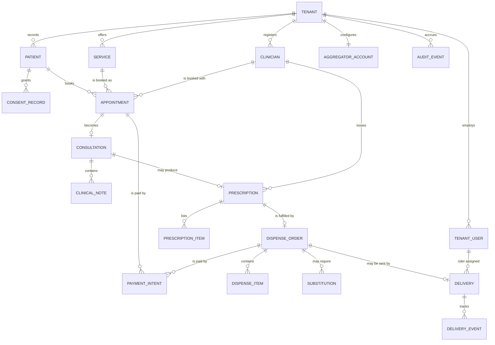
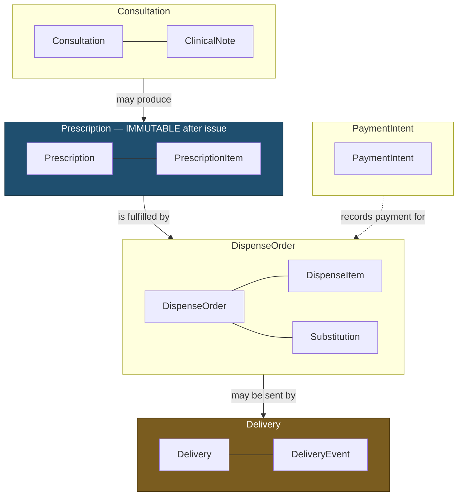

# Domain Model

> **Status:** Draft
> **Last reviewed:** 2026-08-13
> **Derives from:** Business Plan §H; [Ubiquitous Language](ubiquitous-language.md)

The aggregates, their invariants, and how they relate. Invariants stated here become assertions in code and constraints in the schema — they are not aspirational prose.

## Aggregate map



Every entity in that diagram except `TENANT` itself carries `tenant_id`. It is omitted from the relationships above only to keep the diagram readable — see [Multi-Tenancy](../30-architecture/multi-tenancy.md) for why it is on every row without exception.

## Aggregate boundaries

Which entities change together in one transaction, and where a boundary deliberately separates two facts:



**The boundary between Prescription and DispenseOrder is the important one.** It exists so the prescription stays immutable while the pharmacy records stock checks, pricing and substitutions — what was *prescribed* and what was *dispensed* are different facts and both must survive. It is also what makes Phase 2 inventory addable without touching clinical records.

The Delivery boundary is amber because it is a **disclosure** boundary as much as a transactional one: no clinical field crosses into it.

## Aggregates

### Tenant *(platform-scoped)*

The clinic. Root of everything else.

```
Tenant
  id, slug, legal_name, trading_name
  subdomain, custom_domain?
  branding: logo_url, primary_colour, secondary_colour
  contact: phone, email, physical_address, district
  compliance: umdpc_facility_reference?, nda_licence_reference?
  subscription: plan, status, trial_ends_at
  locale: timezone (Africa/Kampala), currency (UGX)
  status: provisioning | active | suspended | offboarding | closed
```

**Invariants**

- `subdomain` is globally unique and immutable after provisioning — it appears in patient-facing URLs and in the aggregator callback configuration.
- Compliance references are **stored as evidence, not verified**. Carevelo does not and cannot validate a UMDPC or NDA licence; recording it is the clinic's attestation. Never present these as verified in any UI (§H1.2).
- A tenant in `suspended` state blocks staff sign-in but never blocks a patient from reading their own existing records or a delivery in flight — suspension is a commercial action and must not become a clinical one.
- `offboarding` triggers the export obligation in [Retention & Deletion](../50-security-compliance/data-retention-and-deletion.md).

### TenantUser

A staff member. Roles: `clinic_admin`, `clinician`, `pharmacist`, `dispatcher`, `front_desk`, `rider`. A user may hold several roles — in a five-person clinic, one person is frequently admin, front desk and dispatcher at once.

**Invariants**

- Belongs to exactly one tenant. No cross-tenant staff identity in the MVP; someone working at two clinics has two accounts.
- Phone number is the primary credential (unique within the tenant); email is optional. This reflects reality — many staff have no working email but everyone has a phone.
- The last active `clinic_admin` cannot be deactivated. Locking a clinic out of its own tenant creates a support incident and a data-controller problem simultaneously.

### Clinician

Extends a `TenantUser` holding a clinical role with the registration details required to prescribe.

```
Clinician
  tenant_user_id
  registration_body: umdpc | ahpc | nurses_midwives
  registration_number
  practising_licence_expires_at?
  specialty?
  can_prescribe: bool
```

**Invariants**

- **A prescription may only be issued by a Clinician with `can_prescribe = true` and a non-empty `registration_number`.** This is the single most important invariant in the system; it is what keeps the platform a recorder rather than an issuer.
- Registration details are captured, not verified. Same reasoning as tenant compliance references.
- If `practising_licence_expires_at` is in the past, warn prominently but **do not hard-block** — the clinician's licence status is the clinic's regulatory responsibility, not ours, and blocking care on our stale data would be worse than the alternative. Record the warning as an `AuditEvent`.

### Patient

```
Patient
  id, tenant_id
  user_id?                 -- the account, if staff have issued one
  given_name, family_name
  phone (as given — never platform-verified), email?
  date_of_birth?, sex?
  national_id_number?      -- optional, never mandatory
  address?, district?
  guardian: guardian_name?, guardian_phone?, guardian_relationship?
  status: pending_consent | active | withdrawn
```

**Invariants**

- Unique on `(tenant_id, phone)`.
- `user_id` is nullable and is written only when a member of clinic staff issues an account against this record — an explicit, audited act, never an inference from a matching phone number. One account may hold several records, which is how a guardian holds their children's ([ADR-0010](../70-decisions/0010-patient-account-link.md), [ADR-0011](../70-decisions/0011-staff-issued-patient-accounts.md)).
- The number is recorded as the patient gave it and is read back at the desk. Nothing in the product proves control of the handset, so `phone_verified_at` stays null on a patient record — a staff member issuing the patient an account is not phone verification and is not recorded as one ([ADR-0011](../70-decisions/0011-staff-issued-patient-accounts.md)).
- **No clinical data may attach to a Patient in `pending_consent`.** If consent is declined the record is discarded beyond the minimal contact detail needed to explain why service cannot proceed (§H2.4).
- A patient under 18 requires guardian consent; guardian fields become mandatory.
- `national_id_number` is optional in perpetuity. Requiring a NIN excludes patients, and exclusion is a worse outcome than an unverified identity.

### ConsentRecord

```
ConsentRecord
  id, tenant_id, patient_id
  consent_type: data_processing | telemedicine | delivery_disclosure
  policy_version, policy_text_hash
  action: granted | withdrawn
  granted_by: patient | guardian
  guardian_name?, relationship?
  occurred_at, ip_address, user_agent
```

**Invariants**

- **Immutable.** Withdrawal is a new record, never an update. The history of consent decisions is itself the evidence.
- `policy_text_hash` pins the exact wording shown. Reconstructing what the patient actually agreed to is the entire purpose.
- Processing special-category health data requires a current `data_processing` grant. Withdrawal stops new processing; it does not retroactively erase records the clinic is legally obliged to retain as a medical record — this tension is resolved in [Retention & Deletion](../50-security-compliance/data-retention-and-deletion.md).

### Service, Appointment

```
Service
  id, tenant_id, name, description?
  duration_minutes, price_minor, currency
  modes: [in_person, video, voice, chat]
  eligible_roles: [...]
  is_active

Appointment
  id, tenant_id, reference       -- human-readable, tenant-scoped
  patient_id, clinician_id, service_id
  scheduled_start_at, scheduled_end_at
  mode_booked
  payment_expectation: prepaid | pay_at_clinic
  status  -- see State Machines
```

**Invariants**

- An appointment's clinician, service and patient all belong to the same tenant. Enforced by composite foreign keys including `tenant_id`, not by application check.
- No double-booking: one clinician cannot hold two `confirmed` appointments with overlapping times.
- A `prepaid` appointment reaches `confirmed` only on a succeeded `PaymentIntent`, or by an explicit, audited deferral by clinic staff (§H3.3).
- `reference` is unique within the tenant and is what staff and patients actually say aloud on the phone.

### Consultation, ClinicalNote

```
Consultation
  id, tenant_id, appointment_id
  clinician_id, patient_id
  started_at, ended_at?
  mode_used                     -- may differ from mode_booked
  outcome: completed | patient_no_show | clinician_unavailable
         | converted_to_in_person | technical_failure

ClinicalNote
  id, tenant_id, consultation_id, author_id
  body, note_type: subjective | objective | assessment | plan | addendum
  created_at
  supersedes_note_id?
```

**Invariants**

- `mode_used` records what actually happened. A video call that fell back to voice is recorded as voice — the truthful record matters clinically and for the honest reporting of what patients on poor connections actually experience.
- **Notes are never destructively edited.** A correction is a new note of type `addendum` with `supersedes_note_id` set. The original stays. A medical record that can be silently rewritten is not a medical record.
- `outcome = converted_to_in_person` means the clinician judged remote care unsafe. **No prescription may be issued on such a consultation** (§H3.6) — this is a hard constraint, not a warning.

### Prescription, PrescriptionItem

```
Prescription
  id, tenant_id, consultation_id
  clinician_id
  clinician_name_snapshot          -- captured at issue
  clinician_registration_snapshot  -- captured at issue
  issued_at
  status: issued | cancelled | superseded
  supersedes_prescription_id?
  document_url                     -- rendered PDF
  document_hash

PrescriptionItem
  id, tenant_id, prescription_id
  medicine_name, form?, strength?, quantity, unit
  directions
  is_controlled: bool
```

**Invariants**

- **Immutable after issue.** Correction means cancelling and issuing a replacement with `supersedes_prescription_id`. The PDF has left the building and may already be on someone's phone; pretending otherwise is dishonest.
- The clinician's name and registration number are **snapshotted at issue**, not joined at read time. If the clinician later leaves the tenant or corrects their registration number, the historical document must still show what was actually on it.
- Requires a Clinician with `can_prescribe = true` and a registration number.
- Requires a Consultation whose outcome is not `converted_to_in_person`.
- `document_hash` allows a rendered PDF to be verified against the record.
- **Items with `is_controlled = true` are flagged for in-person handling and are excluded from the delivery flow** (§H4.6, NDPA Act Cap 206).

### DispenseOrder, DispenseItem, Substitution

```
DispenseOrder
  id, tenant_id, prescription_id, reference
  pharmacist_id?
  fulfilment: pickup | delivery
  subtotal_minor, delivery_fee_minor, total_minor, currency
  status  -- see State Machines
  dispensed_at?

DispenseItem
  id, tenant_id, dispense_order_id
  prescription_item_id
  medicine_name_dispensed          -- may differ, via Substitution
  quantity_dispensed, unit_price_minor
  substitution_id?

Substitution
  id, tenant_id, dispense_order_id, prescription_item_id
  proposed_medicine_name, reason
  proposed_by (pharmacist), proposed_at
  status: pending | approved | rejected
  decided_by (clinician)?, decided_at?
```

**Invariants**

- Same tenant as its Prescription. Always. This is the composite-key rule again and it matters most here, where a cross-tenant leak would mean dispensing against another clinic's prescription.
- **A DispenseOrder never mutates its Prescription.** What was prescribed and what was dispensed are separate facts, both permanently recoverable.
- **A Substitution takes effect only after clinician approval** (§H4.6). A pending substitution blocks dispensing of that item; it does not block the rest of the order.
- Pricing is the clinic's. There is no platform price list and no platform margin on medicines.
- **Dispensing is recorded as performed by a named pharmacist of the tenant.** Carevelo never dispenses.

### Delivery, DeliveryEvent

```
Delivery
  id, tenant_id, dispense_order_id, reference
  rider_id?
  recipient_name, recipient_phone
  address_text, district, landmark?, geo?
  status  -- see State Machines
  assigned_at?, delivered_at?
  failure_reason?

DeliveryEvent
  id, tenant_id, delivery_id
  from_status, to_status, actor_id, occurred_at, note?
```

**Invariants**

- **A Delivery carries no clinical data.** No diagnosis, no notes, no prescription detail. It references a `DispenseOrder` by identifier, and the rider-facing serialisation exposes only recipient, address, contact and package reference. Enforced in the API resource layer and covered by test — see [Data Protection](../50-security-compliance/data-protection-dppa.md).
- A rider sees only their own assigned deliveries.
- A Delivery may not be created for an order containing controlled items.
- Failure returns the order to the pharmacy (`returned_to_pharmacy`) and opens refund or reschedule — never a silent write-off.

### PaymentIntent

```
PaymentIntent
  id, tenant_id, reference
  payable_type, payable_id       -- Appointment | DispenseOrder
  amount_minor, currency
  method: mtn_momo | airtel_money | card | cash_at_clinic
  aggregator: flutterwave | pesapal | none
  aggregator_reference?          -- their transaction id
  aggregator_tracking_id?        -- their id for a server-side handoff
  redirect_url?                  -- the aggregator's hosted payment page
  idempotency_key                -- unique per tenant
  status  -- see State Machines
  initiated_at, resolved_at?
  failure_code?, failure_message?
  raw_callback_payload           -- stored for reconciliation, PII-redacted
```

**Invariants**

- **Records an attempt; does not move money.** Funds flow patient → aggregator → *the clinic's own account*, using the clinic's own credentials. No field in this entity, or anywhere else in the platform, represents a Carevelo-held balance. See [Payments Regulatory Boundary](../50-security-compliance/payments-regulatory-boundary.md).
- `idempotency_key` is unique per tenant and prevents a retried request from creating a second charge (§H5.6).
- `aggregator_reference` is stored against the payable so the daily reconciliation view can flag mismatches. **We reconcile records, not money** (§H5.4).
- `aggregator_tracking_id` exists because Pesapal's inbound notification carries **its** id and nothing else — no status, no amount, no signature — so an unstored tracking id is a payment that can never be tied back to the attempt it settled ([ADR-0012](../70-decisions/0012-pesapal-unsigned-ipn.md)). Distinct from `aggregator_reference`, which is the confirmation code for a *completed* collection.
- `redirect_url` is **somewhere to send the patient, not a confirmation that anybody has paid.** The intent is `initiated` when it is written.
- `cash_at_clinic` involves no aggregator and resolves by staff attestation, which is itself an audited action.
- Refunds are **initiated by the clinic through its own aggregator**, and recorded here as an outcome. Carevelo never issues a refund, because it holds nothing to refund from.

### AggregatorAccount

```
AggregatorAccount
  id, tenant_id
  provider: flutterwave | pesapal
  public_key, secret_key_encrypted, webhook_secret_encrypted
  merchant_reference
  ipn_id?                        -- Pesapal's id for our registered notification URL
  environment: sandbox | live
  status: unconfigured | pending_verification | active | failing
  last_verified_at?
```

**Invariants**

- One active account per tenant per provider.
- Field names are provider-neutral and the providers use them differently. Pesapal's consumer key lives in `public_key` and its consumer secret in `secret_key`; Pesapal has **no** `webhook_secret`, because it signs nothing ([ADR-0012](../70-decisions/0012-pesapal-unsigned-ipn.md)).
- `ipn_id` is not a credential — it identifies a URL — but it is still never returned by any API. It is cleared whenever credentials are replaced, because a registration belongs to the merchant account that made it.
- Secrets are envelope-encrypted at rest, **write-only through the API, never returned in any response, never written to any log**, including exception traces.
- Settlement target is the clinic's own account at the aggregator. Carevelo has no visibility of, and no claim on, the settled funds.
- `status = unconfigured` degrades gracefully: consultations still run as `pay_at_clinic` (§H1.6). Payments are a feature, not a prerequisite for care.

### AuditEvent *(append-only)*

```
AuditEvent
  id, tenant_id?          -- null for platform-level events
  actor_type, actor_id?, actor_role
  action, subject_type, subject_id
  occurred_at, ip_address, user_agent
  metadata (jsonb, PII-minimised)
```

**Invariants**

- Append-only, enforced at the database level: the application role holds `INSERT` and `SELECT` and is denied `UPDATE` and `DELETE`. See [ADR-0006](../70-decisions/0006-audit-log-immutability.md).
- Every consent decision, every clinical-record access, every break-glass grant, every credential change and every payment state transition writes one.
- `metadata` holds identifiers and outcomes, never clinical content. An audit log that itself leaks health data is a liability rather than a control.

## Cross-cutting invariants

These hold across every aggregate and are the ones to check first when reviewing any change:

1. **Every clinical and commercial row carries `tenant_id`**, and every foreign key between tenant-scoped tables is composite on `(tenant_id, id)`. Referential integrity then makes a cross-tenant reference structurally impossible rather than merely forbidden.
2. **No entity represents Carevelo-held funds.** Not in the MVP, not later.
3. **No entity represents a Carevelo-employed clinician.** Clinicians exist only within tenants.
4. **No entity represents Carevelo-held drug stock.** Inventory, when it arrives in Phase 2, is tenant-owned.
5. **Clinical documents are immutable** — Prescription, ClinicalNote, ConsentRecord, AuditEvent. Change is expressed by supersession or addendum.
6. **Minimum necessary data crosses each boundary**, most sharply at the rider.
