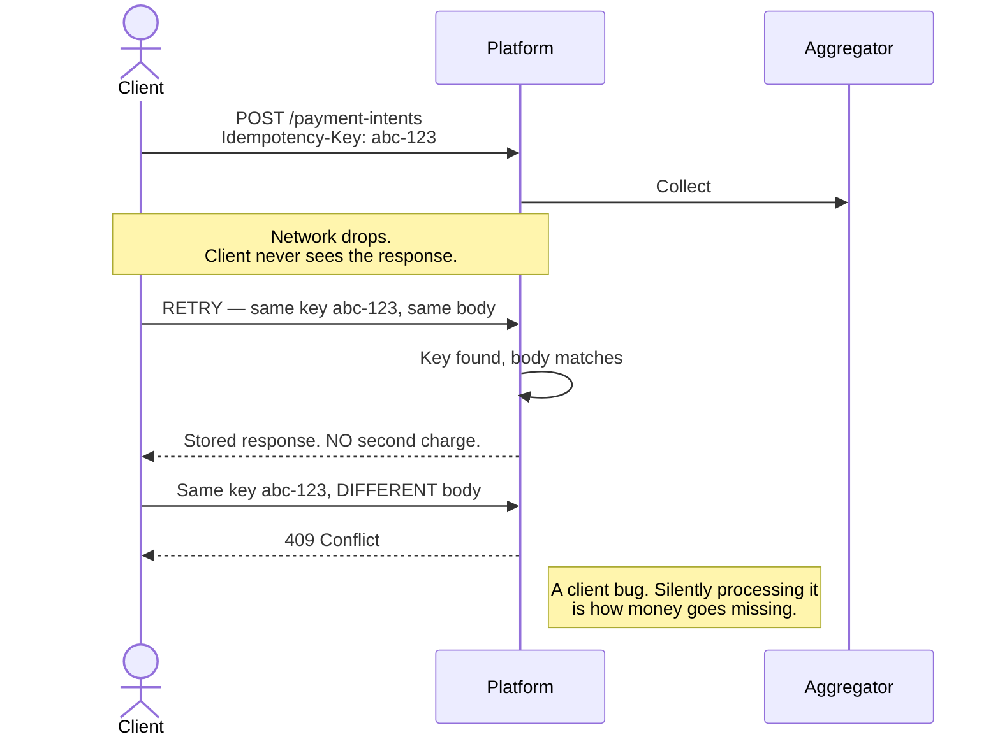

# Identifiers & Numbering

> **Status:** Draft
> **Last reviewed:** 2026-08-13
> **Derives from:** [Domain Model](domain-model.md); Business Plan §H5.6

Three separate concerns that are often conflated: the **primary key** the database uses, the **reference** a human says out loud, and the **idempotency key** that stops a retry becoming a second charge.

## Primary keys: ULIDs

All primary keys are **ULIDs** stored as `char(26)`.

Not auto-incrementing integers, for two reasons that matter here specifically. First, sequential IDs leak volume — a competitor or a patient can read `/appointments/1043` and know roughly how many appointments a clinic has had, and in a multi-tenant product where tenants are also each other's local competitors, that is a real disclosure. Second, sequential IDs invite enumeration attacks against tenant isolation; a random ID means a guessed URL fails before authorisation is even consulted.

ULID over UUIDv4 because ULIDs sort lexicographically by creation time, which keeps B-tree index locality reasonable and makes `ORDER BY id` a sensible default. Laravel supports them natively (`HasUlids`).

```php
class Appointment extends Model
{
    use HasUlids;
}
```

**Never expose a ULID as the thing a human reads.** They are unpronounceable over a phone call, which is how most support in this market actually happens.

## Human references

Every entity a person needs to talk about carries a short, tenant-scoped `reference`.

| Entity | Format | Example |
|---|---|---|
| Appointment | `APT-{YY}{MM}-{seq}` | `APT-2608-0147` |
| DispenseOrder | `RX-{YY}{MM}-{seq}` | `RX-2608-0092` |
| Delivery | `DLV-{YY}{MM}-{seq}` | `DLV-2608-0031` |
| PaymentIntent | `PAY-{YY}{MM}-{seq}` | `PAY-2608-0455` |

**Rules**

- Unique within a tenant, not globally. Two clinics may both have `APT-2608-0001`; they never see each other's, and a tenant-local sequence is what makes the numbers small enough to say aloud.
- The sequence resets monthly, keeping references short for years.
- Generated in a transaction against a per-tenant, per-prefix, per-month counter row with `SELECT ... FOR UPDATE`. Under Carevelo's write volumes this is not a bottleneck and gap-free numbering is worth the lock.
- Case-insensitive on lookup. Someone will type `apt-2608-0147`.
- Never used as a foreign key. References are for humans; ULIDs are for machines.

Gaps are acceptable — a rolled-back transaction may consume a number. Do not build reconciliation logic that assumes contiguity.

## Idempotency keys

The mechanism that prevents a double charge (§H5.6). This is the highest-consequence identifier in the system: get it wrong and a patient pays twice for one consultation.

**Client-supplied** on every mutating payment request, via an `Idempotency-Key` header. The client generates a UUIDv4 and **reuses it across retries of the same logical operation**. A new attempt by the user — pressing "pay" again deliberately after a failure — generates a new key.



**Server behaviour**

- Unique on `(tenant_id, idempotency_key)`.
- First request with a given key: process, store the response.
- Repeat with the same key and the same request body: return the stored response. Do not re-execute.
- Repeat with the same key and a *different* body: reject with `409 Conflict`. This means a client bug, and silently processing it is how money goes missing.
- Keys are retained 24 hours, comfortably longer than any mobile-money resolution window.

Detailed in [API Conventions](../40-api/api-conventions.md).

**Internal jobs** use a deterministic key derived from the operation — for example `reconcile:{payment_intent_id}:{date}` — so a retried job cannot duplicate an effect.

## Aggregator references

Two identifiers move between us and the aggregator, and they must not be confused:

- **`merchant_reference`** — ours, sent to them. Use the `PaymentIntent` reference (`PAY-2608-0455`) so the clinic can match a line on its aggregator dashboard to a booking without asking us.
- **`aggregator_reference`** — theirs, stored by us. This is the authoritative identifier for reconciliation and for any dispute, because it is the one the aggregator will recognise.

Reconciliation joins on `aggregator_reference` and falls back to `merchant_reference`. Both are indexed. We reconcile *records*, not *money* (§H5.4) — see [Payments Regulatory Boundary](../50-security-compliance/payments-regulatory-boundary.md).

## Tenant identifiers

- **`tenant_id`** — ULID, on every tenant-scoped row, immutable. Never reassigned, never recycled.
- **`slug`** — lowercase alphanumeric with hyphens, globally unique, immutable after provisioning. Appears in the subdomain, so changing it breaks patient bookmarks, saved aggregator webhook URLs and printed materials. If a clinic rebrands, add a custom domain rather than mutating the slug.
- **Reserved slugs:** `www`, `api`, `app`, `admin`, `docs`, `status`, `mail`, and any single-character value. Enforced at provisioning.

## Patient identity

- No cross-tenant patient identifier exists. A person attending two clinics is two Patient records — an intentional consequence of tenant isolation, not an oversight.
- Uniqueness within a tenant is `(tenant_id, phone)`, normalised to E.164 (`+256...`) on write. Ugandan numbers are written half a dozen ways (`0772...`, `256772...`, `+256 772 ...`); normalise once at the boundary and never deal with it again.
- `national_id_number` is optional, never a key, and never required to receive care.

## Storage and files

Uploaded objects — prescription PDFs, clinic logos, attachments — are stored under a tenant-partitioned path:

```
{tenant_id}/{entity_type}/{entity_id}/{ulid}.{ext}
```

Tenant partitioning at the storage layer means a bucket-policy mistake fails at tenant granularity rather than exposing everything. Object names are never guessable, and access is always brokered through a signed, short-lived URL issued after an authorisation check — never a public path.

Prescription PDFs additionally store a `document_hash` in the database so a rendered document can be verified against the record it claims to represent.
