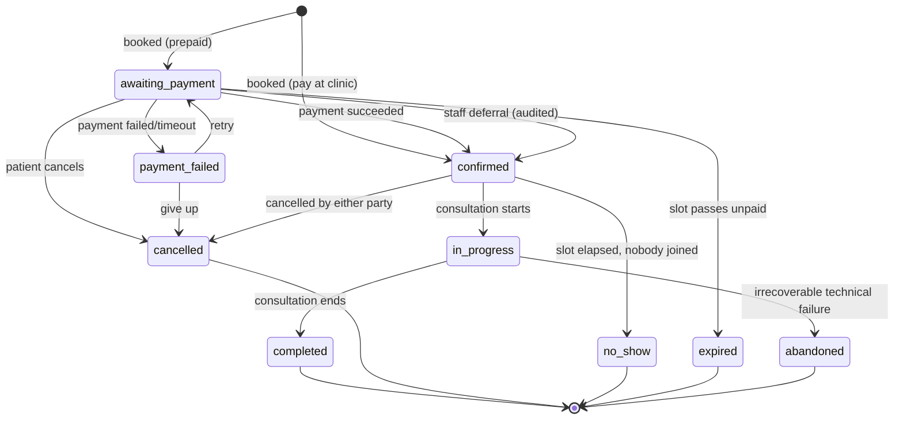
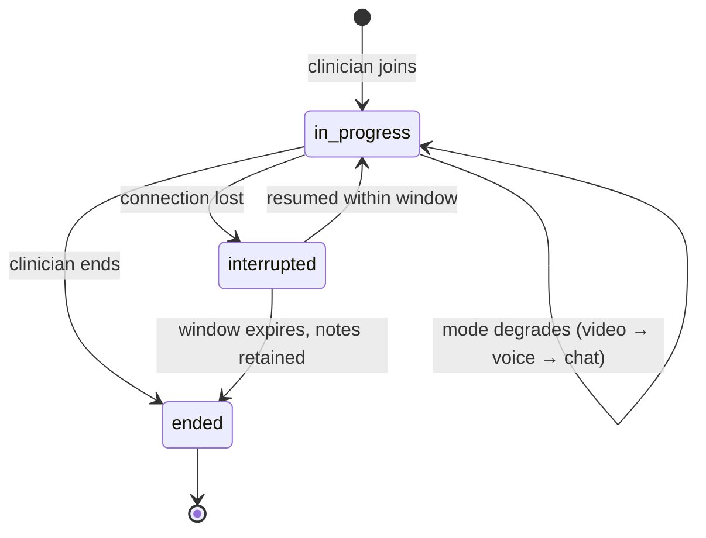
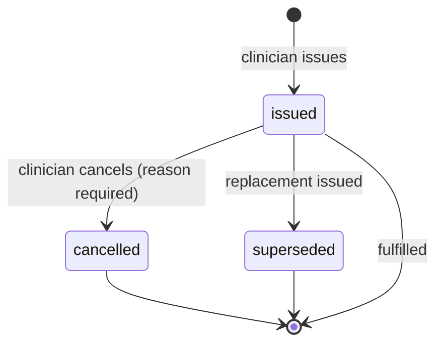
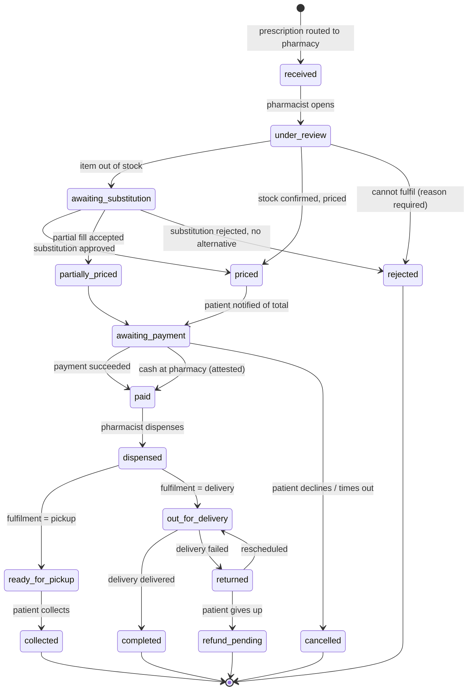
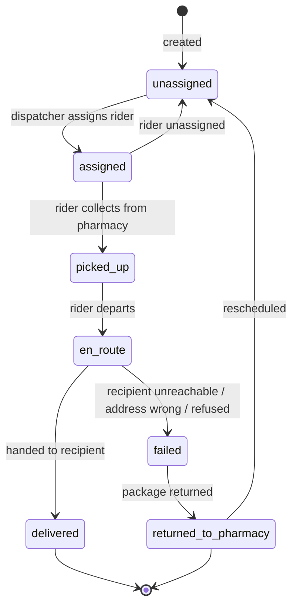
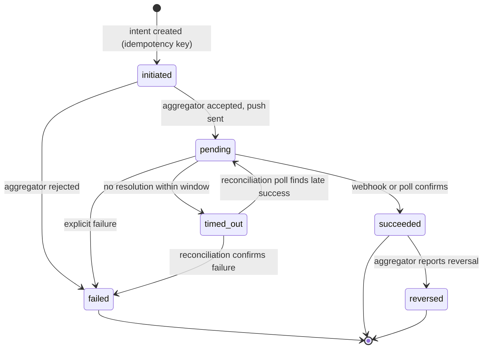
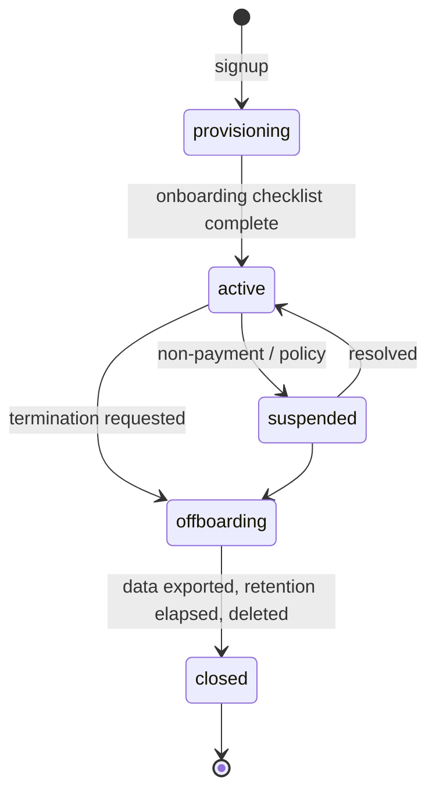
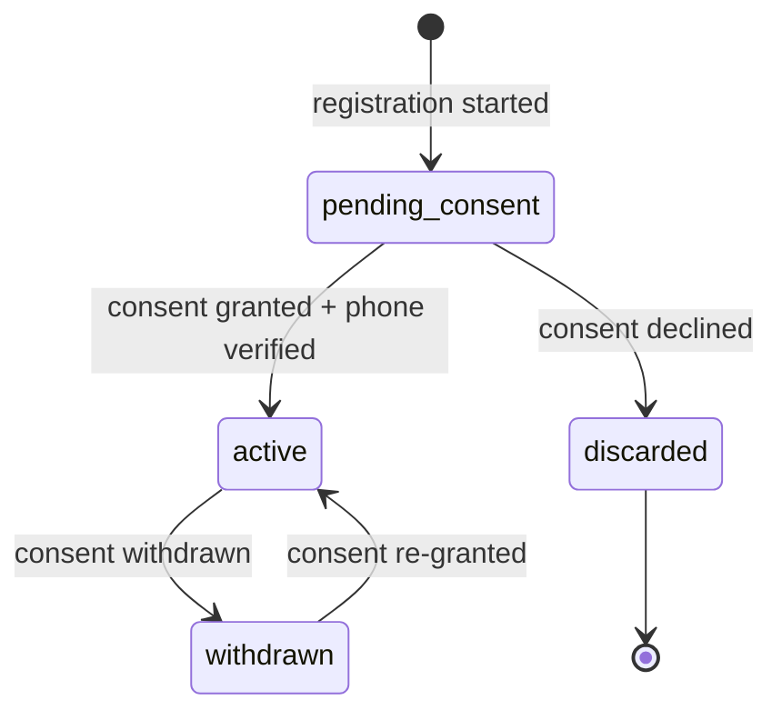

# State Machines

> **Status:** Draft
> **Last reviewed:** 2026-08-13
> **Derives from:** Business Plan §H3, §H4, §H5

Every stateful entity's legal transitions. Anything not drawn here is illegal and the code must reject it rather than silently permit it.

Two rules apply throughout:

- **Transitions are explicit methods, not attribute assignment.** `$appointment->cancel($reason)` — never `$appointment->status = 'cancelled'`. Illegal transitions throw.
- **Every transition emits a domain event and writes an `AuditEvent`.** State history must be reconstructable from the log alone, because "how did this order get here?" is the most common support question and the hardest to answer after the fact.

## Appointment

**Notes**

- `expired` and `cancelled` differ: expiry is the system releasing an unpaid slot, cancellation is a human decision. The clinic owner reads these differently and so should we.
- `no_show` triggers the tenant's own refund policy. Carevelo does not decide refund policy — it records the outcome and lets the clinic act through its own aggregator (§H3.6).
- `abandoned` covers a dropped call that could not be resumed. The patient gets a resume link first; only after the window closes does the appointment abandon.
- A cancelled or expired appointment releases the slot immediately.

## Consultation

**Notes**

- Mode degradation is a recorded transition, not a hidden one. `mode_used` reflects reality (see [Domain Model](domain-model.md)).
- **Notes survive interruption.** Drafts are persisted as they are typed; a lost connection must never lose clinical text. This is a hard requirement, not an optimisation — see [Frontend](../30-architecture/frontend-nextjs.md).
- A prescription may be issued only from a consultation that reached `ended` with outcome `completed`.

## Prescription

**Notes**

- No `draft` state. A prescription exists from the moment it is issued; before that there is only an unsaved form. A half-written prescription is not a clinical document.
- Immutable. Correction is cancel-and-replace with `supersedes_prescription_id`.
- Cancellation after dispensing is still permitted and recorded — it happens, and the record must reflect it rather than refuse it.

## DispenseOrder

**Notes** (all from §H4)

- `awaiting_substitution` blocks only the affected item. The rest of the order proceeds — otherwise one out-of-stock item stalls everything, and pharmacists will work around us rather than with us.
- `partially_priced` is the patient accepting a partial fill.
- **Controlled items never reach `out_for_delivery`.** The order splits or is flagged for in-person collection (NDPA Act Cap 206).
- `refund_pending` is a signal to the clinic to refund through its own aggregator. Carevelo cannot refund; it holds no funds. The state exists to make the obligation visible, not to discharge it.

## Delivery

**Notes**

- Every transition writes a `DeliveryEvent` with actor and timestamp — this is the status thread the patient sees.
- `failed` requires a reason from a fixed list. Free text alone cannot be reported on.
- Package contents are never exposed in the rider-facing view or in any delivery notification.

## PaymentIntent

The one that matters most operationally, because mobile money is genuinely asynchronous — the patient has to pick up their handset and enter a PIN, and they may not (§H5.3).

**Notes**

- `pending` is the normal state, not an edge case. The UI must be honest about waiting rather than pretending to be instant.
- **`timed_out` is not final.** Mobile-money confirmations arrive late; a reconciliation poll can move it to `succeeded`. Treating a timeout as a definitive failure produces the worst possible outcome — a patient charged for a booking that was cancelled.
- Two independent paths resolve a payment: the aggregator **webhook**, and a scheduled **reconciliation poll** as backstop for missed webhooks (§H5.6). Both are idempotent; whichever arrives first wins and the second is a no-op.
- `reversed` is rare, always flagged for the clinic administrator, and never auto-actioned by us.
- No state in this machine represents Carevelo holding money. `succeeded` means *the aggregator told us it settled to the clinic* — nothing more.

## Tenant

**Notes**

- `suspended` blocks staff sign-in. It does **not** block a patient reading their own records, and does not abandon a delivery in flight. A commercial dispute must not become a clinical incident.
- `offboarding` starts the controller-obligation clock: export the clinic's data to the clinic, then delete on the retention schedule ([Retention & Deletion](../50-security-compliance/data-retention-and-deletion.md), §H7.4).
- `closed` means tenant data is deleted; the audit trail of the deletion itself is retained.

## Patient

**Notes**

- **No clinical data may attach to a patient in `pending_consent`** (§H2.4).
- `discarded` retains only the minimal contact detail needed to explain why service could not proceed, and is purged on schedule.
- `withdrawn` halts new processing. It does not erase records the clinic must retain as a medical record — the clinic is the controller and that obligation is theirs; see [Retention & Deletion](../50-security-compliance/data-retention-and-deletion.md).
