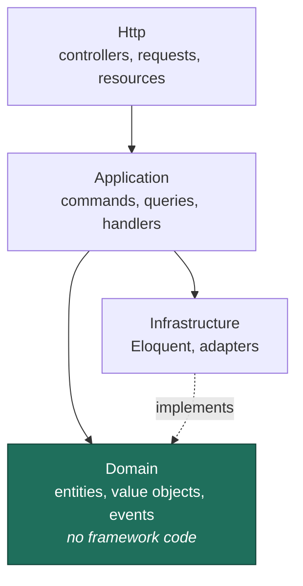
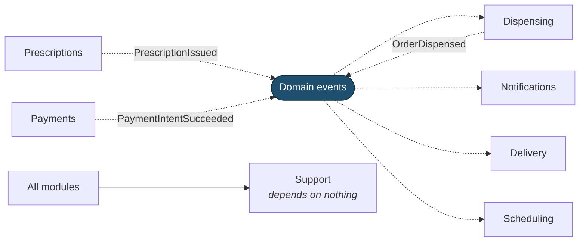
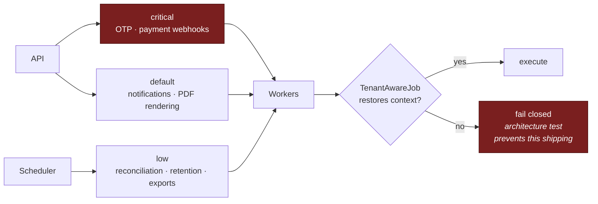

# Backend — Laravel

> **Status:** Draft
> **Last reviewed:** 2026-08-13
> **Derives from:** [ADR-0001](../70-decisions/0001-laravel-nextjs-stack.md), [ADR-0005](../70-decisions/0005-modular-monolith-over-microservices.md); Business Plan §M

A **modular monolith**: one deployable application with enforced internal boundaries. §M names founder capacity as a top-three risk, and a distributed system is a tax paid daily by a team that does not exist.

## Stack

| Component | Choice |
|---|---|
| Runtime | PHP 8.3+ |
| Framework | Laravel 11+ |
| Database | PostgreSQL 16+ |
| Queue / cache | Redis 7+, Laravel Horizon |
| API auth | Laravel Sanctum |
| Authorisation | Laravel policies + `spatie/laravel-permission` |
| PDF rendering | Headless Chromium via a queued job |
| Testing | Pest |
| Static analysis | PHPStan / Larastan, level 8 |
| Style | Laravel Pint (PSR-12) |
| Architecture tests | Pest architecture presets |

## Module layout

```
app/
  Modules/
    Tenancy/        tenant provisioning, resolution, context, branding
    Identity/       users, roles, invitations, OTP, sessions
    Compliance/     consent, audit, data-subject requests, retention
    Catalogue/      services, prices, working hours, availability
    Scheduling/     appointments, slots, reminders
    Consultations/  consultation lifecycle, notes, video session brokering
    Prescriptions/  prescriptions, items, PDF rendering
    Dispensing/     dispense orders, substitutions, pharmacy queue
    Delivery/       deliveries, riders, dispatch, status events
    Payments/       payment intents, aggregator adapters, reconciliation
    Notifications/  templates, SMS/WhatsApp channels, delivery receipts
  Support/          shared primitives: Money, PhoneNumber, Ulid, Reference
```

Each module:

```
Modules/Dispensing/
  Domain/          entities, value objects, state machines, domain events
  Application/     commands, queries, handlers
  Infrastructure/  Eloquent models, repositories, external adapters
  Http/            controllers, form requests, API resources
  Jobs/
  Providers/
  Tests/
```

### Boundary rules

Enforced by architecture tests, so they are real rather than aspirational:

1. **A module may not reference another module's `Domain` or `Infrastructure`.** Cross-module interaction goes through published `Application` contracts or domain events.
2. **Domain contains no framework code.** No Eloquent, no facades, no `request()`. This keeps invariants testable without a database and keeps the domain honest.
3. **Domain events are the default for cross-module communication.** `PrescriptionIssued` is emitted by Prescriptions and consumed by Dispensing and Notifications; Prescriptions knows nothing of either.
4. **`Support` may be referenced by anything; it references nothing.**

The dependency graph should read as: Http → Application → Domain, with Infrastructure implementing Domain interfaces.



And between modules — the rule is that arrows only ever touch another module's published `Application` contract, or an event:



**Prescriptions knows nothing about Dispensing or Notifications.** It emits a fact; whoever cares subscribes. That is what keeps a module extractable later ([ADR-0005](../70-decisions/0005-modular-monolith-over-microservices.md)) and what the architecture tests enforce.

## Tenancy plumbing

The single most important piece of infrastructure. Full treatment in [Multi-Tenancy](multi-tenancy.md).

```php
// Middleware, before any query
ResolveTenant::class      // from host or authenticated user
BindTenantContext::class  // SET LOCAL app.tenant_id in the request transaction
```

```php
// The only way tenant context is entered outside a request
Tenancy::run($tenantId, function () {
    // RLS active for this tenant
});
```

- Every queueable job extends `TenantAwareJob` or is explicitly `#[PlatformScoped]`. An architecture test fails the build otherwise.
- Every model on a tenant-scoped table uses the `BelongsToTenant` trait, which adds the global scope *and* auto-fills `tenant_id` on create. This is convenience; **RLS is the control**.
- Cache keys are tenant-namespaced. An unprefixed key is a cross-tenant leak with a time delay.

## Persistence

**Migrations** run as `carevelo_migrator`; the application connects as `carevelo_app`, which does not own the tables and holds `NOBYPASSRLS`. Getting this backwards makes every RLS policy silently inert while the application appears to work — the most dangerous failure mode in the system.

Every tenant-scoped migration must, in the same file: add `tenant_id`, enable and **force** RLS, create the isolation policy, and add composite foreign keys on `(tenant_id, id)`. A shared macro does this so it cannot be half-done.

```php
Schema::create('dispense_orders', function (Blueprint $t) {
    $t->ulid('id')->primary();
    $t->ulid('tenant_id')->index();
    $t->ulid('prescription_id');
    // ...
    $t->foreign(['tenant_id', 'prescription_id'])
      ->references(['tenant_id', 'id'])->on('prescriptions');
});
Schema::enableTenantIsolation('dispense_orders');  // RLS + policy, our macro
```

Composite foreign keys make a cross-tenant reference **structurally impossible** rather than merely forbidden — referential integrity does the work, and no future query can undo it.

**Money** is stored as `bigint` minor units with an explicit `currency` column, wrapped in a `Money` value object. Never a float. UGX has no subunit in practice, but the rule holds so the type never has to change.

**Timestamps** are `timestamptz`, stored UTC, displayed in `Africa/Kampala`.

## Domain model in code

State transitions are methods that throw on an illegal move ([State Machines](../20-domain/state-machines.md)):

```php
final class DispenseOrder
{
    public function dispense(PharmacistId $by, Clock $clock): void
    {
        $this->status->assertCanTransitionTo(Status::Dispensed);

        if ($this->hasPendingSubstitutions()) {
            throw new PendingSubstitutionException($this->id);
        }

        $this->status = Status::Dispensed;
        $this->dispensedAt = $clock->now();
        $this->pharmacistId = $by;

        $this->record(new OrderDispensed($this->id, $by, $this->dispensedAt));
    }
}
```

Never `$order->status = 'dispensed'`. Invariants live in the aggregate where they cannot be bypassed by a controller in a hurry.

## Queues

Horizon on Redis, with separate queues by urgency because an SMS backlog must never delay a payment webhook:



Separating the queues is not premature optimisation. A clinic sending a batch of appointment reminders must not delay an OTP that a patient is waiting on, or a payment webhook whose delay leaves a patient unsure whether they paid.

| Queue | Contents | Target |
|---|---|---|
| `critical` | OTP, payment webhooks | seconds |
| `default` | Notifications, PDF rendering | under a minute |
| `low` | Reconciliation sweeps, retention, exports | minutes |

Every job is idempotent, carries a deterministic key where it has an external effect ([Identifiers](../20-domain/identifiers-and-numbering.md)), and restores tenant context. Failures land in `failed_jobs` with tenant context intact so a retry is possible.

## Scheduled work

| Schedule | Task |
|---|---|
| every minute | Payment reconciliation sweep — selects intents **due** for a poll |
| every 5 minutes | Timed-out payment sweep |
| hourly | Appointment reminders; expire unpaid holds |
| daily | Reconciliation report; retention sweep; audit archive |
| weekly | Isolation self-check; credential-expiry warnings |

Every scheduled command declares its tenant scope explicitly. A command that iterates tenants does so with `Tenancy::run()` per tenant, never with a raw cross-tenant query.

**On the reconciliation sweep:** the command *runs* every minute, but it does not poll every pending intent every minute. It selects the intents whose next poll is **due** under the graduated schedule — frequent while a mobile-money confirmation is plausibly imminent, sparse thereafter. [Webhooks](../40-api/webhooks.md) holds that schedule and is the single source for it; do not restate the intervals here, or they will drift.

## External integrations

Each external service sits behind a domain interface, with the adapter in `Infrastructure`:

```php
interface PaymentGateway {
    public function initiateCollection(CollectionRequest $r): CollectionResult;
    public function queryStatus(AggregatorReference $ref): PaymentStatus;
}
```

**Every call uses the tenant's own credentials**, resolved from `AggregatorAccount` at call time ([Payments Regulatory Boundary](../50-security-compliance/payments-regulatory-boundary.md)). There is no platform-level aggregator account, because there is no platform account for funds to reach.

Adapters: timeouts on every call, circuit breaker on repeated failure, structured logging with **secrets and PII redacted**, and no retry on a non-idempotent operation without an idempotency key.

Per the hook discipline in [Phase 2 & 3](../10-product/phase-2-3-outline.md): the interface exists because two providers are genuinely in scope (Flutterwave and Pesapal), not on speculation.

## What lives outside Laravel

Almost nothing, deliberately.

- **Video media** goes browser-to-provider and never traverses the API ([Realtime & Video](realtime-and-video.md)).
- **Card data** never touches us; PCI scope stays with the aggregator.
- **Funds.** Permanently.

## Testing

Detail in [Test Strategy](../80-quality/test-strategy.md). Backend-specific non-negotiables:

- A cross-tenant isolation test per tenant-scoped model.
- An architecture test per boundary rule above.
- A schema test asserting RLS is enabled and forced on every tenant-scoped table.
- A connection test asserting the application role cannot bypass RLS.
- Domain unit tests requiring no database — the reason `Domain` is framework-free.
