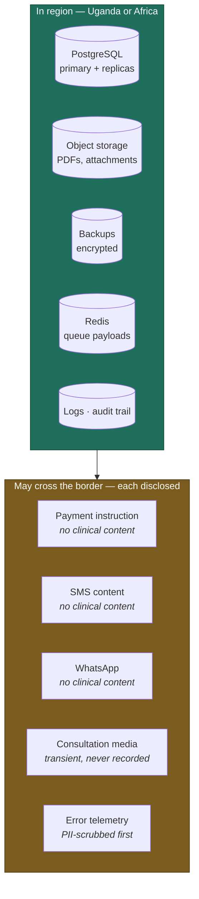

# Data Residency & Hosting

> **Status:** Draft
> **Last reviewed:** 2026-08-13
> **Derives from:** Business Plan §I, §E

## The requirement

DPPA 2019 restricts cross-border transfer of personal data without adequate safeguards. Health data is special-category, attracting stricter handling. Enforcement is real rather than theoretical: Google was found in breach in July 2025 for failing to register with the PDPO (§I), which established that the Act's extraterritorial reach is exercised.

§I is direct about the response: **host in-country, or in a jurisdiction with safeguards plus a data-transfer agreement; prefer Ugandan or African data residency for trust.**

Note the second word. Residency is a compliance requirement *and* a sales asset. §E lists Ugandan data residency among the four things we compete on, against India-built EasyClinic and Nigeria-built Helium Health. "Your patients' records stay in Uganda" is a sentence a clinic owner understands immediately and a foreign vendor cannot say.

## Decision

**Primary hosting in Uganda or the nearest African region**, with all persistent data — database, object storage, backups — in that region.

Ranked preference:

1. **Ugandan data centre.** Strongest compliance position and the strongest sales claim. Trades away managed-service convenience and, often, mature automated failover.
2. **African region of a major cloud** (South Africa is the realistic option). Good latency to Kampala, mature tooling, and an African-residency claim that is honest if slightly weaker.
3. **Elsewhere with safeguards and a transfer agreement.** Legally workable and commercially weaker. Only if 1 and 2 fail on cost or capability, and disclosed plainly.

Selection is deferred to procurement — but the architecture assumes region-portability throughout, which is what makes the decision reversible.



**Every item that may cross the border carries no clinical content.** That is not coincidence — the notification content rule is precisely what keeps a whole class of cross-border transfers legally uninteresting.

## What must stay in region

| Data | Requirement |
|---|---|
| PostgreSQL, primary and replicas | **In region.** Non-negotiable |
| Object storage — prescription PDFs, attachments | **In region** |
| Backups | **In region**, encrypted |
| Redis — queue payloads, cache, Reverb pub/sub | **In region.** Payloads contain patient identifiers |
| **Reverb WebSocket frames** | **In region.** Self-hosted precisely so realtime traffic never crosses the border ([ADR-0008](../70-decisions/0008-laravel-reverb-for-realtime.md)) |
| Application logs | **In region.** Logs are PII-minimised, but assume leakage |
| Audit log | **In region** |

## What may cross the border, and why

Each of these is a deliberate, disclosed exception. Every one is covered by a data-processing agreement and named in the patient privacy notice.

| Data | Destination | Justification |
|---|---|---|
| Payment instruction | Aggregator | The aggregator is a BoU-licensed party; funds must reach it. Carries no clinical content |
| SMS content | SMS gateway | Contains **no clinical content** by rule ([Notifications](../10-product/notifications-sms-whatsapp.md)) |
| WhatsApp messages | Meta infrastructure, outside Uganda | Opt-in, no clinical content |
| Consultation media | Video provider, possibly outside region | Transient, never recorded. See [Realtime & Video](realtime-and-video.md) and [ADR-0004](../70-decisions/0004-video-provider-selection.md) |
| Aggregated error telemetry | Error tracking service | **PII-scrubbed before transmission.** Prefer a self-hosted or in-region option |

The pattern is consistent: **what crosses the border carries no clinical content.** The content rule for notifications is not merely a privacy nicety — it is what keeps a large class of cross-border transfers legally uninteresting.

Static assets — CSS, JavaScript, fonts — may be served from a CDN edge anywhere. **Clinical responses are never CDN-cached.**

## Hosting shape

```
Region (Uganda / Africa)
  ├─ Load balancer, TLS termination
  ├─ Next.js instances          (stateless, horizontally scaled)
  ├─ Laravel API instances      (stateless, horizontally scaled)
  ├─ Horizon workers            (queue consumers)
  ├─ PostgreSQL primary + standby
  ├─ Redis (persistence enabled — queue jobs must survive restart)
  └─ Object storage (S3-compatible, in region)
```

Everything is stateless except the data stores. Scaling is horizontal on the application tier, and the database is the constraint long before the application is — which at 33 clinics, then 165, then 500, is a comfortable position.

## Encryption

- **In transit:** TLS 1.2+ everywhere, including between application and database. HSTS with preload on public surfaces.
- **At rest:** full-disk or volume encryption on database and storage. Application-level envelope encryption additionally for aggregator credentials and other secrets — so a database backup leaking does not hand over a clinic's merchant credentials.
- **Backups:** encrypted, with keys held separately from the backup store. A backup encrypted with a key stored beside it is not encrypted.

## Secrets

Never in the repository, never in an environment file committed anywhere. A managed secret store or the platform's encrypted variables, injected at runtime.

Per-tenant aggregator credentials are **envelope-encrypted in the database**, decrypted only in memory at the moment of use, and never logged — including in exception traces, which is where they most often escape. See [Threat Model](../50-security-compliance/threat-model.md).

## The PDPO obligation

Registration with the Personal Data Protection Office is mandatory and cheap: UGX 100,000, Form 2 and Form 3 commissioned by a Commissioner for Oaths, and a nominated Data Protection Officer (§I).

**This must be complete before any real patient data is processed** — it is a Phase 1 gate in [Roadmap](../00-overview/roadmap.md). Each clinic registers separately as a controller; Carevelo registers as a processor. The full checklist is in [Data Protection](../50-security-compliance/data-protection-dppa.md).

## Reversibility

Region choice must remain reversible, because the compliance ground is moving — MoH is drafting digital-health and EMR guidance and it may harden residency requirements (§I, §J.4).

Accordingly: no dependency on a proprietary managed service without a portable equivalent; S3-compatible rather than a vendor-specific storage API; PostgreSQL rather than a proprietary database; containerised deployment; infrastructure as code.

The cost of this discipline is modest. The cost of discovering that a regulation requires a migration we architecturally cannot perform is not.
