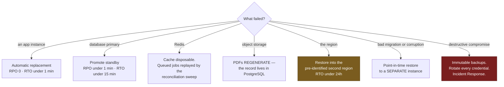
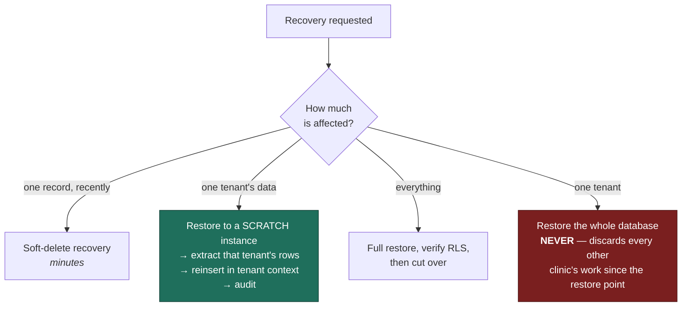

# Disaster Recovery

> **Status:** Draft
> **Last reviewed:** 2026-08-13
> **Derives from:** [Data Residency](data-residency-and-hosting.md), [Backup & Restore](../60-operations/backup-and-restore.md)

What happens when something is genuinely broken, and what the clinics can expect while it is.

Worth stating up front: clinics ran on paper before Carevelo and can run on paper during an outage. The platform failing must never mean a patient cannot be treated — which shapes the whole recovery posture toward *graceful degradation and honest communication* rather than heroic uptime.

## Objectives

| Scenario | RPO (data loss) | RTO (downtime) |
|---|---|---|
| Application instance failure | 0 | Under 1 minute — automatic |
| Database primary failure | Under 1 minute | Under 15 minutes |
| Redis failure | Queued jobs only | Under 10 minutes |
| Object storage failure | 0 | Under 1 hour |
| Region failure | Under 1 hour | Under 24 hours |
| Data corruption or bad migration | Point-in-time | Under 4 hours |
| Ransomware / destructive compromise | Under 1 hour | Under 48 hours |

These are targets for a small team, not enterprise five-nines commitments, and [Support & SLA](../60-operations/support-and-sla.md) states them honestly to clinics. Promising what we cannot deliver is worse than promising less.

Which scenario you are in decides everything else, so establish that first:

Two of these deserve emphasis. **Object storage failure is survivable because the prescription record lives in PostgreSQL and the PDF is a rendering of it** — that separation is deliberate. And regional failure is the scenario a single-region deployment handles worst, which is the honest cost of the data-residency choice.

## Scenarios

### Application instance failure
Stateless and horizontally scaled; the load balancer removes the failed instance and the rollout replaces it. No data at risk.

### Database primary failure
Streaming replication to a standby. Promotion may be manual for a small team — automated failover that misfires is worse than a fifteen-minute human decision.

During failover the platform is read-degraded or down. Clinics fall back to paper; on recovery, records are entered retrospectively. **The failure mode to avoid absolutely is accepting writes that are later lost** — better to refuse a booking than to confirm one that vanishes.

### Redis failure
Cache loss is harmless. **Queued jobs are not** — an unsent OTP is a failed registration, and an unprocessed payment webhook is a patient wondering whether they paid.

Redis persistence is enabled. Payment resolution never depends on the queue alone: the scheduled reconciliation poll re-resolves any intent whose webhook job was lost (§H5.6). This is the second time that backstop earns its cost.

### Object storage failure
Prescription PDFs become temporarily unavailable. The **prescription record itself lives in PostgreSQL** and the PDF is a rendering of it — so documents regenerate rather than being lost. This separation is deliberate: the clinical fact must never live only in a rendered artefact.

### Region failure
The scenario a single-region deployment handles worst, and the honest trade for data residency (§I).

Backups are in region but in separate storage. A regional loss means restoring into a new region, which conflicts with the residency preference — accordingly, **a second Ugandan or African region is identified in advance** as the failover target, so the decision is not being made under pressure at 2am.

24 hours RTO is realistic for a small team, and clinics are told this plainly.

### Data corruption or bad migration
Point-in-time recovery from continuous archiving. Restore to just before the event, into a separate instance, verify, then cut over.

Destructive migrations require a verified backup taken immediately before ([Environments](environments-and-deployment.md)), which is what makes this a four-hour problem rather than an existential one.

### Destructive compromise
Backups are **immutable and separately credentialed**. An attacker with production access must not be able to delete the backups — this is the single control that separates a bad week from the end of the business.

Recovery: isolate, restore to a clean environment from a pre-compromise backup, rotate every credential including every tenant's aggregator keys, and follow [Incident Response](../50-security-compliance/incident-response.md), including PDPO notification and notification to each affected clinic as controller.

## Tenant-level recovery

The commonest real request is not a disaster at all: *one clinic deleted something and wants it back.*

If a full restore is ever the only available way to recover one tenant, the backup strategy is wrong.

- Soft deletion on clinically significant records, with a recovery window.
- Point-in-time restore into a scratch instance, extract that tenant's rows, reinsert. Slow, manual, and correct.
- **Never restore the whole database to fix one tenant's mistake** — doing so would discard every other clinic's work since the restore point. If this is ever the only option, the backup strategy is wrong.

## Backups

Detail in [Backup & Restore](../60-operations/backup-and-restore.md).

| Property | Requirement |
|---|---|
| Frequency | Continuous WAL archiving; daily full backup |
| Retention | 30 days point-in-time; 12 monthly archives |
| Location | **In region**, separate storage from production |
| Encryption | Encrypted, **keys held separately from the backup store** |
| Immutability | Write-once; not deletable with production credentials |
| **Verification** | **Restore-tested monthly.** An untested backup is a belief |

The restore test is the part that gets skipped and the part that matters. It is scheduled, and its failure is treated as a production incident.

## Communication

During any incident affecting clinics:

1. Status page updated within 15 minutes of detection — before the cause is known. "We are investigating" is useful; silence is not.
2. Direct notification to affected clinic administrators for anything beyond brief degradation.
3. Plain statement of what works and what does not, so a clinic can decide whether to fall back to paper.
4. A written post-incident summary to affected clinics within five working days.

Clinics are small businesses whose patients are waiting. **Tell them early, tell them plainly, and do not minimise.** A clinic that discovers the outage from a patient will remember it far longer than the outage itself.

## Testing

| Test | Frequency |
|---|---|
| Backup restore verification | Monthly |
| Database failover drill | Quarterly, in staging |
| Full regional recovery exercise | Annually |
| Incident-response tabletop | Annually |

Untested recovery procedures fail when used. The drills are scheduled work, not aspirations, and a failed drill is a finding to fix rather than a formality to pass.
