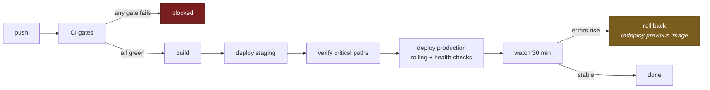
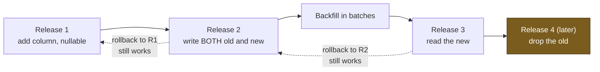

# Environments & Deployment

> **Status:** Draft
> **Last reviewed:** 2026-08-13
> **Derives from:** [Data Residency](data-residency-and-hosting.md), [Multi-Tenancy](multi-tenancy.md)

## Environments

| Environment | Purpose | Data | Aggregators |
|---|---|---|---|
| **local** | Development | Seeded, synthetic | Sandbox |
| **ci** | Automated tests | Ephemeral, synthetic | Stubbed |
| **staging** | Pre-release verification, demos | **Synthetic only** | Sandbox |
| **production** | Live clinics | Real | Live, per-tenant |

**Production data is never copied to any other environment.** Not to debug, not to demo, not "just this once with the names removed" — pseudonymised health data re-identifies more easily than people expect, and the clinic is the controller with no basis to permit it.

Debugging works from logs, audit metadata and reproduction against synthetic data. Where a genuine production investigation is unavoidable, it uses the break-glass procedure ([RBAC Matrix](../50-security-compliance/rbac-matrix.md)) and stays in production.

Staging demos run on a realistic synthetic tenant, which is more useful anyway — it can be reset and it can be made to show the happy path.

## Configuration

Twelve-factor: configuration comes from the environment; secrets come from a managed store at runtime ([Data Residency](data-residency-and-hosting.md)).

Non-negotiable production settings:

```
APP_ENV=production
APP_DEBUG=false          # a stack trace in a health app leaks patient data
DB_USERNAME=carevelo_app # NOT the migrator; NOT the table owner
SESSION_SECURE_COOKIE=true
```

`APP_DEBUG=true` in production is a reportable incident, not a misconfiguration — Laravel's debug page renders request payloads, which here means patient data and potentially decrypted credentials.

## Database roles

Two, and the distinction is load-bearing ([Multi-Tenancy](multi-tenancy.md)):

| Role | Used by | Privileges |
|---|---|---|
| `carevelo_migrator` | Migrations only | Owns the tables; bypasses RLS |
| `carevelo_app` | The running application | `NOBYPASSRLS`; **not** the table owner; no DDL |

A deployment check asserts at boot that the application role cannot bypass RLS and does not own the tables. **If the application connects as the owner, every RLS policy is silently inert** — the system appears to work perfectly while protecting nothing. This is the single most dangerous misconfiguration in the platform, and it is why the check runs at boot rather than only in CI.

## Connection pooling

**A pooler must run in transaction mode.**

We set tenant context with `SET LOCAL app.tenant_id`, which is transaction-scoped. In session mode, a pooled connection can carry a setting across requests belonging to different tenants — a cross-tenant read with no code defect at all.

This is documented here because it is invisible in the application and catastrophic in effect. The deployment configuration test asserts transaction mode.

## Two deployables

`backend/` and `frontend/` build, test and deploy **independently** ([ADR-0007](../70-decisions/0007-separate-backend-frontend-trees.md)). CI is path-filtered: a change touching only `frontend/` does not run the PHP suite, and vice versa.

`docs/` belongs to neither, and a change touching `docs/40-api/openapi.yaml` triggers **both** — the backend because the contract is its obligation, the frontend because its client must be regenerated.

**Ordering:** on an additive contract change, **the backend deploys first.** A frontend calling a field the backend does not yet serve fails; a backend serving a field nobody reads yet is harmless. On a removal, the order reverses and the removal waits a release — the same expand-and-contract discipline as migrations.

Rollback is independent: either half can go back without the other, which is only true because contract changes are additive within a version.

## Processes

| Process | Tree | Notes |
|---|---|---|
| Next.js instances | `frontend/` | Three apps, independently deployed |
| Laravel API | `backend/` | Stateless, horizontally scaled |
| **Reverb** | `backend/` | **Long-lived supervised process.** Restarted on release; clients reconnect with backoff and re-authorise every channel |
| Horizon workers | `backend/` | Restarted on release, in-flight jobs complete |
| Scheduler | `backend/` | Single leader instance |

Reverb holds open connections, so a restart drops every subscriber at once. Clients handle this — Echo reconnects and re-authorises rather than assuming a prior subscription survives ([Realtime Broadcasting](realtime-broadcasting.md)) — but it is another reason to deploy outside clinic hours.

## Deployment pipeline



**CI gates, all blocking:**

1. Pint and PHPStan level 8 (`backend/`); ESLint and TypeScript (`frontend/`).
2. Unit and integration tests.
3. **Cross-tenant isolation tests** — see [Test Strategy](../80-quality/test-strategy.md).
4. **Architecture tests** — module boundaries; every queueable job restores tenant context.
5. **Schema test** — every table either carries `tenant_id` with RLS enabled and forced, or is on the platform-scoped list.
6. **Forbidden-identifier check** — the identifiers named in [Payments Regulatory Boundary](../50-security-compliance/payments-regulatory-boundary.md).
7. **Tree-boundary check** — no PHP under `frontend/`, no product-UI templates or asset pipeline under `backend/`, no import crossing between them ([ADR-0007](../70-decisions/0007-separate-backend-frontend-trees.md)).
8. **API client in sync** — regenerating the client from `openapi.yaml` produces no diff against the committed one.
9. **Channel-authorisation tests** — every Reverb channel is tenant-prefixed and policy-guarded ([Realtime Broadcasting](realtime-broadcasting.md)).
10. Dependency vulnerability scan.
11. Secret scan on the diff.

An isolation-test failure blocks release with no severity discussion available.

## Migrations

Run as `carevelo_migrator`, before the new application version takes traffic.

**Expand and contract**, always — a health platform has no maintenance window a clinic will accept:



The dotted arrows are the whole point: **rollback is redeploying the previous image, and a database cannot be rolled back with it.** Every release pair must be mutually compatible, which is why the drop waits.

Every migration creating a tenant-scoped table must, in the same file, enable and force RLS, create the isolation policy, and add composite foreign keys on `(tenant_id, id)`. The `Schema::enableTenantIsolation()` macro does this in one call so it cannot be half-applied ([Backend](backend-laravel.md)).

Destructive migrations require a verified backup taken immediately before, and are never combined with a code release.

## Releases

Rolling deployment with health checks; a failing check stops the rollout. Rollback is redeploying the previous image — which means **migrations must be backward-compatible**, since a database cannot be rolled back with the code.

Release windows avoid Ugandan clinic hours (weekday mornings especially). A deploy during morning consultations is a self-inflicted incident.

Full procedure in [Release Process](../60-operations/release-process.md).

## Queue workers

Horizon, with workers deployed alongside the API and restarted on release. Jobs in flight complete first; the queue is Redis-backed with persistence enabled so a restart does not lose queued work.

A stuck payment reconciliation job is a patient wondering whether they paid — worker health is monitored as a production concern, not an infrastructure detail ([Observability](observability.md)).

## Scheduled tasks

Laravel's scheduler on a single leader instance, with overlap protection. Every scheduled command declares its tenant scope; a command iterating tenants uses `Tenancy::run()` per tenant, never a raw cross-tenant query.

## Backups

Detail in [Backup & Restore](../60-operations/backup-and-restore.md) and [Disaster Recovery](disaster-recovery.md).

Encrypted, in region, keys held separately from the backup store, and **restore-tested on a schedule**. An untested backup is a belief, not a backup.

## Monitoring the deployment itself

Every release records version, commit, migrations applied, and who deployed. Error rate and latency are watched for a defined period after rollout, and an automatic rollback trigger is preferable to a human noticing.

## Acceptance criteria

1. The application role cannot bypass RLS and does not own the tables. Asserted at boot in every environment.
2. Any connection pooler runs in transaction mode. Asserted by configuration test.
3. `APP_DEBUG` is false in production. Asserted at boot.
4. Production data never reaches a non-production environment.
5. All CI gates block deployment.
6. Migrations are backward-compatible within a release pair.
7. Every tenant-scoped table gains RLS in the same migration that creates it.
8. Deployments are rollable-back without a database restore.
