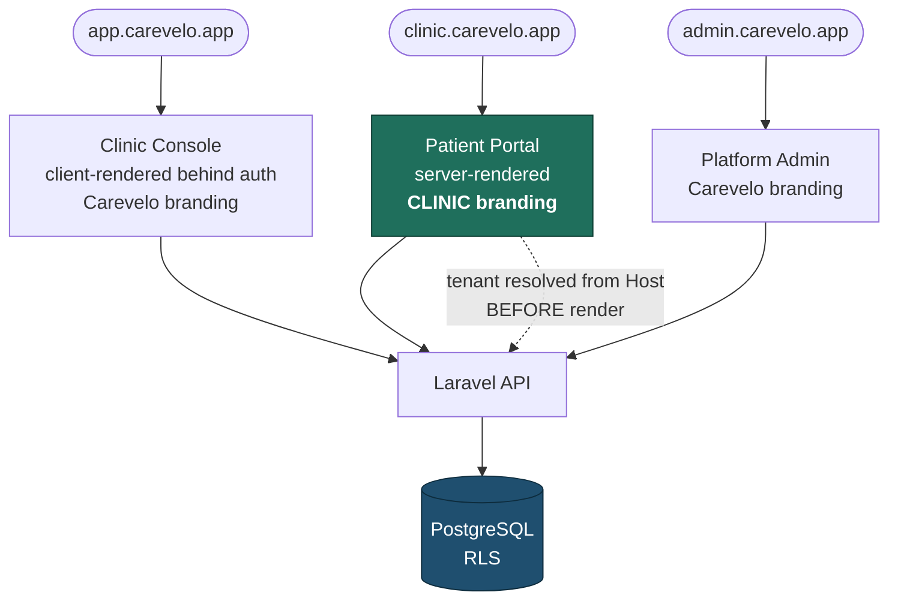
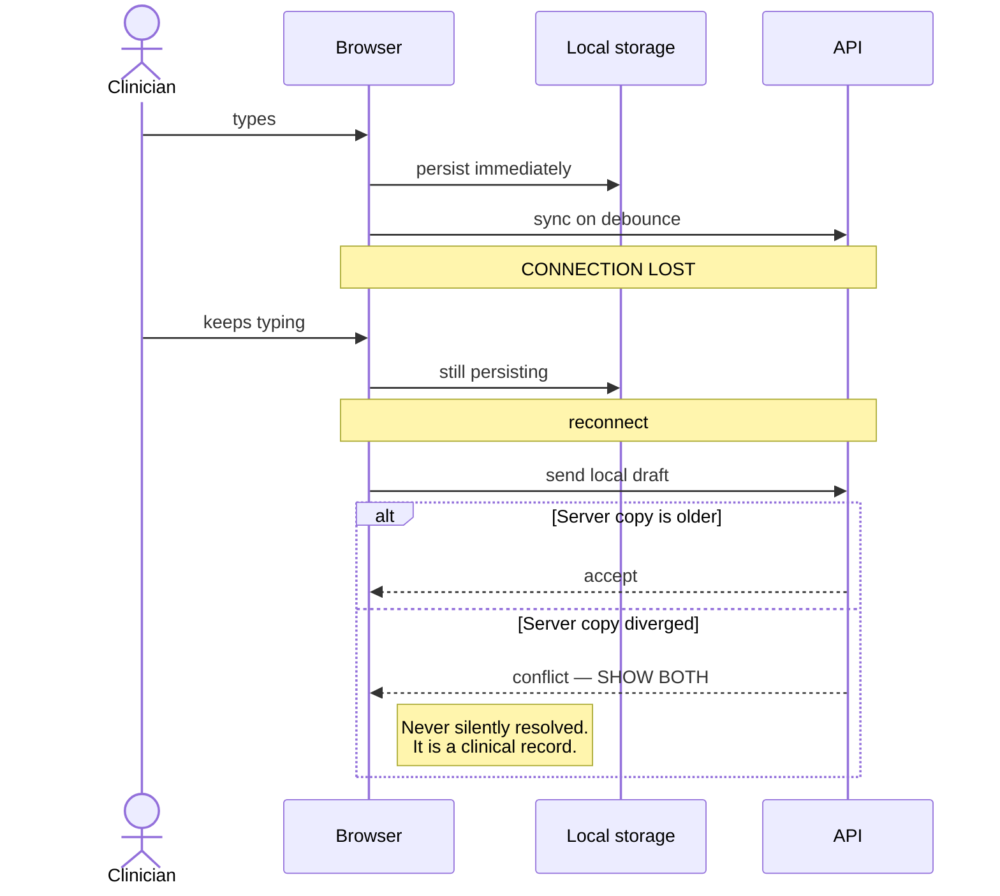

# Frontend — Next.js

> **Status:** Draft
> **Last reviewed:** 2026-08-13
> **Derives from:** [ADR-0001](../70-decisions/0001-laravel-nextjs-stack.md); Business Plan §H, §D

Three surfaces, one codebase or three — see below. All talk to the Laravel API; none talks to the database.

The governing constraint is the patient's device and connection: a mid-range Android phone on variable mobile data ([Personas](../00-overview/personas-and-actors.md)). Every decision here is downstream of that.

## Surfaces

| Surface | Audience | Branding | Rendering |
|---|---|---|---|
| **Patient Portal** | Patients | **Clinic only** | Server-rendered, tenant resolved from subdomain |
| **Clinic Console** | Clinic staff | Carevelo, with the clinic's logo | Mostly client-rendered behind auth |
| **Platform Admin** | Carevelo staff | Carevelo | Client-rendered behind auth |

Recommendation: **separate Next.js applications**, sharing a component library and a generated API client.

The patient portal has genuinely different requirements from the staff console — public, SEO-relevant, tenant-branded, and the one that must work on the worst connection. Bundling it with a heavy staff console penalises exactly the user who can least afford it. Separate deployments also mean an admin bug cannot take down patient booking.

## Patient portal

The white-label surface, and the one that decides whether a clinic's patients trust the product ([White-Labeling](../10-product/white-labeling-and-branding.md)).

**Tenant resolution** happens server-side from the `Host` header before render, so branding is present in the first HTML byte. No flash of unbranded content — a moment of Carevelo colours where the clinic's should be undermines the entire proposition. An unknown host renders a neutral 404 that reveals nothing about which clinics use Carevelo.

**Performance budget**, because this is a competitive advantage in this market rather than an engineering nicety:

- First Contentful Paint under 2s on a throttled 3G connection.
- Initial JavaScript under 150KB gzipped for the booking path.
- Booking and payment work without client-side JavaScript wherever possible — progressive enhancement, forms that post.
- No web fonts on the critical path; system font stack.
- Images served responsively and lazily below the fold.

**No app installation.** Requiring an install loses patients at the moment they need care ([H3](../10-product/prd-h3-teleconsultation.md)).

## Clinic console

Optimised for repetition. A front-desk user books dozens of appointments a day and a pharmacist processes orders continuously; every extra click is multiplied.

- **Mobile-first for clinicians.** Ronald ([Personas](../00-overview/personas-and-actors.md)) works between rooms on a phone. If prescribing is not comfortable one-handed on a phone, it will not be used.
- Keyboard-first for front desk on desktop.
- The pharmacy queue and dispatch board are live-updating views.
- **The revenue view is the retention-critical screen.** It shows money the clinic earned through Carevelo, honestly — §M says the subscription is cut when it cannot be traced to income. Never inflate it, never include test data, never count a `pending` payment as earned.

## The consultation surface

The hardest screen in the product, and the one most likely to lose a clinician.

**Notes must never be lost.** Draft notes persist to local storage as they are typed and sync to the API on a debounce. A dropped connection loses nothing; on reconnect, the local draft is reconciled with the server and any conflict is shown rather than silently resolved. This is a hard requirement from [H3](../10-product/prd-h3-teleconsultation.md), not an optimisation.

**Mode degradation is visible and honest.** Video → voice → chat, with the patient told what happened rather than left watching a frozen frame. The mode actually used is reported to the API and recorded ([State Machines](../20-domain/state-machines.md)).

The clinician sees patient history, the note editor and the prescribing form on one screen. Prescribing requires an explicit confirmation step showing exactly what will appear on the PDF — including the clinician's own name and registration number — because it is a clinical act and should feel like one.

## Tenant safety in the client

The client is untrusted. Rules that follow from that:

1. **Tenant identity is never a client-supplied value.** It comes from the host or the session, and the API ignores any client attempt to assert it ([Multi-Tenancy](multi-tenancy.md)).
2. **Branding tokens are validated server-side before reaching the client.** They arrive as a strict, typed set and are applied as CSS custom properties. No tenant-supplied string is ever interpolated into a `<style>` block or a `dangerouslySetInnerHTML`.
3. **A strict Content Security Policy** with no `unsafe-inline` for scripts. Nonce-based where inline is unavoidable.
4. **Clinical data is never cached in the service worker or in local storage**, with the sole exception of the in-progress consultation note draft — which is cleared on submission and on sign-out.

## Sessions

Detail in [Authentication & Sessions](../40-api/authentication-and-sessions.md).

All three surfaces use **Sanctum cookie sessions** — HTTP-only, Secure, SameSite. No bearer token is held in local storage, where any script with a foothold could read it on a page rendering health data.

- **Patient portal:** sign-out is prominent; patients are frequently on a shared or borrowed handset.
- **Staff console:** role-scoped abilities, with a **20-minute idle timeout** — shorter than the patient's, because an unattended logged-in terminal at a front desk is a real and routine exposure.
- **Rider:** the most restricted session of all, seeing only assigned deliveries ([H4](../10-product/prd-h4-prescription-dispensing-delivery.md)).

## API client

Generated from the OpenAPI specification ([openapi.yaml](../40-api/openapi.yaml)) so types cannot drift from the backend. Errors follow RFC 9457 problem details ([API Conventions](../40-api/api-conventions.md)) and are surfaced as human sentences — a clinic administrator seeing a raw validation payload is a support call.

Aggregator errors are shown **verbatim from the aggregator**, since only the aggregator knows why a mobile-money collection failed and paraphrasing loses the actionable part ([H5](../10-product/prd-h5-payments-non-custodial.md)).

## Accessibility and language

- WCAG 2.1 AA. Contrast is computed rather than left to a clinic's colour choice ([White-Labeling](../10-product/white-labeling-and-branding.md)).
- English and Luganda at minimum in the patient portal, including the consent text ([H2](../10-product/prd-h2-patient-registration-consent.md)). Structure for additional languages from the start; retrofitting internationalisation is far more expensive than allowing for it.
- Touch targets sized for real thumbs; forms usable one-handed.
- Every interactive element reachable by keyboard.

## Acceptance criteria

1. The patient portal renders clinic branding server-side with no flash of unbranded content.
2. An unknown subdomain reveals nothing about tenant existence.
3. Consultation notes survive a deliberate mid-session disconnection.
4. The booking path meets the performance budget on a throttled 3G profile.
5. No tenant-supplied value can inject markup, style or script. Covered by test with hostile inputs.
6. CSP blocks inline script.
7. No clinical data persists in client storage beyond the active note draft.
8. Patient consent text renders in English and Luganda.
9. The revenue view excludes test data and never counts pending payments as earned.
