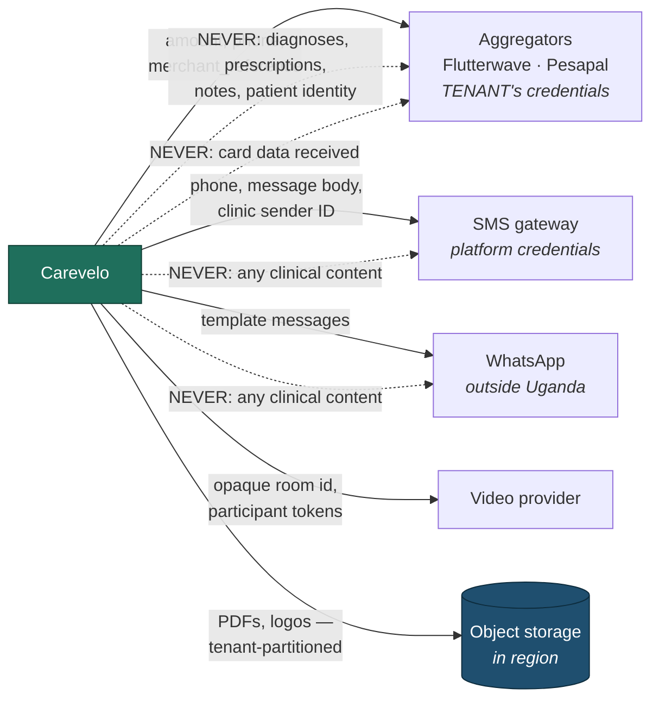

# Integrations

> **Status:** Draft
> **Last reviewed:** 2026-08-13
> **Derives from:** Business Plan §F, §H5, §I

Every external service, what crosses the boundary, and — for each — what must never cross it.

## Principles

1. **Per-tenant credentials wherever the service acts on the clinic's behalf.** Patient payments use the clinic's own aggregator account. There is no platform-level merchant account in that path, because there is no platform account for a patient's funds to reach ([Payments Regulatory Boundary](../50-security-compliance/payments-regulatory-boundary.md)). The single exception acts on **Carevelo's** behalf rather than a clinic's — subscription billing, whose credentials come from config and whose code path cannot reach a clinic's account ([ADR-0003](../70-decisions/0003-non-custodial-payment-architecture.md)).
2. **Behind a domain interface**, adapter in `Infrastructure` ([Backend](backend-laravel.md)).
3. **Minimum necessary data crosses.** Each section below states what must not.
4. **No external call blocks a user-facing transaction.** Notifications and non-critical calls are queued; a gateway timeout must never fail a booking.
5. **Timeouts, circuit breakers, and redacted structured logging on every call.** Secrets and PII never reach a log line, including exception traces.

The map, annotated with what crosses each boundary — and, in red, what must not:

## Payment aggregators — Flutterwave and Pesapal

Both hold Bank of Uganda Payment System Operator licences (§I): Flutterwave's PSO licence was announced in August 2024; Pesapal is likewise PSO-licensed.

| | |
|---|---|
| **Credentials** | The **tenant's own**, from `AggregatorAccount`. Envelope-encrypted, write-only, never returned, never logged |
| **Outbound** | Collection request: amount, currency, patient phone or card session, `merchant_reference` (our `PAY-…` reference), callback URL |
| **Inbound** | Flutterwave: a **signed** webhook carrying the outcome. Pesapal: an **unsigned** notification carrying only its own tracking id, which we answer by calling `GetTransactionStatus` ourselves ([ADR-0012](../70-decisions/0012-pesapal-unsigned-ipn.md)). Both providers are also polled for reconciliation |
| **Initiation** | Flutterwave is started by the client against Flutterwave. Pesapal is started by us — `SubmitOrderRequest` returns a hosted payment page we send the patient to. Neither moves money through Carevelo |
| **Never crosses** | Diagnoses, prescriptions, clinical notes. A payment description says "Consultation" or "Medicines", never why |
| **Never received** | Card data. 3-D Secure is entirely the aggregator's; PCI scope stays with them |

**Fees:** roughly 3% (Flutterwave local) to 3.5% (Pesapal) on collections (§F). These are partially published and must be confirmed directly — treat the figures as indicative for modelling only.

**Reconciliation:** every `PaymentIntent` has a scheduled status poll as a backstop for a missed webhook (§H5.6). Neither path is trusted alone; both are idempotent.

**What the patient-payment adapter must never implement:** a platform merchant account, a payout, a settlement instruction, a balance query on a Carevelo account. None of those exist to be queried. Subscription billing is a different adapter with a different merchant, and it is not a route into this one — it holds no `AggregatorAccount`, and nothing here can construct its credentials.

Two providers exist in real scope, which is why the `PaymentGateway` interface is justified now rather than speculative — and both are implemented. Because they work in opposite directions, the container binds the port to a **resolver keyed on the account's provider** rather than to one client ([Backend](backend-laravel.md)); a default would send one clinic's collection through the other provider's client.

## SMS gateway

Candidates include Africa's Talking and Yo! Uganda (§F). Selection pending a live comparison of per-message rates, which vary by provider and volume and are not reliably published.

| | |
|---|---|
| **Credentials** | Platform-level. SMS is Carevelo delivering on the clinic's behalf, metered and rebilled at cost plus a small margin (§F) |
| **Outbound** | Recipient phone, message body, clinic alphanumeric sender ID |
| **Inbound** | Delivery receipts where supported |
| **Never crosses** | **Any clinical content.** No diagnosis, medicine name, test result or appointment reason ([Notifications](../10-product/notifications-sms-whatsapp.md)) |

Sender-ID registration costs UGX 300,000 — monthly with MTN, one-off with Airtel (§F). This is a per-clinic onboarding cost and belongs in the setup fee conversation.

Assume the operator can read every message, because the operator can. That assumption is what makes the content rule absolute rather than cautious.

## WhatsApp Business API

Opt-in, secondary, never the sole channel. Template messages require pre-approval.

**Residency note:** WhatsApp Business infrastructure sits outside Uganda, making every message a cross-border transfer under DPPA 2019. This is survivable precisely because the content rule holds — a message containing no clinical content transfers little of consequence. It is disclosed in the privacy notice regardless.

## Video / realtime provider

See [Realtime & Video](realtime-and-video.md) and [ADR-0004](../70-decisions/0004-video-provider-selection.md) — the decision is open, recorded there.

| | |
|---|---|
| **Outbound** | Room creation, short-lived participant tokens |
| **Never crosses** | Patient identity, appointment reason, any clinical data. Room identifiers are opaque (`apt-{ulid}`) |
| **Never stored** | Media. Consultations are not recorded |

## Object storage

S3-compatible, in-region ([Data Residency](data-residency-and-hosting.md)).

- Tenant-partitioned paths ([Identifiers](../20-domain/identifiers-and-numbering.md)).
- Server-side encryption at rest.
- **No public objects, ever.** Access is a short-lived signed URL issued after an authorisation check.
- Uploads re-encoded server-side, metadata stripped, declared content type never trusted.

## Deferred integrations

| Integration | Phase | Note |
|---|---|---|
| **EFRIS (URA)** | 2 | On the **clinic's own** TIN and credentials — the same non-custodial pattern as payments. The tax obligation is the clinic's |
| **NIRA / NIN verification** | Not planned | NIN stays optional and unverified. Requiring it excludes patients |
| **Third-party laboratories** | Deferred | Until demand is proven (§H6.3) |
| **Insurance / NHIS claims** | 3, gated | Bill unassented; no published claim formats to build against |
| **HL7 / FHIR export** | Watch | Design field naming to be FHIR-conformant where free; MoH interoperability guidance is coming (§I) |

## Outbound network policy

The application makes outbound calls only to an **explicit allow-list** of integration hosts. Anything else is blocked at the network layer.

This is a data-exfiltration control, and it is worth the small operational friction: it means a compromised dependency — the realistic supply-chain scenario for a PHP or Node application — cannot quietly post a patient database to an attacker's endpoint. It also catches the mistake of a debugging tool phoning home from production.

## Failure handling

| Failure | Behaviour |
|---|---|
| Aggregator unreachable at initiation | Intent stays `initiated`; retry with backoff; patient told no charge was made |
| Aggregator webhook never arrives | Reconciliation poll resolves it (§H5.6) |
| Aggregator credentials revoked | `AggregatorAccount.status = failing`; administrator alerted; new bookings fall back to pay-at-clinic rather than failing silently |
| SMS gateway down | Queued with backoff; failures on critical messages surfaced to staff |
| Video provider down | Consultation falls back to chat, which we serve ourselves; the clinic is told |
| Object storage unavailable | PDF rendering retries; the prescription record exists regardless and the document regenerates |

The pattern throughout: **degrade to something the clinic can still work with**, and say so. Silent failure in a clinical setting is the worst option available.
