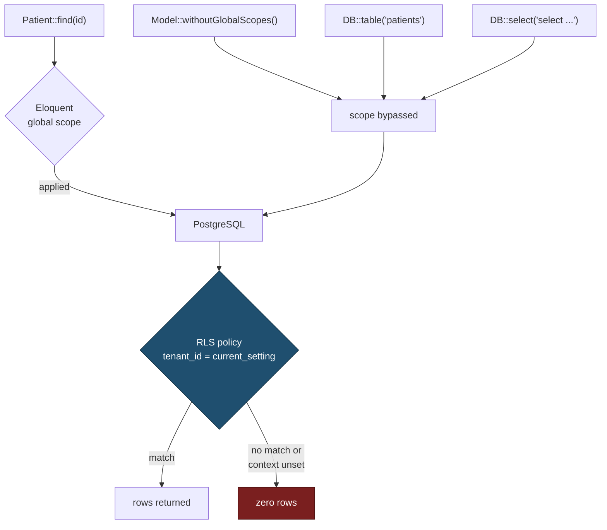
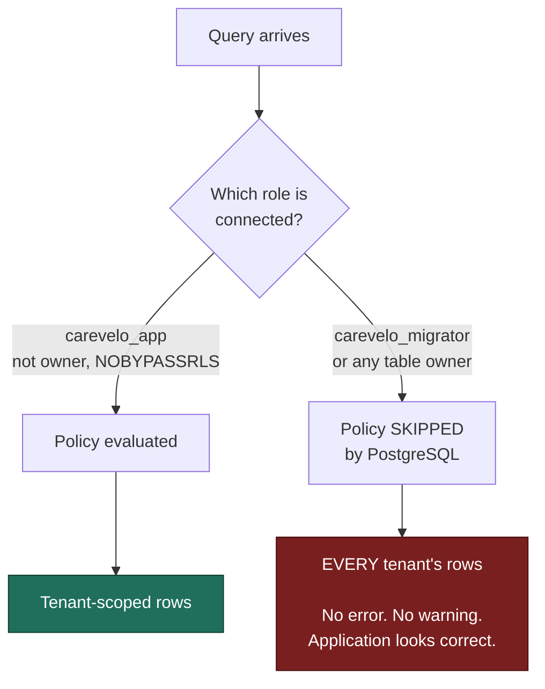
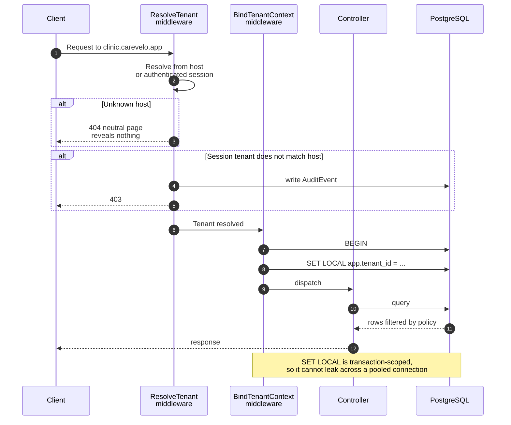
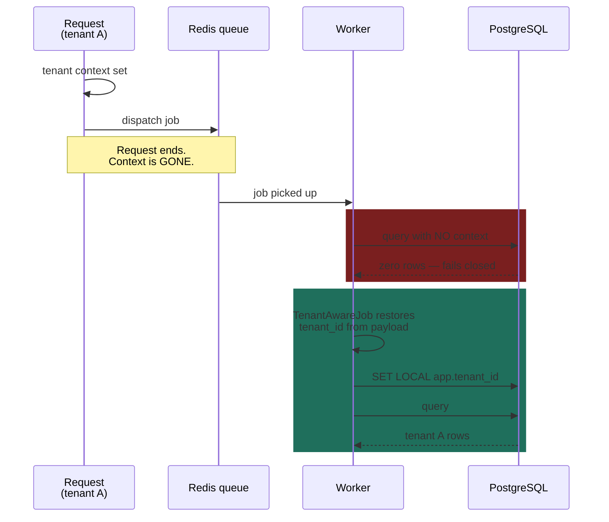

# Multi-Tenancy

> **Status:** Draft
> **Last reviewed:** 2026-08-13
> **Derives from:** Business Plan §H7, §I, §J.5; [ADR-0002](../70-decisions/0002-postgresql-rls-shared-schema-tenancy.md)

**Tenant isolation is a legal requirement, not a feature.** Each clinic is a data controller of special-category health data under DPPA 2019. A cross-tenant leak is a notifiable breach affecting two controllers at once, and — because our tenants are frequently each other's local competitors — a commercial disclosure on top of a regulatory one.

§H7.1 states it plainly: *one clinic can never read another's data.*

## Decision

**Shared database, shared schema, `tenant_id` on every row, enforced by PostgreSQL row-level security.**

Isolation lives in the database, not in the application. Full reasoning in [ADR-0002](../70-decisions/0002-postgresql-rls-shared-schema-tenancy.md); the summary is that application-layer scoping is one forgotten call away from a leak, while RLS fails closed.

## Why not application-layer scoping alone

Laravel's global scopes are the obvious approach and they are not sufficient. Every one of these bypasses a global scope, and every one appears in ordinary code written by competent people:

```php
Model::withoutGlobalScopes()->get();          // deliberate, occasionally legitimate
DB::table('patients')->get();                 // query builder ignores Eloquent scopes
DB::select('select * from patients');         // raw SQL
$patient->consultations()->get();             // relation on a wrongly-loaded parent
Patient::find($idFromRequest);                // no scope on a primary-key lookup
```

The last one is the killer. It looks completely normal, it appears in every controller, and it will return another tenant's patient if the ID is guessed or leaked. Reviewing every future query forever is not a control.

**Application scoping is a convenience layer. RLS is the control.** Both are implemented; only one is trusted.

The difference, drawn. Every path on the left bypasses the global scope; every path is stopped by the same policy at the bottom:



Note that `Patient::find($idFromRequest)` is the only path that *looks* dangerous-free — it appears in every controller and it is scoped. But the three below it are ordinary code too, and only the policy at the bottom catches them.

## How RLS works here

### Database roles

Two roles, and the distinction is the whole mechanism:

| Role | Used by | RLS |
|---|---|---|
| `carevelo_app` | The application at runtime | **Subject to RLS.** Not the table owner, and explicitly `NOBYPASSRLS` |
| `carevelo_migrator` | Migrations and deploys only | Owns the tables, bypasses RLS |

PostgreSQL exempts a table's owner from RLS by default. If the application connects as the owner, every policy is silently inert and the system appears to work perfectly while protecting nothing. **The application role must never own the tables.** This single detail is the most common way RLS deployments fail, and it fails silently.

The two paths, and why only one of them is visible when it goes wrong:



**The right-hand branch produces no error.** That is the entire problem: there is no failing test, no exception, no log line — only a system that quietly returns everything. It is why the role configuration is asserted at boot and exposed as `/health/isolation` ([Observability](observability.md)) rather than merely documented here.

### Policies

Every tenant-scoped table:

```sql
ALTER TABLE patients ENABLE ROW LEVEL SECURITY;
ALTER TABLE patients FORCE ROW LEVEL SECURITY;

CREATE POLICY tenant_isolation ON patients
  USING (tenant_id = current_setting('app.tenant_id', true)::text)
  WITH CHECK (tenant_id = current_setting('app.tenant_id', true)::text);
```

`USING` filters reads. `WITH CHECK` blocks writes that would place a row in another tenant — without it, an attacker could insert into someone else's tenant even while unable to read it.

`current_setting('app.tenant_id', true)` returns NULL when unset, so the comparison yields NULL, so **no rows match**. Unset context means zero rows, never all rows. Fail closed by construction.

### Setting the context

`SET LOCAL` scopes the setting to the current transaction, so it cannot leak between requests sharing a pooled connection:

```php
DB::statement("SET LOCAL app.tenant_id = ?", [$tenant->id]);
```

Set immediately after tenant resolution, inside the request transaction. **Connection pooling is the hazard here**: a pooler in transaction mode is safe with `SET LOCAL`; session mode is not. See [Environments & Deployment](environments-and-deployment.md).

## Tenant resolution

Resolved in middleware, **before any query runs**. The ordering matters: context is bound to the transaction before the router dispatches, so no controller can execute a query without it.



The final note is the reason a connection pooler **must** run in transaction mode — see [Environments & Deployment](environments-and-deployment.md). In session mode a pooled connection can carry one tenant's context into another tenant's request, which is a cross-tenant read with no code defect at all.

Rules:

- Unknown host → 404 with a neutral page. **Never confirm or deny that a clinic uses Carevelo** — enumerating our customer list should not be a `for` loop over subdomains.
- An authenticated user's tenant must match the resolved host tenant. A mismatch is a hard 403 and an `AuditEvent` — it means either a bug or an attack, and both deserve a record.
- The tenant ID comes from the host or the session. **It is never taken from a request parameter, a header or a body field.** A client-supplied tenant ID is a client-controlled authorisation decision.
- No tenant resolved on a tenant-scoped route → 400. Never a default, never "the first tenant", never null-means-all.

## Platform-scoped tables

The complete list of tables without `tenant_id`, enumerated so that additions are deliberate:

| Table | Contents |
|---|---|
| `tenants` | The tenant register |
| `platform_users` | Carevelo staff |
| `plans` | Subscription plans |
| `subscriptions` | Tenant ↔ plan |
| `jobs`, `failed_jobs` | Queue infrastructure (payloads carry tenant context) |
| `migrations` | Schema versioning |
| `reserved_slugs` | Subdomain reservations |

Everything else carries `tenant_id`. **A new table is presumed tenant-scoped**; adding a platform-scoped table requires updating this list in the same change, and a schema test asserts the two agree.

## The queue hazard

The most likely place isolation breaks, because the request context is gone by the time the job runs.

A job serialised in tenant A's request and executed later by a worker has **no tenant context**. With RLS that means it sees zero rows and fails loudly, which is the correct failure — but "fails loudly" still means broken notifications until the context is restored properly.



The red band is what happens without `TenantAwareJob`; the green band is the fix. **Never work around a "no tenant context" error by removing the guard** — the error is the guard working.

Every job therefore captures and restores tenant context:

```php
abstract class TenantAwareJob implements ShouldQueue
{
    public string $tenantId;

    public function __construct()
    {
        $this->tenantId = Tenancy::currentOrFail()->id;
    }

    public function handle(): void
    {
        Tenancy::run($this->tenantId, fn () => $this->handleForTenant());
    }

    abstract protected function handleForTenant(): void;
}
```

Enforced by:

- A queue middleware asserting tenant context is set before any job body executes.
- An architecture test failing the build if a job implementing `ShouldQueue` does not extend `TenantAwareJob` or carry an explicit `#[PlatformScoped]` attribute.
- The same rule for scheduled commands, event listeners, notifications and mailables. **Anything running outside a request needs explicit tenant context.**

Platform-scoped jobs — provisioning, billing, cross-tenant health checks — are explicitly marked, and marking one is a reviewable act.

## Storage isolation

Object storage is tenant-partitioned: `{tenant_id}/{entity_type}/{entity_id}/{ulid}.{ext}` ([Identifiers](../20-domain/identifiers-and-numbering.md)).

Partitioning means a misconfigured bucket policy fails at tenant granularity rather than exposing everything. Access is always a short-lived signed URL issued after an authorisation check — never a public path, never a guessable name.

Caches are namespaced by tenant. **A cache key without a tenant prefix is a cross-tenant leak with a time delay**, and it is a particularly nasty one because it appears intermittently and only under load.

## Where isolation is deliberately crossed

Currently: **nowhere.** There is no cross-tenant read in the MVP, and the referral network ([Phase 2 & 3](../10-product/phase-2-3-outline.md)) is the only planned case.

When it arrives it will be an explicit, narrow, consent-bound, audited **export** — not a relaxation of RLS. If the isolation model has to soften to accommodate a feature, the feature design is wrong.

Platform operators reaching tenant clinical data use the break-glass procedure in [RBAC Matrix](../50-security-compliance/rbac-matrix.md): time-boxed, reason-recorded, tenant-notified, audited.

## Testing

Non-negotiable, and this is the section to point at when someone asks why the test suite is slow ([Test Strategy](../80-quality/test-strategy.md)):

1. **Every tenant-scoped model has a cross-tenant isolation test.** Create in tenant A, attempt every access path from tenant B — find, query builder, raw SQL, relation traversal, API endpoint — and assert zero rows.
2. **A schema test** asserts every table either carries `tenant_id` with RLS enabled and forced, or appears in the platform-scoped list above.
3. **A connection test** asserts the application role is not the table owner and holds `NOBYPASSRLS`. Verified in CI *and* against production configuration, because this is the silent-failure mode.
4. **An architecture test** asserts every queueable job restores tenant context.
5. **A `WITH CHECK` test** asserts a write cannot place a row in another tenant.

An isolation test failure blocks release. There is no severity discussion to have.

## What we do not use, and why

`stancl/tenancy` is the well-known Laravel package and offers database-per-tenant and schema-per-tenant modes. Both give strong isolation and both make migrations across hundreds of tenants slow and operationally painful for a small team — running a schema change over 300 databases with no operations engineer is the failure mode that ends a solo founder's weekend.

Shared-schema RLS gives one migration path and isolation enforced by the database. If the package is later adopted for its resolution helpers, **the RLS layer stays regardless**. Defence in depth means the application layer being wrong is survivable.
