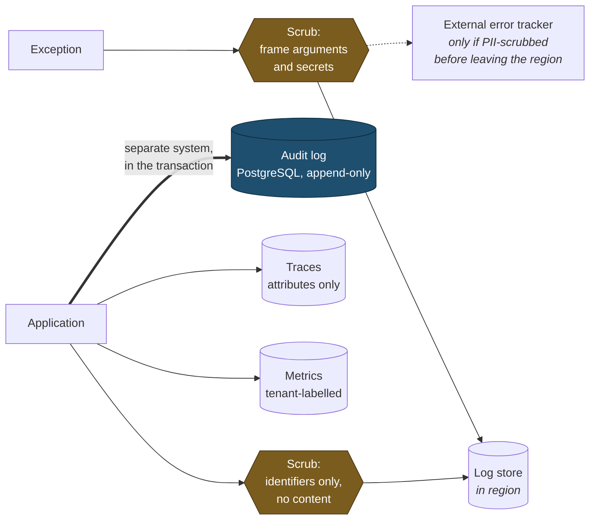

# Observability

> **Status:** Draft
> **Last reviewed:** 2026-08-13
> **Derives from:** [Threat Model](../50-security-compliance/threat-model.md), Business Plan §I

Observability in a health platform has an unusual constraint: **the thing you most want to log is the thing you least may log.** A telemetry system full of patient data is a second, less-protected copy of the medical record — and one that tends to be shipped to third parties, retained loosely, and read by whoever has a dashboard.

The discipline is to make the system diagnosable from identifiers and outcomes rather than from content.

## The logging rule

> **Never log clinical content, personal identifiers, or secrets.**

Log **identifiers and outcomes**. `patient_id` is fine; a patient's name is not. `prescription_id` is fine; the medicine is not.

| Never | Instead |
|---|---|
| Patient name, phone, address, NIN | `patient_id` (ULID) |
| Diagnosis, notes, medicine names | `consultation_id`, `prescription_id` |
| Aggregator keys, webhook secrets, tokens | `[redacted]` |
| Full request bodies on clinical endpoints | Field names and validation outcomes |
| Card data of any kind | Never reaches us at all |

**Exception traces are the usual leak.** A Laravel exception carries the arguments of every frame, which on a payment call includes decrypted credentials and on a clinical call includes patient data. Configure the handler to scrub argument values before serialisation, and treat any stack trace reaching an external error tracker as PII-bearing until proven otherwise.

The scrub points, and where the region boundary sits:



The thick arrow marks the distinction drawn below: a log line may be lost without consequence, an audit event may not.

`APP_DEBUG=false` in production, always ([Environments](environments-and-deployment.md)).

## Structured logging

JSON, one event per line, with a consistent context envelope:

```json
{
  "timestamp": "2026-08-13T09:14:22Z",
  "level": "info",
  "message": "payment_intent.resolved",
  "tenant_id": "01J...",
  "request_id": "01J...",
  "actor_id": "01J...",
  "actor_role": "patient",
  "subject_type": "PaymentIntent",
  "subject_id": "01J...",
  "outcome": "succeeded",
  "duration_ms": 412
}
```

**Every log line carries `tenant_id`.** Without it, diagnosing one clinic's problem means reading every clinic's logs — which is both impractical and an access-control failure.

`request_id` propagates from the edge through to queued jobs, so a notification failure can be traced to the booking that caused it.

Retention is short, in region ([Data Residency](data-residency-and-hosting.md)), and access is restricted and itself audited.

## Logs vs the audit trail

Two different systems, and conflating them is a mistake worth avoiding explicitly.

| | Application logs | [Audit log](../50-security-compliance/audit-logging.md) |
|---|---|---|
| Purpose | Diagnosis | Compliance evidence |
| Storage | Log store | PostgreSQL, append-only |
| Retention | Short | Long, per policy |
| Mutable | Rotated, deleted | **Never** |
| Content | Technical | Who did what to what, when |

An audit event is a *domain* fact and is written in the transaction. A log line is a technical observation and may be lost without consequence.

## Metrics

**Golden signals** per surface: request rate, error rate, latency percentiles, saturation.

**Business metrics that indicate health**, because in this product the meaningful failures are business-shaped rather than technical:

| Metric | Why it matters |
|---|---|
| Payment intents stuck `pending` beyond the window | A patient who does not know whether they paid. §H5's core failure mode |
| Payment intents `timed_out` awaiting reconciliation | The poll backstop is not working |
| Webhook receipt lag and failure rate | Missed webhooks are ordinary here; a rising rate means reconciliation is carrying load it should not |
| Consultations ending `technical_failure` | Our video is failing real patients |
| Mode step-downs to voice or chat | Honest signal of what patients actually experience |
| Queue depth and oldest job age, per queue | A stalled `critical` queue means payment outcomes and staff invitations are not moving, and somebody is waiting at a screen for each |
| SMS delivery failure rate per tenant | Notifications silently not arriving |
| Dispense orders held in `awaiting_substitution` | Clinicians not responding; patients waiting |
| Failed sign-ins per tenant | Credential stuffing |
| **Reverb channel authorisation failures** | A security signal, not just an error. A cross-tenant subscription attempt means a bug or an attack |
| Reverb concurrent connections and reconnection rate | Capacity, and whether clients are flapping |
| Broadcast lag — event emitted to frame delivered | A queue watched by a waiting pharmacist |
| **Break-glass grants** | Should be near zero. A rising count means broken support tooling |

All tenant-labelled, so a single clinic's degradation is visible rather than averaged away — with 33 clinics, one clinic being completely broken barely moves a global error rate.

## Tracing

Distributed tracing across the API, queue workers and external calls. Trace IDs propagate into job payloads.

Span attributes carry identifiers only, never content — the same rule as logging, and easier to breach because tracing libraries capture parameters enthusiastically by default.

## Alerting

Alert on **symptoms users feel**, not on causes. High CPU is not an incident; patients unable to pay is.

| Severity | Example | Response |
|---|---|---|
| **Critical** | API down; database unreachable; payments failing platform-wide; suspected cross-tenant exposure | Immediate, any hour |
| **High** | One tenant's payments failing; queue backed up beyond threshold; webhook processing stopped | Within the hour, clinic hours |
| **Medium** | Elevated video failures; SMS delivery degraded; aggregator credentials expiring | Same day |
| **Low** | Certificate expiring; disk trending; dependency advisory | Next working day |

**These are alert severities — one of three scales in use**, distinct from support ticket severities (`S1…S4`) and security incident severities (`SEV-1…4`). The reconciliation table is in [Incident Response](../50-security-compliance/incident-response.md).

**Suspected cross-tenant data exposure is always critical**, regardless of scale, and **escalates out of this scale entirely** into [Incident Response](../50-security-compliance/incident-response.md) as a SEV-1. One record is a notifiable breach affecting two controllers.

Alerts route to a single on-call — realistically the founder for some time (§M) — which is a strong argument for keeping them few and meaningful. An alerting system that cries wolf gets muted, and then the real one is missed.

## Health checks

- `/health/live` — the process is running.
- `/health/ready` — database, Redis and storage reachable.
- **`/health/isolation`** — asserts the application role cannot bypass RLS and does not own the tables. This is a *security* health check, run at boot and periodically, because the failure it detects is silent and total ([Multi-Tenancy](multi-tenancy.md)).

Health endpoints reveal nothing about tenants and are not publicly exposed beyond the liveness check.

## Uptime and status

External uptime monitoring of the patient booking path — the surface whose failure the clinic hears about from patients before hearing about it from us.

A public status page, since a clinic owner deserves to know whether the problem is ours before telephoning ([Support & SLA](../60-operations/support-and-sla.md)).

## Acceptance criteria

1. No log line contains patient names, contact details, clinical content or secrets. Covered by a test asserting against a prohibited-pattern list on representative flows.
2. Exception traces are scrubbed of argument values before leaving the application.
3. Every log line and span carries `tenant_id` and `request_id`.
4. `request_id` propagates into queued jobs.
5. Metrics are tenant-labelled.
6. `/health/isolation` fails if the application role can bypass RLS.
7. Suspected cross-tenant exposure pages immediately at critical severity.
8. Telemetry is stored in region, or PII-scrubbed before leaving it.
