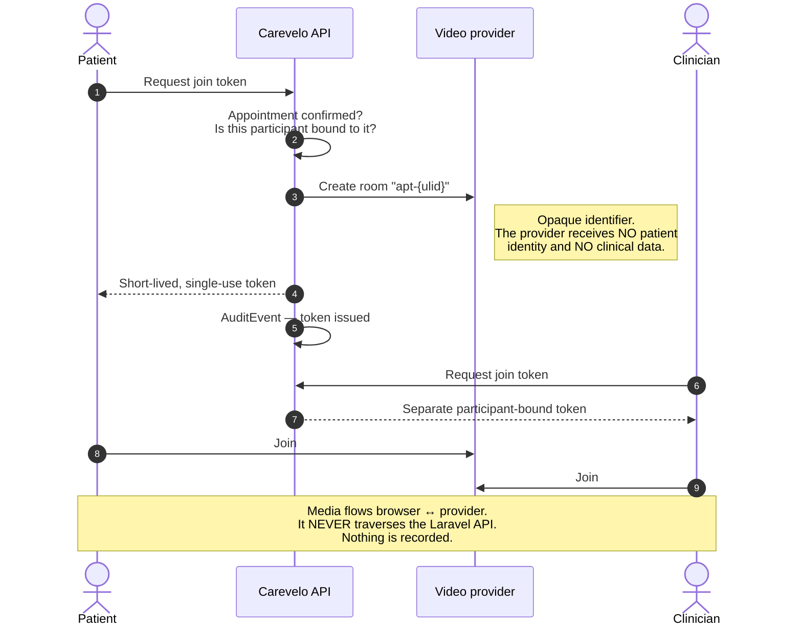
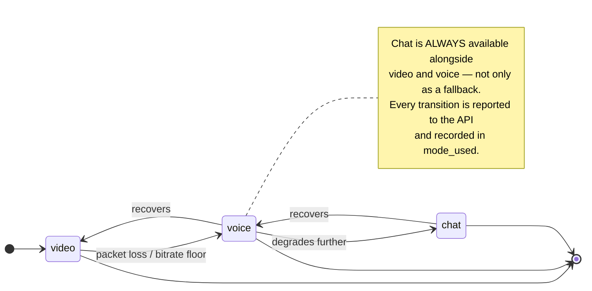

# Realtime & Video

> **Status:** Draft — open decision
> **Last reviewed:** 2026-08-13
> **Derives from:** Business Plan §H3, §I; [ADR-0004](../70-decisions/0004-video-provider-selection.md)

How a consultation actually travels between a clinician and a patient on a Ugandan mobile connection. This is a genuinely open decision, recorded here with the evidence needed to close it.

## Requirements

1. **Video, voice and chat, with voice and chat as first-class modes** — not degraded fallbacks. A patient on 3G in the rain should be able to *choose* voice deliberately ([H3](../10-product/prd-h3-teleconsultation.md)).
2. **Works on a mid-range Android phone in a browser, with no app install.**
3. **Graceful degradation** — video steps down to voice, voice to chat, with the step recorded truthfully in `mode_used`.
4. **No recording.** Consultation media is transient. Recording special-category data raises breach exposure and consent complexity for a benefit no clinic has asked for ([Non-Goals](../10-product/non-goals.md)).
5. **Media does not traverse the Laravel API.** Only metadata — start, end, mode used — is persisted.
6. **Data residency pressure.** DPPA 2019 restricts cross-border transfer without adequate safeguards (§I). Media is health data by context: the fact of a consultation, the participants' faces and voices.
7. Predictable cost. §M makes clinic willingness-to-pay the binding constraint; a per-minute cost that scales with success and cannot be passed on is dangerous.

## Options

### A. Self-hosted Jitsi Meet / JVB

**For:** media stays in our chosen region, so residency is fully controlled. No per-minute cost — the marginal consultation is free, which matters enormously at UGX 150,000/month pricing. Open source, mature, browser-based with no install. Configurable down to audio-only.

**Against:** we operate real-time media infrastructure. TURN servers, bandwidth, scaling, and debugging one clinician's failing call at 9am — with no operations engineer. §M identifies founder capacity as a top-three risk and this option spends it directly. Quality on poor networks depends on our own tuning, which is specialised work.

### B. Managed provider — Daily, Agora, Twilio, Vonage

**For:** reliability on poor networks is their core competence and they are measurably better at it than a first-time self-hosted deployment. Adaptive bitrate, global TURN, no operational burden. Time to first working consultation is days rather than weeks.

**Against:** per-minute cost that grows with success and is hard to pass through at our price point. Media traverses infrastructure outside Uganda — a cross-border transfer requiring safeguards, a data-processing agreement, and disclosure in the privacy notice. It is also a dependency we cannot fix when it breaks.

### C. Hybrid — managed now, self-hosted later

Start managed to reach a working consultation quickly during Phase 1, behind an internal `ConsultationTransport` interface. Move to self-hosted if per-minute cost becomes material or if regulation hardens on residency.

## Recommendation

**Option C, starting managed**, subject to two conditions:

1. A signed data-processing agreement with the provider, with the cross-border transfer disclosed in the patient consent text ([H2](../10-product/prd-h2-patient-registration-consent.md)).
2. Provider selected with an African or nearest-available region and demonstrable performance on East African mobile networks — tested, not assumed.

The reasoning is Phase 1's actual risk. The binding constraint is proving clinics will pay (§M), not achieving perfect residency for transient media that is never stored. Spending scarce founder weeks on media infrastructure before a single clinic has paid is the wrong trade. Media is transient and unrecorded, which materially limits the residency exposure — there is no store of consultation recordings to breach, only ephemeral streams.

**Revisit when** monthly media cost exceeds roughly 10% of MRR, or when MoH telemedicine regulations impose residency requirements on consultation media (§J.4). Both are foreseeable and both are watched.

Recorded, with the trigger, in [ADR-0004](../70-decisions/0004-video-provider-selection.md).

## Session brokering

Whichever provider: the API issues a **short-lived, single-use join token** scoped to one appointment and one participant.

The final note is why the residency exposure here is limited: there is no store of consultation media to breach, only ephemeral streams.

- Issued only after the appointment reaches `confirmed`.
- Bound to the participant — the patient of that appointment, or the assigned clinician.
- Expires shortly after the scheduled slot.
- Never guessable, never reusable, never shareable in a way that admits a third party.
- Issuance and use both write an `AuditEvent`.

The provider never receives clinical data. A room identifier is opaque and reveals nothing about the patient or the reason for the consultation — an identifier like `apt-{ulid}` and nothing more.

## Degradation

Client-side monitoring of packet loss and bitrate triggers the step-down, the user is **told what happened**, and the transition is reported to the API. A frozen frame with no explanation is worse than an honest downgrade — the patient assumes the product is broken and the clinic hears about it.

Chat is always available alongside video and voice, as a fallback and for sharing text that is awkward spoken aloud. Chat messages within a consultation are clinical data, stored in-tenant, subject to RLS, and never sent by SMS.

## Non-media realtime

Separate concern, and much simpler: the pharmacy queue, the dispatch board and delivery status need live updates.

**Laravel Reverb** (first-party WebSockets) with per-tenant, per-role private channels. Channel authorisation runs through the same policies as the REST API — a channel name is not a permission, and subscribing must be authorised exactly as reading would be.

Polling is an acceptable fallback for low-frequency views. Do not build WebSocket infrastructure for a board that changes twice an hour.

## Acceptance criteria

1. Join tokens are short-lived, single-use, participant-bound and appointment-scoped.
2. No consultation media is recorded or persisted.
3. Media does not traverse the Laravel API.
4. Mode degradation is recorded in `mode_used` and surfaced to both participants.
5. A consultation completes on a throttled 3G profile.
6. The provider receives no clinical data and no patient identifiers.
7. Realtime channels are authorised by the same policies as the REST API.
8. Any cross-border media transfer is disclosed in the consent text and covered by a data-processing agreement.
