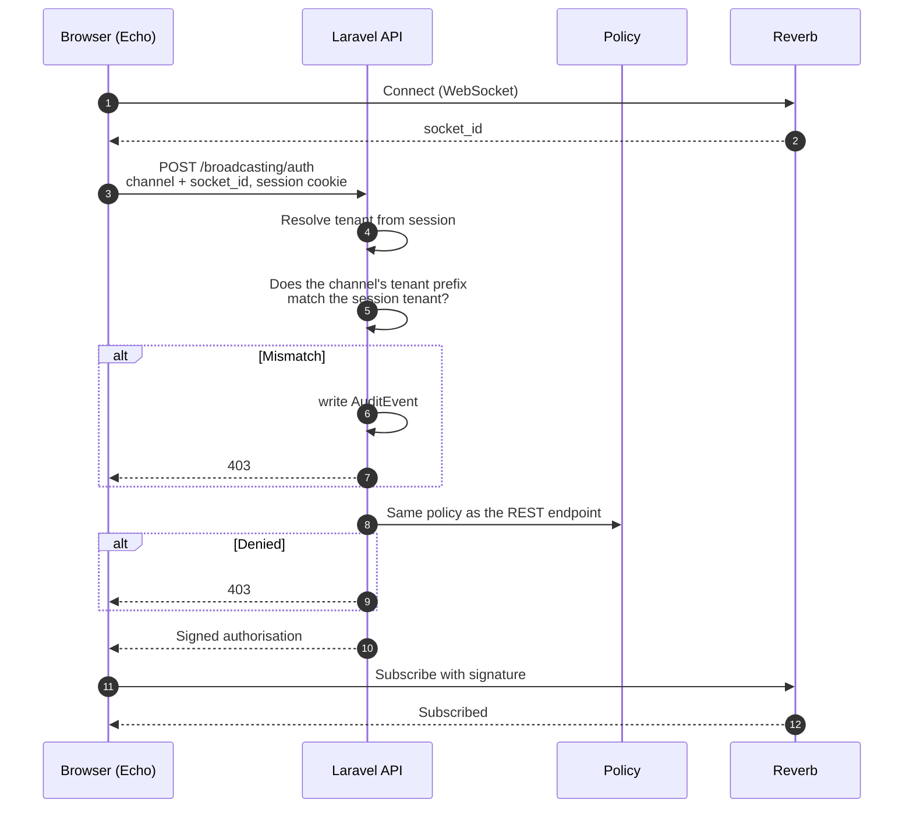
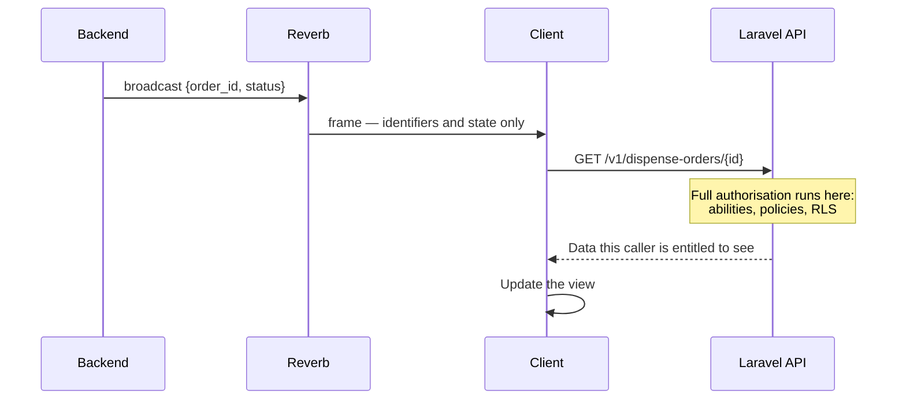
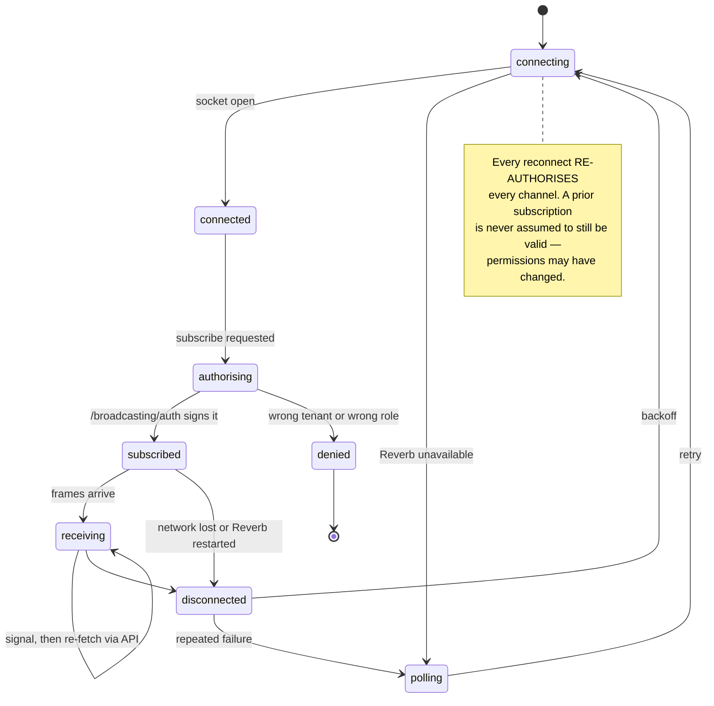

# Realtime Broadcasting — Laravel Reverb

> **Status:** Draft
> **Last reviewed:** 2026-08-13
> **Derives from:** [ADR-0008](../70-decisions/0008-laravel-reverb-for-realtime.md); Business Plan §H4, §I

Application state pushed to open screens: the pharmacy queue, the dispatch board, delivery status, in-app notifications.

**This is not consultation media.** Video and voice are a separate concern with an open provider decision — see [Realtime & Video](realtime-and-video.md) and [ADR-0004](../70-decisions/0004-video-provider-selection.md). Nothing in this document touches consultation media, and Reverb never carries it.

## Why Reverb

Self-hosted, so **frames stay in region**. Realtime traffic carries tenant identifiers, patient identifiers and order references; routing that continuously through a hosted provider outside Uganda would be a cross-border transfer of personal data for a benefit we can obtain locally ([Data Residency](data-residency-and-hosting.md), §I). No per-message cost. And because it is first-party Laravel broadcasting, **channel authorisation runs through the same policies as the REST API** rather than a parallel permission system that can drift.

Full reasoning in [ADR-0008](../70-decisions/0008-laravel-reverb-for-realtime.md).

## The four rules

Everything below follows from these. They are stated together because each is individually easy to breach and collectively they are what make a persistent socket into a health system safe.

| # | Rule |
|---|---|
| 1 | **Every channel is private and tenant-prefixed.** A channel name without a tenant prefix is a cross-tenant leak, delivered live |
| 2 | **Authorisation runs the same policies as the REST API.** A channel name is not a permission |
| 3 | **Payloads carry identifiers and state only — never clinical content** |
| 4 | **A broadcast is a hint to refresh, never authoritative.** The client re-fetches through the authorised API |

## Channel taxonomy

All private. All tenant-prefixed. No exceptions.

| Channel | Subscribers | Carries |
|---|---|---|
| `private-tenant.{tenantId}.pharmacy-queue` | `pharmacist`, `clinic_admin` | Order arrived, order state changed |
| `private-tenant.{tenantId}.dispatch-board` | `dispatcher`, `clinic_admin` | Delivery created, assigned, status changed |
| `private-tenant.{tenantId}.user.{userId}` | That user only | Personal notifications — substitution awaiting your approval |
| `private-tenant.{tenantId}.patient.{patientId}` | That patient only | Their own appointment, payment, order and delivery state |
| `private-tenant.{tenantId}.rider.{userId}` | That rider only | Their own assignments |
| `private-tenant.{tenantId}.consultation.{id}` | The consultation's clinician and patient | Session state — not media |

### The tenant prefix is mandatory

The same hazard as an unprefixed cache key ([Multi-Tenancy](multi-tenancy.md)), and worse in one respect: a cache leak requires someone to make a request, while a channel leak **pushes** another tenant's data to a subscriber unprompted.

```php
// yes — tenant-prefixed, private
Broadcast::channel('tenant.{tenantId}.pharmacy-queue', ...);

// NEVER — leaks across tenants the moment two clinics have a pharmacist online
Broadcast::channel('pharmacy-queue', ...);
```

Channel names are built through a helper that takes the resolved tenant from context and cannot produce an unprefixed name. **A manually concatenated channel name is a defect**, reviewable on sight.

## Authorisation

`backend/routes/channels.php`, delegating to the **same policies** used by the REST API ([RBAC Matrix](../50-security-compliance/rbac-matrix.md)):

```php
Broadcast::channel('tenant.{tenantId}.pharmacy-queue', function ($user, $tenantId) {
    return $user->tenant_id === $tenantId
        && $user->can('viewAny', DispenseOrder::class);
});
```

Two checks, and both are required. The tenant comparison catches a user of tenant A requesting tenant B's channel; the policy catches a user of the right tenant with the wrong role.



A **tenant-prefix mismatch is audited**, because like the session/host mismatch in [Auth](../40-api/authentication-and-sessions.md) it means either a bug or an attack, and both deserve a record.

Subscription authorisation is checked once, at subscribe time. **A role change or deactivation must therefore terminate the connection**, not merely invalidate the next request — sessions invalidating on role change ([Auth](../40-api/authentication-and-sessions.md)) includes disconnecting the socket.

## The payload rule

A WebSocket frame is a disclosure surface exactly as an SMS is ([Notifications](../10-product/notifications-sms-whatsapp.md)) — and in one way a sharper one, because a role channel fans out to every subscriber at once.

```json
{ "order_id": "01J8XK...", "reference": "RX-2608-0092", "status": "dispensed" }
```

```json
{ "order_id": "01J8XK...", "medicine": "Amoxicillin 500mg",
  "patient_name": "…", "diagnosis": "…" }
```

The first is correct. **The second must never exist** — not on a private channel, not on a single-user channel, not "because the pharmacist can see it anyway".

| Never in a payload | Instead |
|---|---|
| Diagnoses, notes, medicine names | `order_id`, `prescription_id` |
| Patient names, phone numbers, addresses | `patient_id` |
| Amounts and payment detail | `payment_intent_id`, `status` |
| Anything a rider must not see | Nothing — the rider channel carries only assignment identifiers |

## Broadcast then re-fetch

Rule 4, drawn. The socket says *something changed*; the API says *what it is now*, under authorisation.



Three things fall out of this that are worth stating.

**The API remains the single source of truth.** A dropped or duplicated frame degrades freshness, never correctness. This matters most for payment state — a client must never treat a broadcast as confirmation that a patient paid ([H5](../10-product/prd-h5-payments-non-custodial.md)).

**Authorisation is enforced on the re-fetch**, where abilities, policies and RLS all apply. The channel controls *who is told something changed*; the API controls *what they may see*.

**A missed frame is self-healing**, because any subsequent refresh reconciles.

## Event catalogue

Broadcasts originate from **domain events**, never from controllers — the same rule as any other cross-module reaction ([Backend](backend-laravel.md)).

| Domain event | Channel | Payload |
|---|---|---|
| `PrescriptionIssued` | pharmacy-queue | `dispense_order_id`, `reference` |
| `OrderDispensed` | pharmacy-queue, patient | `order_id`, `status` |
| `SubstitutionProposed` | user (the prescribing clinician) | `substitution_id`, `order_reference` |
| `SubstitutionApproved` / `Rejected` | pharmacy-queue | `substitution_id`, `status` |
| `DeliveryAssigned` | dispatch-board, rider | `delivery_id`, `reference` |
| `DeliveryDelivered` / `Failed` | dispatch-board, patient | `delivery_id`, `status` |
| `PaymentIntentSucceeded` / `Failed` | patient, user | `payment_intent_id`, `status` |
| `AppointmentBooked` / `Cancelled` | user (the clinician) | `appointment_id`, `reference` |

**Deliberately not broadcast:** consent decisions, clinical notes, audit events, anything touching aggregator credentials, and anything on a platform-wide channel — there is no such channel.

## Connection lifecycle

Worth reading alongside the failure section below — note that a reconnect **re-authorises**, it does not resume.



## Scaling and failure

Reverb with a Redis backend so multiple instances share connections. Capacity is planned on concurrent connections rather than message volume; a clinic contributes a handful of open consoles, so the numbers stay modest well past Phase 3 scale (§K).

**When Reverb is unavailable**, the client falls back to polling. The pharmacy queue refreshes on an interval instead of instantly; dispensing is never blocked. This is the same "degrade to something the clinic can still work with" pattern as an aggregator or video outage ([Integrations](integrations.md)).

Echo reconnects with backoff and **re-authorises every channel on reconnect** — it does not assume a prior subscription survives, because permissions may have changed while the socket was down.

## Frontend integration

Laravel Echo, wrapped in `frontend/packages/realtime` so no application imports Echo directly ([Frontend](frontend-nextjs.md)). The wrapper owns channel-name construction, so an app cannot build an unprefixed name.

Authentication is the **session cookie** against `/broadcasting/auth` — no separate token, and no credential in client-side storage ([Auth](../40-api/authentication-and-sessions.md)).

| Surface | Subscribes to |
|---|---|
| Patient portal | own patient channel |
| Clinic console — pharmacy | pharmacy-queue, own user channel |
| Clinic console — dispatch | dispatch-board, own user channel |
| Clinic console — clinician | own user channel |
| Rider view | own rider channel only |
| Platform admin | nothing tenant-scoped |

## What must not be realtime

Do not build WebSocket infrastructure for a board that changes twice an hour. Polling is correct for low-frequency views, and every channel is a permission surface, a test burden and a thing to monitor.

Reverb is justified where a person is **watching a screen waiting for something to arrive** — the pharmacy queue and the dispatch board. Everywhere else, start with polling and promote only on evidence.

## Deployment and monitoring

Reverb runs as a **supervised long-lived process** alongside the API, restarted on release ([Environments & Deployment](environments-and-deployment.md)). Metrics in [Observability](observability.md): concurrent connections, subscription authorisation failures (a security signal, not just an error), broadcast lag, and reconnection rate.

## Acceptance criteria

1. Every channel is private and tenant-prefixed; an unprefixed channel name cannot be constructed through the helper.
2. Channel authorisation checks **both** the tenant prefix against the session tenant **and** the same policy as the REST endpoint.
3. A tenant-prefix mismatch returns 403 and writes an `AuditEvent`.
4. No broadcast payload contains clinical content, patient names or contact details. Covered by a test asserting payload shapes against a prohibited-content list.
5. A rider can subscribe only to their own rider channel.
6. Clients re-fetch through the API after a frame; no view renders directly from payload content.
7. Payment state is never treated as confirmed on the basis of a broadcast.
8. Role change or deactivation terminates the socket, not only the next request.
9. Echo re-authorises every channel on reconnect.
10. Reverb being unavailable degrades to polling and never blocks a clinical or dispensing action.
11. Broadcasts originate from domain events, not controllers.
12. Reverb runs in region.
