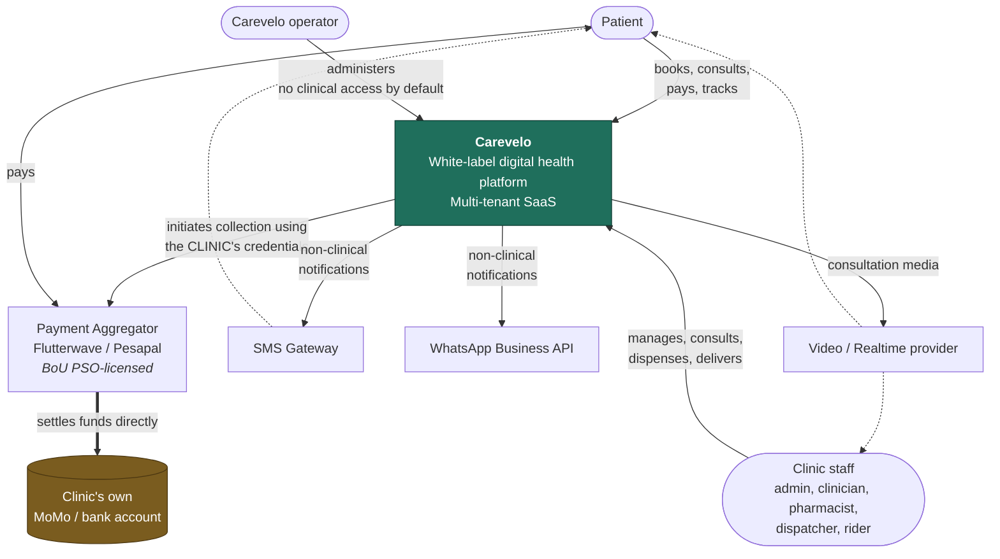
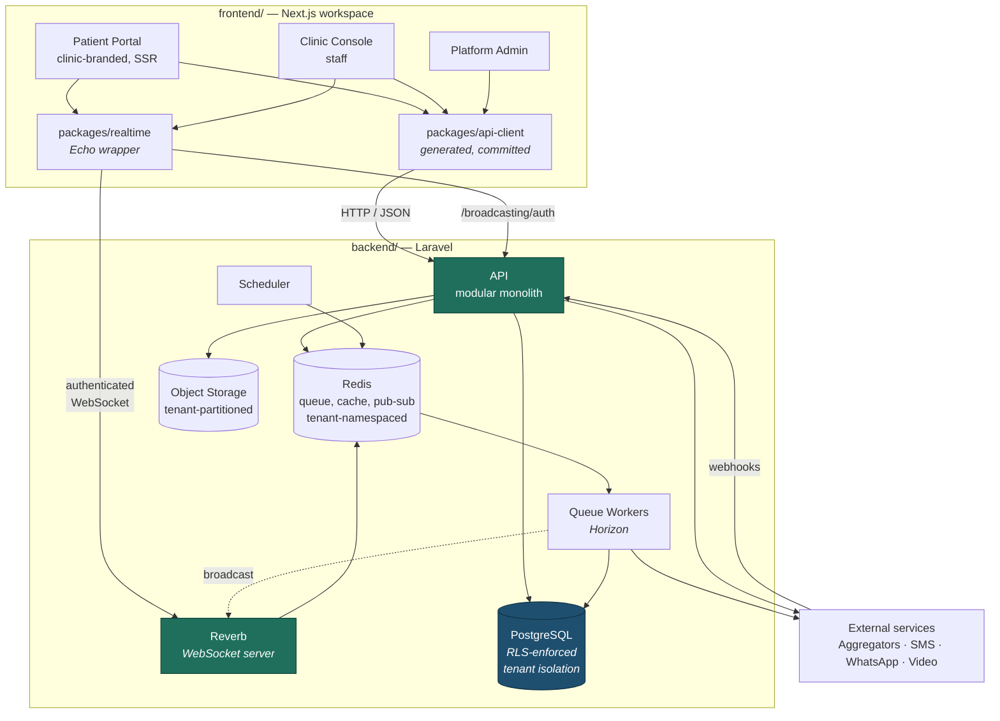
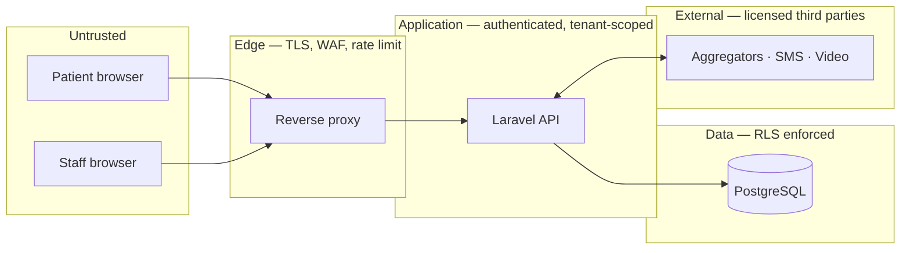
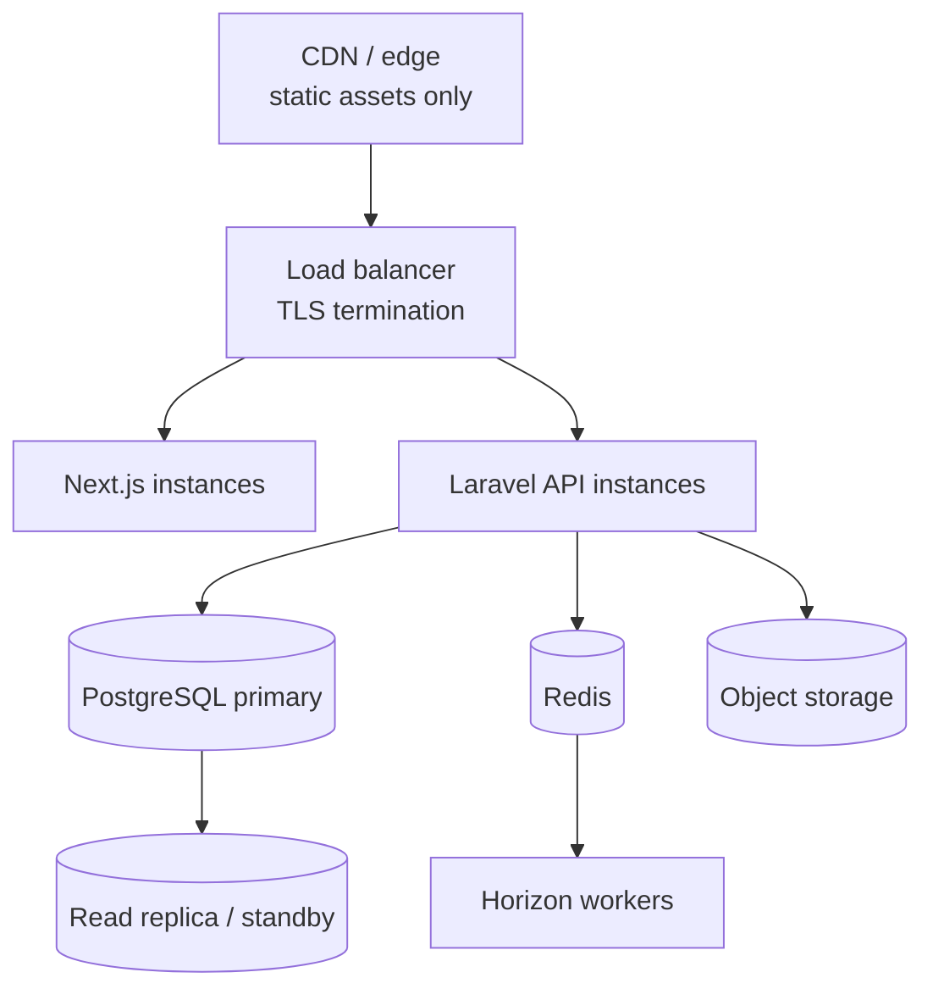

# System Context

> **Status:** Draft
> **Last reviewed:** 2026-08-13
> **Derives from:** Business Plan §H; [Personas & Actors](../00-overview/personas-and-actors.md)

C4 levels 1 and 2. Level 3 lives in [Backend](backend-laravel.md) and [Frontend](frontend-nextjs.md).

## Level 1 — System context

Two features of this diagram are the whole architecture:

**Money never enters the Carevelo box.** The heavy line runs aggregator → clinic account. Carevelo initiates a collection using the clinic's own credentials and then records what happened. See [Payments Regulatory Boundary](../50-security-compliance/payments-regulatory-boundary.md).

**Clinical data never leaves it except to the people treating the patient.** SMS and WhatsApp carry no clinical content ([Notifications](../10-product/notifications-sms-whatsapp.md)); video media is transient and unrecorded.

## Level 2 — Containers

Two deployables, `frontend/` and `backend/`, with the API and authenticated WebSocket frames as the **only** channels between them ([ADR-0007](../70-decisions/0007-separate-backend-frontend-trees.md)).

Note that `packages/realtime` authorises against the **API**, not against Reverb — channel authorisation runs the same policies as the REST endpoints, so there is no second permission system to drift ([Realtime Broadcasting](realtime-broadcasting.md)).

| Container | Tree | Technology | Responsibility |
|---|---|---|---|
| **Patient Portal** | `frontend/` | Next.js | Clinic-branded booking, consultation, prescriptions, payment, delivery tracking. Tenant resolved by subdomain |
| **Clinic Console** | `frontend/` | Next.js | Staff surfaces: schedule, consultations, pharmacy queue, dispatch, administration, reconciliation |
| **Platform Admin** | `frontend/` | Next.js | Tenant register, subscriptions, system health. No clinical data without break-glass |
| **api-client** | `frontend/` | Generated TypeScript | The API contract as code. Generated from `openapi.yaml`, committed |
| **realtime** | `frontend/` | Laravel Echo wrapper | Channel construction and subscription. No app imports Echo directly |
| **API** | `backend/` | Laravel 13, PHP 8.3+ | All business logic. Modular monolith ([ADR-0005](../70-decisions/0005-modular-monolith-over-microservices.md)) |
| **Reverb** | `backend/` | Laravel Reverb | WebSocket server. Self-hosted **in region** ([ADR-0008](../70-decisions/0008-laravel-reverb-for-realtime.md)) |
| **Queue Workers** | `backend/` | Laravel Horizon | Notifications, PDF rendering, reconciliation polls, webhook processing. Every job restores tenant context |
| **Scheduler** | `backend/` | Laravel | Reminders, reconciliation sweeps, retention jobs |
| **PostgreSQL** | `backend/` | 16+ | Single database, shared schema, RLS-enforced isolation ([Multi-Tenancy](multi-tenancy.md)) |
| **Redis** | `backend/` | 7+ | Queue backend, cache, rate limiting, Reverb pub/sub. Keys namespaced per tenant |
| **Object Storage** | `backend/` | S3-compatible | Prescription PDFs, logos, attachments. Tenant-partitioned, signed URLs only |

Deliberately simple: one API, one database, one queue. A solo or two-person team cannot operate a distributed system, and §M identifies founder capacity as a top-three risk — the architecture is a response to that constraint as much as to the technical requirements.

## Trust boundaries

| Boundary | Control |
|---|---|
| Internet → Edge | TLS 1.2+, HSTS, rate limiting, WAF |
| Edge → API | Authentication (Sanctum), tenant resolution, authorisation ([Auth](../40-api/authentication-and-sessions.md)) |
| API → Database | **RLS.** The application role is subject to it and cannot bypass it |
| API ↔ External | Per-tenant credentials, signature-verified webhooks, outbound allow-list |
| Operator → Tenant data | Break-glass only: time-boxed, audited, tenant-notified |

Full analysis in [Threat Model](../50-security-compliance/threat-model.md).

## Data flows worth tracing

**Payment (H5).** Patient → API → aggregator *with the tenant's credentials* → aggregator pushes to the patient's handset → funds settle to the clinic → aggregator webhook → API records the outcome. A scheduled poll backstops the webhook. Carevelo is never in the funds path.

**Prescription (H3 → H4).** Clinician issues within a consultation → PDF rendered asynchronously to tenant-partitioned storage → `DispenseOrder` created in the same tenant → pharmacy queue → dispensing → optional delivery. The prescription is never mutated; the dispense order carries everything the pharmacy does.

**Notification.** Domain event → queued job restoring tenant context → template rendered with clinic branding → SMS gateway. **No clinical content crosses this boundary** ([Notifications](../10-product/notifications-sms-whatsapp.md)).

**Consultation media.** Browser ↔ video provider, peer-to-peer or relayed. Media does not traverse the Laravel API and is not recorded. Only metadata — start, end, mode used — is persisted ([Realtime & Video](realtime-and-video.md)).

## Deployment shape

Single region, Ugandan or African, for data residency (§I) — see [Data Residency](data-residency-and-hosting.md).

Details in [Environments & Deployment](environments-and-deployment.md); recovery objectives in [Disaster Recovery](disaster-recovery.md).
