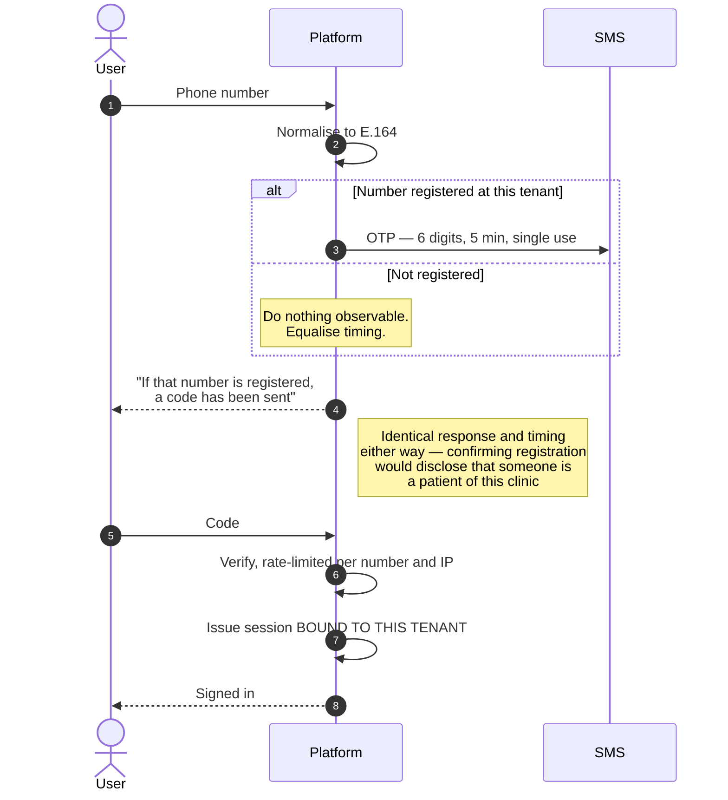
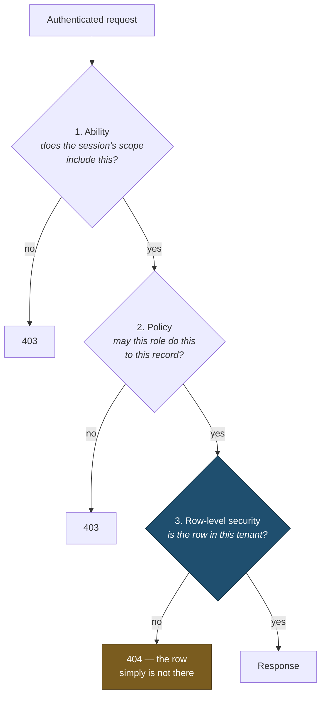

# Authentication & Sessions

> **Status:** Draft
> **Last reviewed:** 2026-08-13
> **Derives from:** [Multi-Tenancy](../30-architecture/multi-tenancy.md), [RBAC Matrix](../50-security-compliance/rbac-matrix.md)

Who you are, which tenant you are in, and what you may do. Three separate questions, resolved in that order, and never collapsed into one.

## Identity is a phone number

Primary credential is the phone number, not email. Most Ugandan clinic staff and nearly all patients have a working phone and no reliably-checked email address ([H1](../10-product/prd-h1-clinic-onboarding.md)). Email is optional everywhere.

Numbers are normalised to E.164 (`+256...`) on write ([Identifiers](../20-domain/identifiers-and-numbering.md)) — Ugandan numbers are written half a dozen ways and normalising once at the boundary removes an entire class of duplicate-account bugs.

Uniqueness is `(tenant_id, phone)`. **The same person at two clinics is two accounts**, which follows directly from tenant isolation.

## Mechanisms

| Actor | Mechanism | Rationale |
|---|---|---|
| Patient | Sanctum cookie session, HTTP-only, SameSite=Lax, Secure | Browser-based; no token for a shared device to leak |
| Clinic staff | Sanctum cookie session | Same origin, same protections |
| Rider | Sanctum session, most restricted scope | Least-trusted human actor |
| Platform operator | Session + **mandatory second factor** | Cross-tenant reach demands it |
| Aggregator webhook | **Signature verification, not authentication** | See [Webhooks](webhooks.md) |

Sanctum's cookie mode over bearer tokens in local storage: a token in local storage is readable by any script that gets a foothold, and on a page rendering special-category health data that is not a risk worth taking for a convenience the first-party clients do not need.

## Sign-in

The branch that matters is the one where the number is unknown — it must be indistinguishable from a wrong password.

1. Phone number entered.
2. Password, if set, **or** OTP.
3. OTP delivered by SMS — six digits, five-minute expiry, single use, rate-limited per number and per IP.
4. Session issued, bound to the resolved tenant.

**Enumeration:** the response to "this number is not registered" and "this password is wrong" is identical, and the timing is equalised. In a health application, confirming that a number is registered at a specific clinic discloses that the person is a patient there — which is itself health-adjacent information.

Patients may use OTP alone. Requiring a password from a patient who consults twice a year produces forgotten passwords and abandoned care.

## Second factor

Mandatory for platform operators. Available and recommended for `clinic_admin`, since that role can change aggregator credentials — the highest-value target in a tenant ([Threat Model](../50-security-compliance/threat-model.md)).

TOTP where the actor can manage it; SMS OTP as the practical fallback, acknowledging that SMS as a second factor is weak against SIM swap. For a platform operator, TOTP is required rather than offered.

## Sessions

| Actor | Idle timeout | Absolute lifetime |
|---|---|---|
| Patient | 30 minutes | 7 days |
| Clinic staff | 20 minutes | 12 hours |
| Rider | 12 hours | 24 hours |
| Platform operator | 15 minutes | 8 hours |

**Staff idle timeout is shorter than the patient's, deliberately.** A patient is on their own phone; a front-desk terminal is a shared machine in a public part of a small clinic, left logged in while someone answers the door. The idle timeout is the only control that addresses it, and the mild inconvenience of re-authenticating is the price.

The rider's long idle timeout is a deliberate trade — a rider on a delivery round must not be signed out mid-round — compensated by the narrowest scope in the system.

Sessions are invalidated on password change, role change, deactivation, and tenant suspension. A revoked role must not survive in an active session.

## Tenant binding

Every session is bound to exactly one tenant, resolved at sign-in.

**A session's tenant is checked against the host on every request.** A mismatch is a hard 403 and an `AuditEvent` — it means a bug or an attack, and both deserve a record ([Multi-Tenancy](../30-architecture/multi-tenancy.md)).

There is no tenant switching. A person working at two clinics signs out and signs in.

## Authorisation

Three layers, each of which can independently deny. Only the last one is the control:

Layers 1 and 2 produce good error messages and enforce intra-tenant rules the database cannot express. **Layer 3 is what holds when layers 1 and 2 have a bug** — and note that it yields a 404 rather than a 403, because a 403 would confirm the record exists.

The layers in detail:

1. **Ability** — the token's scope. A rider's session carries only delivery abilities.
2. **Policy** — Laravel policies per resource: may this actor, in this role, perform this action on this record ([RBAC Matrix](../50-security-compliance/rbac-matrix.md)).
3. **RLS** — the database returns nothing outside the tenant, regardless of what layers 1 and 2 concluded ([Multi-Tenancy](../30-architecture/multi-tenancy.md)).

Layer 3 is the control; layers 1 and 2 produce good error messages and enforce intra-tenant rules that the database cannot express.

### Realtime channel authorisation

Reverb subscriptions authorise against **`POST /broadcasting/auth` on the API**, using the same session cookie — no separate token, nothing in client storage.

That endpoint performs **two** checks before signing an authorisation:

1. The channel's tenant prefix matches the session's tenant. A mismatch is a hard 403 **and an `AuditEvent`**, for the same reason a session/host mismatch is: it means a bug or an attack.
2. The **same policy** that governs the equivalent REST read. A channel name is not a permission.

Because authorisation is checked once at subscribe time rather than per frame, **role change and deactivation must terminate the socket**, not merely invalidate the next HTTP request. Session invalidation includes disconnecting live channels.

Full specification in [Realtime Broadcasting](../30-architecture/realtime-broadcasting.md).

## Patient access to their own records

A patient may read their own data within their tenant, and nothing else. Not another patient's, not the clinic's internal views, and not notes a clinician has marked private.

Access is via the session, never via a link containing a token that could be forwarded. **Prescription PDFs are served through short-lived signed URLs issued after an authorisation check** — never a public or guessable path ([Identifiers](../20-domain/identifiers-and-numbering.md)).

## Staff invitation

Invitations are single-use, tenant-bound, expiring links sent by SMS ([H1](../10-product/prd-h1-clinic-onboarding.md)). The invitee verifies by OTP and sets a password. The role is fixed at invitation and cannot be self-elevated.

## Break-glass

The only route by which a Carevelo operator reaches tenant clinical data ([Personas](../00-overview/personas-and-actors.md), [RBAC Matrix](../50-security-compliance/rbac-matrix.md)):

- Requires a recorded reason and a stated scope.
- Time-boxed and automatically revoked.
- **The tenant is notified** — the clinic is the controller and has a right to know when its processor read its records.
- Every access under the grant writes an `AuditEvent`.
- Grants are reviewed. A rising count means the support tooling is inadequate ([Observability](../30-architecture/observability.md)).

## Acceptance criteria

1. Sign-in responses do not reveal whether a phone number is registered, in content or in timing.
2. OTPs are six digits, five-minute expiry, single-use, rate-limited per number and per IP.
3. Every session is tenant-bound; a host mismatch returns 403 and writes an audit event.
4. No endpoint accepts a tenant identifier from the client.
5. Platform operators cannot authenticate without a second factor.
6. Sessions invalidate on role change, deactivation and tenant suspension.
7. A rider session cannot reach any endpoint outside its delivery scope.
8. Prescription PDFs are reachable only through short-lived signed URLs issued after authorisation.
9. Realtime subscriptions are authorised by the same policies as REST.
10. Break-glass grants are time-boxed, reason-recorded, tenant-notified and audited.
