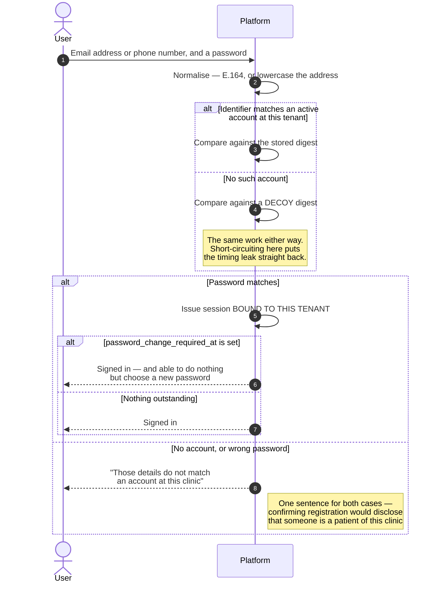
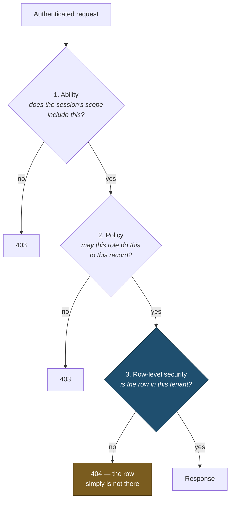

# Authentication & Sessions

> **Status:** Draft
> **Last reviewed:** 2026-08-13
> **Derives from:** [Multi-Tenancy](../30-architecture/multi-tenancy.md), [RBAC Matrix](../50-security-compliance/rbac-matrix.md)

Who you are, which tenant you are in, and what you may do. Three separate questions, resolved in that order, and never collapsed into one.

## Identity

**Staff are identified by a phone number, patients by an email address.** Sign-in accepts either, and exactly one per request.

Phone comes first for staff because most Ugandan clinic staff have a working phone and no reliably-checked email address ([H1](../10-product/prd-h1-clinic-onboarding.md)). Numbers are normalised to E.164 (`+256...`) on write ([Identifiers](../20-domain/identifiers-and-numbering.md)) — Ugandan numbers are written half a dozen ways and normalising once at the boundary removes an entire class of duplicate-account bugs.

A patient's account carries an email address and **no phone number at all**. Staff issue it from the patient's clinical record (§ Patient accounts are issued by clinic staff), and that record already holds the number the clinic rings. Copying the number onto the account would collide with the account of a patient who also works at the clinic, and with the documented practice of registering a patient against a next-of-kin number ([H2](../10-product/prd-h2-patient-registration-consent.md)). The account and the record are joined explicitly instead. The cost is stated plainly rather than hidden: **a patient with no email address gets no portal** ([ADR-0011](../70-decisions/0011-staff-issued-patient-accounts.md)).

Uniqueness is `(tenant_id, phone)` and `(tenant_id, email)`. **The same person at two clinics is two accounts**, which follows directly from tenant isolation.

## Mechanisms

| Actor | Mechanism | Rationale |
|---|---|---|
| Patient | Sanctum cookie session, HTTP-only, SameSite=Lax, Secure | Browser-based; no token for a shared device to leak |
| Clinic staff | Sanctum cookie session | Same origin, same protections |
| Rider | Sanctum session, most restricted scope | Least-trusted human actor |
| Platform operator | Session + **mandatory second factor** | Cross-tenant reach demands it |
| Aggregator webhook | **Signature verification, not authentication** | See [Webhooks](webhooks.md) |

Sanctum's cookie mode over bearer tokens in local storage: a token in local storage is readable by any script that gets a foothold, and on a page rendering special-category health data that is not a risk worth taking for a convenience the first-party clients do not need.

## Sign-in

One mechanism: an identifier and a password. The branch that matters is the one where the identifier is unknown — it must be indistinguishable from a wrong password.



1. Email address **or** phone number, and a password. Exactly one identifier; sending both is a confused client and is rejected as one.
2. The password is compared against the account at the resolved tenant — and against a decoy digest when there is no account, so both branches cost the same.
3. Rate-limited per identifier and per IP.
4. Session issued, bound to the resolved tenant.
5. If the account carries `password_change_required_at`, the session may do nothing until it is discharged (§ The first password).

**Enumeration:** the response to "this identifier is not registered" and "this password is wrong" is identical, and the timing is equalised. In a health application, confirming that a number is registered at a specific clinic discloses that the person is a patient there — which is itself health-adjacent information.

### Patient accounts are issued by clinic staff

A patient may fill in their own details on the clinic's portal, but **no patient creates their own account**, and **no code is sent to a handset anywhere in the product**. A `clinic_admin`, `front_desk` or `clinician` creates the account from the patient's own record:

```
POST /v1/patients/{patient}/account
```

- The staff member supplies an **email address**, which is the account's only identifier.
- **The platform generates the initial password** and returns it exactly once, in that response, for the staff member to hand over. It is never stored in the clear, never logged, never placed in audit metadata, and never sent by SMS — an SMS carrying a credential is the message shape this product deliberately no longer has.
- The same call writes `patients.user_id` for the record **named in the URL**. The link is an explicit, record-scoped act by a named staff member, not an inference from a matching phone number ([ADR-0011](../70-decisions/0011-staff-issued-patient-accounts.md)).
- `phone` and `phone_verified_at` stay **null**. A desk visit proves that a person was present and that a staff member vouched for them; it proves nothing about a handset, and `phone_verified_at` is surfaced to clinic administrators precisely so they can tell a verified number from one typed at a front desk.
- `password_change_required_at` is set, and the act writes a `patient.account_created` audit event naming the staff member and the record.

The trust basis is **in-person identification by clinic staff**, which is a different claim from possession of a handset rather than a weaker version of the same one. H2's exception paths already sanction it — "front desk may verify identity in person and attest, as an audited action" — and [ADR-0011](../70-decisions/0011-staff-issued-patient-accounts.md) states what each basis proves and what each risks.

### The first password

An account issued this way has a password its issuer knows. `password_change_required_at` bounds that window: while it is set, **middleware refuses every authenticated request** except

- `GET /v1/me`
- `POST /v1/me/password`
- `POST /v1/auth/sign-out`

`POST /v1/me/password` is unchanged and still requires `current_password`. The patient has it — a staff member read it to them — and relaxing the only password endpoint to accommodate a first sign-in would leave a permanently weaker one for everybody. Discharging the requirement clears the column and, as every password change does, ends every other session.

## Second factor

Mandatory for platform operators. Available and recommended for `clinic_admin`, since that role can change aggregator credentials — the highest-value target in a tenant ([Threat Model](../50-security-compliance/threat-model.md)).

**TOTP, and only TOTP.** There is no SMS fallback, because the platform sends no codes at all ([ADR-0011](../70-decisions/0011-staff-issued-patient-accounts.md)) — which also removes SIM swap as a way past a second factor. An operator who loses their authenticator is recovered out of band, as a recorded administrative action rather than by a message to a handset. For a platform operator, TOTP is required rather than offered.

**Patients have no second factor.** That is an accepted risk, stated as one in the [Threat Model](../50-security-compliance/threat-model.md), not an omission.

## Sessions

| Actor | Idle timeout | Absolute lifetime |
|---|---|---|
| Patient | 30 minutes | 7 days |
| Clinic staff | 20 minutes | 12 hours |
| Rider | 12 hours | 24 hours |
| Platform operator | 15 minutes | 8 hours |

**Staff idle timeout is shorter than the patient's, deliberately.** A patient is on their own phone; a front-desk terminal is a shared machine in a public part of a small clinic, left logged in while someone answers the door. The idle timeout is the only control that addresses it, and the mild inconvenience of re-authenticating is the price.

The rider's long idle timeout is a deliberate trade — a rider on a delivery round must not be signed out mid-round — compensated by the narrowest scope in the system.

Sessions are invalidated on password change, role change, deactivation, and tenant suspension. A revoked role must not survive in an active session.

## Tenant binding

Every session is bound to exactly one tenant, resolved at sign-in.

**A session's tenant is checked against the host on every request.** A mismatch is a hard 403 and an `AuditEvent` — it means a bug or an attack, and both deserve a record ([Multi-Tenancy](../30-architecture/multi-tenancy.md)).

There is no tenant switching. A person working at two clinics signs out and signs in.

## Authorisation

Three layers, each of which can independently deny. Only the last one is the control:



Layers 1 and 2 produce good error messages and enforce intra-tenant rules the database cannot express. **Layer 3 is what holds when layers 1 and 2 have a bug** — and note that it yields a 404 rather than a 403, because a 403 would confirm the record exists.

The layers in detail:

1. **Ability** — the token's scope. A rider's session carries only delivery abilities.
2. **Policy** — Laravel policies per resource: may this actor, in this role, perform this action on this record ([RBAC Matrix](../50-security-compliance/rbac-matrix.md)).
3. **RLS** — the database returns nothing outside the tenant, regardless of what layers 1 and 2 concluded ([Multi-Tenancy](../30-architecture/multi-tenancy.md)).

Layer 3 is the control; layers 1 and 2 produce good error messages and enforce intra-tenant rules that the database cannot express.

### Realtime channel authorisation

Reverb subscriptions authorise against **`POST /broadcasting/auth` on the API**, using the same session cookie — no separate token, nothing in client storage.

That endpoint performs **two** checks before signing an authorisation:

1. The channel's tenant prefix matches the session's tenant. A mismatch is a hard 403 **and an `AuditEvent`**, for the same reason a session/host mismatch is: it means a bug or an attack.
2. The **same policy** that governs the equivalent REST read. A channel name is not a permission.

Because authorisation is checked once at subscribe time rather than per frame, **role change and deactivation must terminate the socket**, not merely invalidate the next HTTP request. Session invalidation includes disconnecting live channels.

Full specification in [Realtime Broadcasting](../30-architecture/realtime-broadcasting.md).

## Patient access to their own records

A patient may read their own data within their tenant, and nothing else. Not another patient's, not the clinic's internal views, and not notes a clinician has marked private.

"Their own" is answerable only because `patients.user_id` was written by a member of staff naming that record (§ Patient accounts are issued by clinic staff, [ADR-0010](../70-decisions/0010-patient-account-link.md)). An account with no linked record sees an empty portal rather than someone else's.

Access is via the session, never via a link containing a token that could be forwarded. **Prescription PDFs are served through short-lived signed URLs issued after an authorisation check** — never a public or guessable path ([Identifiers](../20-domain/identifiers-and-numbering.md)).

## Staff invitation

Invitations are single-use, tenant-bound, expiring links sent by SMS ([H1](../10-product/prd-h1-clinic-onboarding.md)). **Possession of the token is the proof** — it arrived at the invited number, so accepting the invitation is what sets `phone_verified_at` on the new staff account. The invitee chooses their own password at acceptance, so no colleague ever knows it. The role is fixed at invitation and cannot be self-elevated.

## Break-glass

The only route by which a Carevelo operator reaches tenant clinical data ([Personas](../00-overview/personas-and-actors.md), [RBAC Matrix](../50-security-compliance/rbac-matrix.md)):

- Requires a recorded reason and a stated scope.
- Time-boxed and automatically revoked.
- **The tenant is notified** — the clinic is the controller and has a right to know when its processor read its records.
- Every access under the grant writes an `AuditEvent`.
- Grants are reviewed. A rising count means the support tooling is inadequate ([Observability](../30-architecture/observability.md)).

## Acceptance criteria

1. Sign-in responses do not reveal whether an identifier is registered, in content or in timing.
2. A patient account can be created only from an existing patient record, only by `clinic_admin`, `front_desk` or `clinician`, and the same call links `patients.user_id` for the record named in the URL.
3. Every session is tenant-bound; a host mismatch returns 403 and writes an audit event.
4. No endpoint accepts a tenant identifier from the client.
5. Platform operators cannot authenticate without a second factor.
6. Sessions invalidate on role change, deactivation and tenant suspension.
7. A rider session cannot reach any endpoint outside its delivery scope.
8. Prescription PDFs are reachable only through short-lived signed URLs issued after authorisation.
9. Realtime subscriptions are authorised by the same policies as REST.
10. Break-glass grants are time-boxed, reason-recorded, tenant-notified and audited.
11. A staff-issued patient account leaves `phone` and `phone_verified_at` null, and its initial password is server-generated, returned exactly once, and absent from logs, audit metadata and every notification template.
12. While `password_change_required_at` is set, every authenticated request outside `GET /v1/me`, `POST /v1/me/password` and `POST /v1/auth/sign-out` is refused.
13. `patient.account_created` names the staff member who issued the account and the patient record it links.
