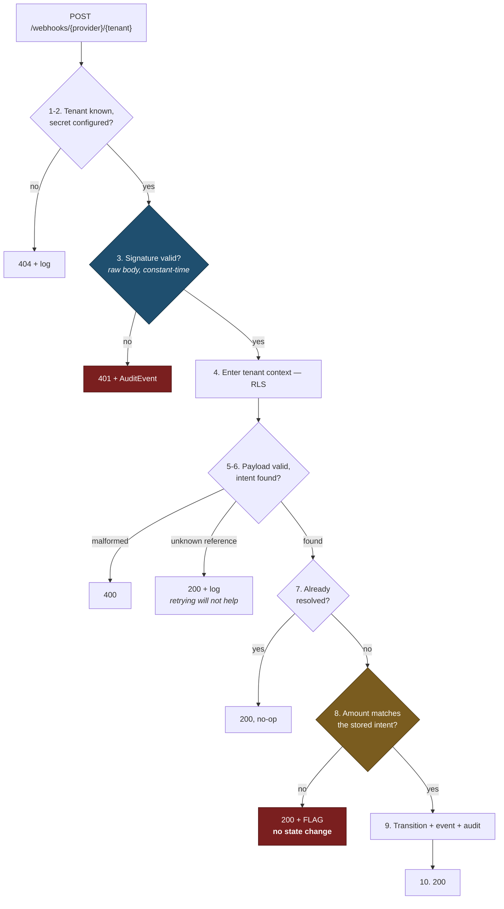
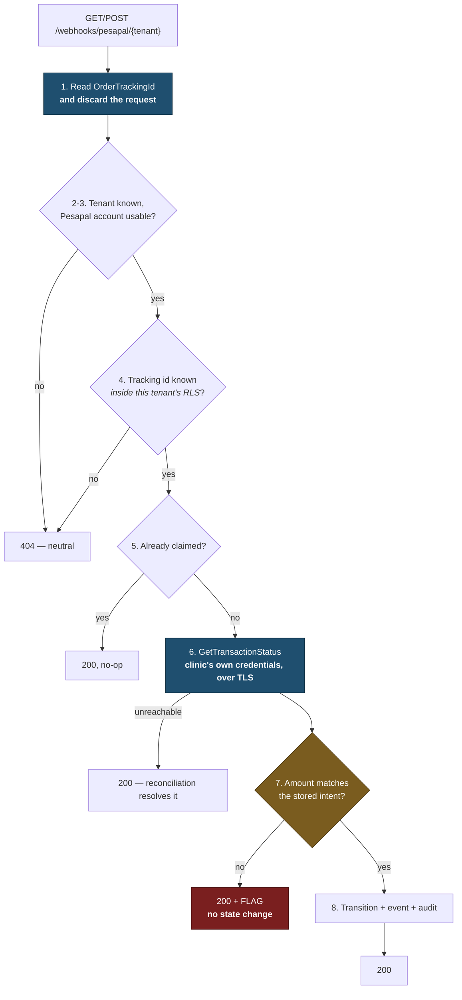
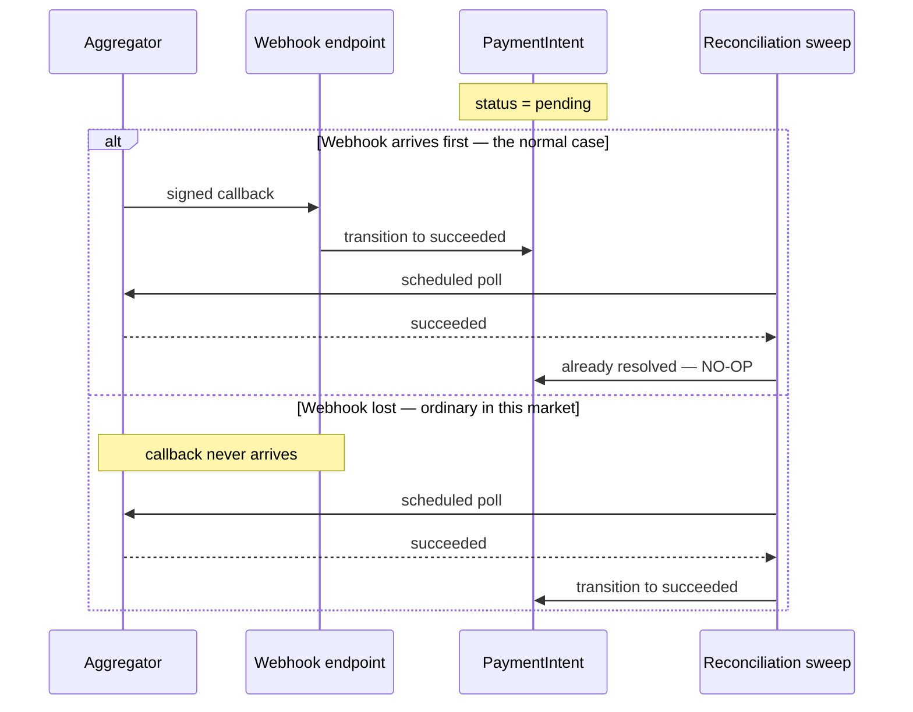

# Webhooks

> **Status:** Draft
> **Last reviewed:** 2026-08-13
> **Derives from:** Business Plan §H5.3, §H5.6

Inbound callbacks from payment aggregators. Small surface, high consequence: this is the endpoint that decides whether a patient's appointment is confirmed, and it is unauthenticated by nature.

**There are two of them, with two security models.** They are not variants of each other, and treating them as one would apply the wrong rules to one provider's traffic.

| | Flutterwave | Pesapal |
|---|---|---|
| Route | `POST /webhooks/{provider}/{tenant}` | `GET · POST /webhooks/pesapal/{tenant}` |
| Carries the outcome? | Yes | **No** |
| Signed? | Yes, HMAC over the raw body | **No, and not signable** |
| Trust comes from | Signature verification | **Nothing in the request** — the outcome is read back from Pesapal |
| Controller | `AggregatorWebhookController` | `PesapalIpnController` |

## The signed endpoint — Flutterwave

```
POST /webhooks/{provider}/{tenant}
```

Unauthenticated — the aggregator has no session with us. **Trust comes entirely from signature verification against the tenant's own webhook secret**, stored in `AggregatorAccount` and configured during onboarding ([H1](../10-product/prd-h1-clinic-onboarding.md)).

The tenant appears in the path because a webhook arrives with no host-based context and no session. It is the one place tenancy comes from the request — and precisely because of that, **the tenant segment is not trusted until the signature verifies against that tenant's secret.** A forged tenant segment fails signature verification.

## Processing

Everything above step 3 is untrusted input. Everything at step 8 is fraud control.



**Step 3 is the security boundary and step 8 is the fraud boundary.** Accepting a callback's word on the amount would let a forged or replayed payload confirm a large booking against a small payment.

**Step 3 is the security boundary.** Everything before it is untrusted input. An invalid signature is not a client error to be quietly discarded — it is either a misconfiguration or an attempt to forge a payment confirmation, and it writes an `AuditEvent` either way.

**Step 8 is the fraud boundary.** Never trust the amount in a callback. Compare it against the stored `PaymentIntent`; a mismatch is flagged for the administrator and **never auto-accepted** ([H5](../10-product/prd-h5-payments-non-custodial.md)). Accepting a callback's word on the amount would let a forged or replayed payload confirm a large booking for a small payment.

Step 6 returns 200 for an unknown reference. Retrying us forever will not conjure the intent into existence, and a 500 encourages the aggregator to hammer the endpoint. Log it and investigate — it usually means a callback for a different environment.

## Signature verification

Per provider, and always constant-time:

```php
$expected = hash_hmac('sha256', $rawBody, $tenantWebhookSecret);
if (! hash_equals($expected, $providedSignature)) {
    // 401 + AuditEvent
}
```

Verify against the **raw body**, before any parsing or normalisation. Re-serialising JSON changes bytes and breaks the comparison — and working around that by verifying a re-encoded payload defeats the mechanism entirely.

Constant-time comparison with `hash_equals`, never `===`.

## Idempotency

Aggregators retry, and duplicate deliveries are routine rather than exceptional.

- Every webhook records `(tenant_id, provider, provider_event_id)` uniquely.
- A duplicate returns `200` and does nothing.
- A transition already applied is a no-op, not an error.
- State transitions themselves are idempotent: `succeeded → succeeded` changes nothing.

Idempotency here is not an optimisation; without it, two deliveries of a success callback could confirm an appointment twice or double-count revenue in the reconciliation view.

## The unsigned endpoint — Pesapal

```
GET · POST /webhooks/pesapal/{tenant}
```

Pesapal's instant payment notification carries three fields:

```
OrderTrackingId · OrderMerchantReference · OrderNotificationType
```

**No status. No amount. No signature, and no shared secret from which one could be derived.** Pesapal does this deliberately — the notification says that *something* changed and requires the merchant to call `GetTransactionStatus` to find out what. A Pesapal `AggregatorAccount` therefore has no webhook secret at all, and that absence is a statement rather than an omission.

**The notification is a hint. It is trusted for nothing.**



**Step 1 is the security boundary, and it is a boundary made of a method signature.** Exactly one field is read from the request; the `Request` object is then discarded, and the method that does the work cannot accept one. No later step can reach back for a status, an amount or a tenant hint that a forger would like to supply.

**Step 6 is the only source of truth.** Every fact acted on comes from an authenticated call made with the clinic's own credentials.

**Step 7 is the same fraud boundary as the signed path** — the same `PaymentIntentResolver`, so the amount check cannot drift between implementations.

The consequence, and the reason this is safe: **the most a forged notification can achieve is to make us ask Pesapal a question we were going to ask anyway on the reconciliation schedule.** It cannot assert a payment, cannot assert an amount, and cannot reach an attempt belonging to another clinic.

`GET` as well as `POST`, because the notification type is registered per URL at Pesapal and both have been observed. Neither is trusted more than the other.

**Unknown tenant, unconfigured clinic and unknown tracking id all answer a neutral 404**, indistinguishable from one another. A Pesapal tracking id is minted by Pesapal, so an unknown one is a guess rather than a stray callback from another environment — which is why it is a 404 here and a 200 on the signed path.

Idempotency is keyed on the tracking id and claimed **before** the status call, so a replayed notification costs one outbound request per order rather than one per delivery. A claim consumed by a delivery we then fail to read is not a lost payment: the reconciliation sweep performs the same read.

Nothing from the notification is stored. There is nothing in it worth keeping, and keeping it would invite a later reader to believe it.

> **Do not "fix" this by trusting the body.** If a future Pesapal version signs its notifications, verify the signature *in addition to* the status call, never instead of it. Full reasoning in [ADR-0012](../70-decisions/0012-pesapal-unsigned-ipn.md).

## The reconciliation backstop

**A webhook is never the only path to resolution** (§H5.6). Missed and delayed webhooks are ordinary in this market, and an intent stuck in `pending` forever is a patient who does not know whether they paid.

The two paths racing, with the loser harmlessly idempotent:



Every `PaymentIntent` therefore carries a scheduled status poll. The sweep command runs every minute and selects the intents that are **due** under this schedule ([Backend](../30-architecture/backend-laravel.md)):

| Age | Action |
|---|---|
| under 2 min | Wait for the webhook |
| 2–15 min | Poll the aggregator every minute |
| 15–60 min | Poll every 5 minutes |
| over 60 min | `timed_out`; poll hourly for 24h |
| over 24 h | Flag for the administrator; stop polling |

**`timed_out` is not final.** A late confirmation moves it to `succeeded` and the payable proceeds if still valid ([State Machines](../20-domain/state-machines.md)). Treating a timeout as definitive failure produces the worst outcome available: a patient charged for a booking that was cancelled.

Whichever path resolves first wins; the second is a no-op.

## Responses

| Situation | Status | Reason |
|---|---|---|
| Processed | 200 | |
| Duplicate | 200 | Idempotent no-op |
| Unknown reference | 200 | Retrying will not help |
| Amount mismatch | 200 | Accepted for delivery, flagged internally, **no state change** |
| Invalid signature (signed path) | 401 | Plus an audit event |
| Unknown tenant or unconfigured | 404 | |
| Unknown tracking id (Pesapal) | 404 | Neutral, and indistinguishable from the row above |
| Pesapal unreadable at that moment | 200 | Recorded as `received`; reconciliation resolves it |
| Malformed payload | 400 | |
| Our failure | 500 | Aggregator retries; we are idempotent |

Never return a body containing internal detail. The endpoint is public and its responses are an information-disclosure surface.

## Timeouts

Webhook handling must be **fast** — aggregators time out and retry, which multiplies load exactly when the system is already slow.

Verify, validate, apply the state transition, return 200. Everything else — notifications, PDF rendering, receipt generation — is queued.

Target: under 200ms.

## Storage

On the signed path the raw payload is stored against the `PaymentIntent` for reconciliation and dispute resolution, **PII-redacted** — payer phone numbers are truncated, and nothing clinical appears in a payment callback in the first place ([Observability](../30-architecture/observability.md)).

Nothing is stored from a Pesapal notification. It contains no status, no amount and no signature, so there is nothing in it a dispute could turn on — and what does matter came from the status read and is already on the intent.


Retained per [Retention & Deletion](../50-security-compliance/data-retention-and-deletion.md).

## Configuration

Each tenant's webhook URL is registered with the aggregator during onboarding, using that tenant's own account. The secret is generated by the aggregator or by us, stored envelope-encrypted, and **never returned by any API** ([H1](../10-product/prd-h1-clinic-onboarding.md)).

Rotation invalidates the old secret after a short overlap window, so an in-flight callback is not lost.

**Pesapal registers a URL rather than a secret.** `RegisterIPN` returns an `ipn_id`, stored on the tenant's `AggregatorAccount` and sent with every order. Registration is **not** idempotent at Pesapal, so `GetIpnList` is consulted first and an existing registration reused — a clinic registering per collection would accumulate registrations and be notified once per registration. Replacing a clinic's credentials clears the stored `ipn_id`: a registration belongs to the merchant account that made it.

## Acceptance criteria

1. Signature verification runs against the raw body before parsing, using constant-time comparison.
2. An invalid signature returns 401 and writes an audit event.
3. The tenant path segment is not trusted until the signature verifies against that tenant's secret.
4. Duplicate deliveries are no-ops; `(tenant_id, provider, provider_event_id)` is unique.
5. Callback amounts are validated against the stored intent; a mismatch is flagged and applies no state change.
6. Every payment intent has a scheduled reconciliation poll independent of webhooks.
7. `timed_out` can transition to `succeeded` on a late confirmation.
8. Handling completes in under 200ms; all secondary work is queued.
9. Responses contain no internal detail.
10. Webhook secrets never appear in any API response or log line.
11. The Pesapal endpoint reads `OrderTrackingId` and nothing else from the request, and every fact it acts on comes from `GetTransactionStatus`.
12. A forged Pesapal notification applies no state change; an unknown tracking id, an unknown tenant and an unconfigured clinic answer an identical 404.
13. Consumer secrets and bearer tokens never appear in any API response, log line or audit event.
