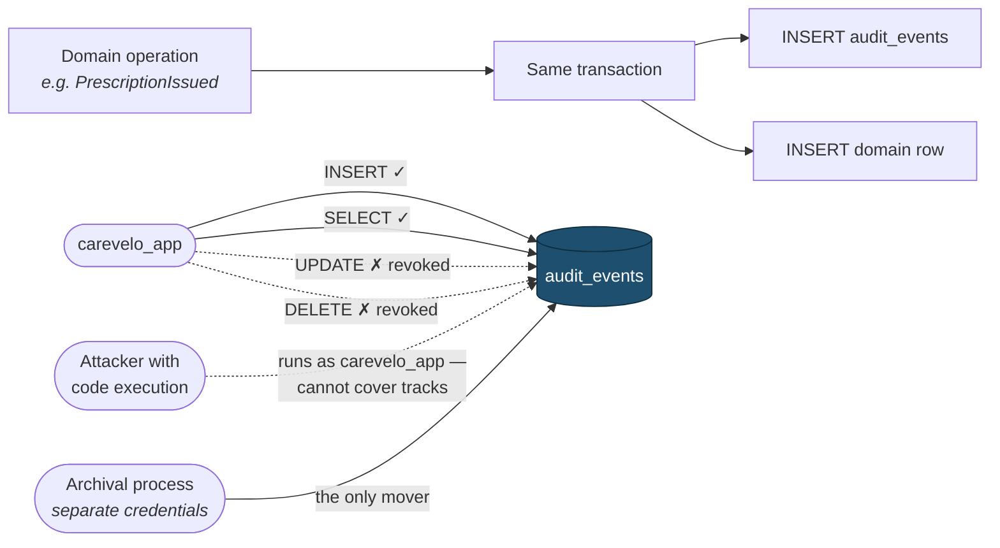

# Audit Logging

> **Status:** Draft
> **Last reviewed:** 2026-08-13
> **Derives from:** Business Plan §H7.3, §I; [ADR-0006](../70-decisions/0006-audit-log-immutability.md)

The evidence layer. When a clinic asks who read a record, when the PDPO asks what a patient consented to, or when we need to scope a breach, this is what answers.

## Audit log versus application logs

Two different systems, and conflating them is a real mistake ([Observability](../30-architecture/observability.md)).

| | Application logs | Audit log |
|---|---|---|
| Purpose | Diagnosis | **Compliance evidence** |
| Storage | Log store | **PostgreSQL, append-only** |
| Written | Best effort | **In the transaction** |
| Mutable | Rotated, deleted | **Never** |
| Loss | Tolerable | **Not tolerable** |

An audit event is a domain fact. If the action succeeded, the audit event exists — writing it in the same transaction is what guarantees that, and it is why the audit log is not simply a log level.

## Immutability

Enforced at the database, not by convention ([ADR-0006](../70-decisions/0006-audit-log-immutability.md)):

```sql
REVOKE UPDATE, DELETE ON audit_events FROM carevelo_app;
GRANT  INSERT, SELECT ON audit_events TO   carevelo_app;
```

The application **cannot** modify or delete an audit event, whatever the code says. An attacker with application-level code execution — the realistic compromise scenario — cannot cover their tracks.



Because the event is written **in the same transaction** as the operation, "the action succeeded but the audit event is missing" is not a state the database permits.

Archival and retention run under a separate, separately-credentialed process ([Retention & Deletion](data-retention-and-deletion.md)).

**No role can write or delete an audit event, including every platform role** ([RBAC Matrix](rbac-matrix.md)). Events are written by the system as a side effect of domain operations, never by a user action.

## What is recorded

The rule: **anything a regulator, a clinic or a court might ask about later.**

### Consent — all of it
Every grant and withdrawal, with the policy version and the hash of the exact text shown. Under DPPA 2019 consent must be *demonstrable*, and this is the demonstration ([Data Protection](data-protection-dppa.md)).

### Clinical record access
Every read of a consultation, note or prescription — who, when, which patient, from where. Answering "who looked at my records?" requires having recorded every look, and reads are far more numerous than writes, which is why this is the volume driver.

### Clinical acts
Prescription issued, cancelled, superseded. Substitution proposed, approved, rejected. Order dispensed, naming the pharmacist. Consultation started and ended with the outcome.

### Payments
Every `PaymentIntent` state transition; cash attestations with the attesting staff member; **every write to aggregator credentials**; every webhook signature failure ([Payments Regulatory Boundary](payments-regulatory-boundary.md)).

### Access control
Sign-in success and failure, role changes, invitations accepted, deactivations, **every session/host tenant mismatch** (which means a bug or an attack), and every break-glass request, grant and access.

### Tenant lifecycle
Provisioning, suspension, offboarding, data export, deletion.

## What is not recorded

**The audit log must not itself become a health-data breach.** It is queried by administrators, exported for compliance, and retained longer than most data — a log full of clinical content is a liability wearing the costume of a control.

| Never | Instead |
|---|---|
| Clinical content — diagnoses, notes, medicines | `consultation_id`, `prescription_id` |
| Patient names, phone numbers, addresses | `patient_id` |
| Secrets, tokens, aggregator credentials | The fact that a credential was written |
| Full request bodies | Action, subject, outcome |

The event records **that** something happened to **which** record. Reconstructing *what* the record said requires the record, under its own authorisation.

## Structure

```
AuditEvent
  id             ULID
  tenant_id      null for platform-level events
  actor_type     patient | tenant_user | platform_user | system
  actor_id, actor_role
  action         'prescription.issued', 'consultation.read', 'break_glass.granted'
  subject_type, subject_id
  occurred_at    timestamptz
  ip_address, user_agent
  request_id     correlates with application logs
  metadata       jsonb — identifiers and outcomes, PII-minimised
```

Actions are `noun.verb`, past tense, matching the domain events in [Ubiquitous Language](../20-domain/ubiquitous-language.md).

`request_id` is the join key to application logs — audit says *what happened*, logs say *how it went technically*.

## Tenant scoping

Audit events carry `tenant_id` and are subject to RLS like everything else. **A clinic sees only its own audit trail.**

Platform-level events — tenant provisioning, break-glass grants — carry a null `tenant_id` and live outside tenant RLS. Break-glass events are the exception that proves the rule: they are written at platform level *and* surfaced to the affected tenant, because the clinic is the controller and has a right to know its processor read its records.

## Access

| Actor | May read |
|---|---|
| `clinic_admin` | Their tenant's full audit trail |
| Other tenant roles | Nothing |
| Patient | Access events on their own records (Phase 2) |
| Platform roles | Platform events and **metadata only** for tenant events |
| Nobody | Write or delete |

**Reading the audit log is itself audited.** Otherwise the log has a blind spot exactly where an insider would look.

## Volume

Clinical-record reads dominate — a clinician opening a patient's history generates several events per consultation.

- Partitioned monthly.
- Indexed on `(tenant_id, occurred_at)`, `(tenant_id, subject_type, subject_id)`, `(tenant_id, actor_id)`.
- Written in the transaction, so the write path stays cheap — a single insert, no serialisation of large payloads.
- Archived after the hot window to in-region cold storage, still immutable.

## Retention

| Class | Retention |
|---|---|
| Consent events | Life of the record plus the statutory period. **Never deleted while the record exists** |
| Clinical access events | 7 years |
| Payment events | 7 years, aligning with tax and financial record expectations |
| Authentication events | 2 years |
| Break-glass events | **Permanent** |
| Tenant lifecycle events | **Permanent** |

Tenant deletion retains the audit trail **of the deletion itself** — proof that the obligation was discharged ([Retention & Deletion](data-retention-and-deletion.md)).

## Monitoring

Some audit events are security signals and should alert rather than merely accumulate ([Observability](../30-architecture/observability.md)):

- **Any session/host tenant mismatch** — a bug or an attack.
- **Any webhook signature failure** — misconfiguration or forgery.
- **Any break-glass grant** — should be rare; a rising count means the support tooling is inadequate.
- Unusual volumes of clinical-record reads by one actor — the insider-exfiltration signature.
- Repeated authentication failures for one tenant — credential stuffing.

## Acceptance criteria

1. The application role holds INSERT and SELECT on `audit_events` and is denied UPDATE and DELETE. Asserted in CI and at boot.
2. No API or role can modify or delete an audit event.
3. Audit events are written in the same transaction as the domain operation.
4. Every consent decision, clinical-record access, prescription issuance, payment transition, credential write and break-glass access writes an event.
5. No audit event contains clinical content, patient names, contact details or secrets. Covered by test.
6. Audit events are tenant-scoped under RLS; a clinic sees only its own.
7. Break-glass events are surfaced to the affected tenant.
8. Reading the audit log is itself audited.
9. Tenant deletion retains the audit trail of the deletion.
