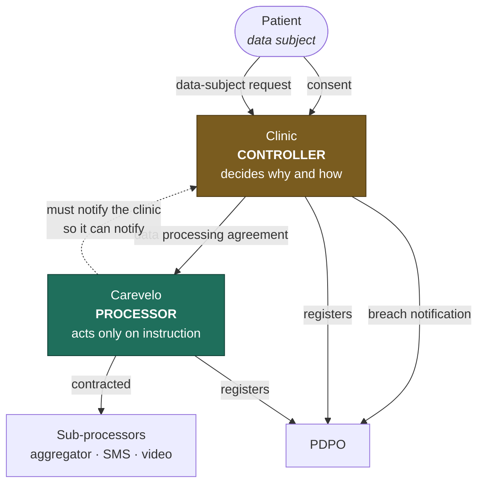
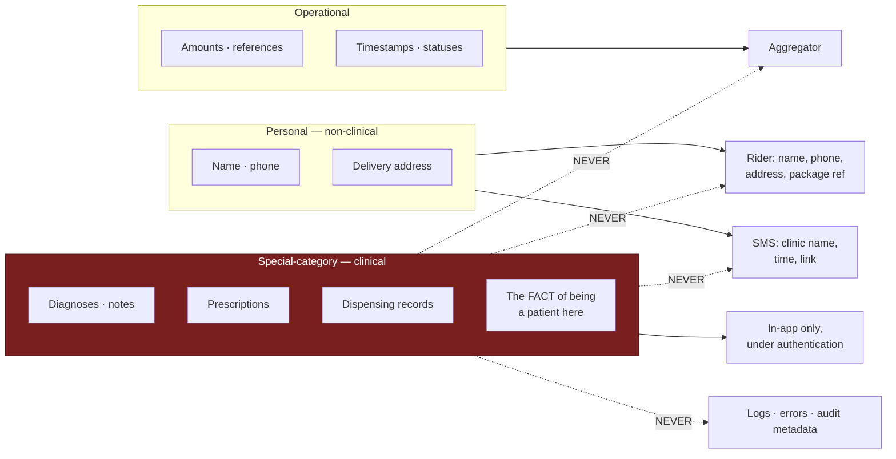

# Data Protection (DPPA 2019)

> **Status:** Draft
> **Last reviewed:** 2026-08-13
> **Derives from:** Business Plan §H2, §I, §J.5

Uganda's Data Protection and Privacy Act 2019 governs everything Carevelo touches, because everything Carevelo touches is personal data and most of it is **special-category health data**.

Enforcement is real. Google was found in breach in July 2025 for failing to register with the Personal Data Protection Office (§I), which settled any question about whether the Act's extraterritorial reach gets exercised.

## Controller and processor

The single most consequential distinction in this document.

| | Role | Meaning |
|---|---|---|
| **Each clinic** | **Data controller** | Decides why and how patient data is processed. Answers data-subject requests. Holds the medical-record retention obligation |
| **Carevelo** | **Data processor** | Processes only on the controller's documented instructions. Provides tooling; does not decide purpose |

The dotted arrow carries the obligation people forget: **the clinic cannot discharge its notification duty if we have not told it.** That is why [Incident Response](incident-response.md) measures notification to clinics in hours.

Consequences that follow directly:

- **A data processing agreement with every clinic**, signed during onboarding before any patient data exists ([H1](../10-product/prd-h1-clinic-onboarding.md)).
- **A data-subject request goes to the clinic**, not to us. We provide the tooling that lets the clinic answer it.
- **Carevelo does not decide what happens to patient data.** No secondary use, no analytics on identifiable data, no cross-tenant aggregation, no training anything on it.
- **Carevelo staff do not read clinical data by default.** Break-glass only ([RBAC Matrix](rbac-matrix.md)).
- On offboarding, we **export to the clinic** and then delete ([Retention & Deletion](data-retention-and-deletion.md)).

Both parties register with the PDPO in their respective capacities.

## PDPO registration

Mandatory, cheap, and a Phase 1 gate that must close **before any real patient data is processed** ([Roadmap](../00-overview/roadmap.md)).

| Step | Detail |
|---|---|
| Fee | UGX 100,000, paid via a URA payment registration number |
| Forms | Form 2 and Form 3, commissioned by a Commissioner for Oaths |
| Portal | pdpo.go.ug |
| Officer | A nominated **Data Protection Officer** — named, contactable, and published in the privacy notice |
| Renewal | Tracked; lapse is a compliance failure, not an administrative one |

Each clinic registers separately as a controller. Our onboarding material should help them do it — a clinic that fails to register is exposed, and its exposure becomes our problem commercially even where it is not ours legally.

## Special-category data

Health data attracts stricter handling. Everything clinical in Carevelo is special-category: diagnoses, notes, prescriptions, dispensing records, and — importantly — **the mere fact that a person is a patient of a specific clinic.**

That last point drives several design decisions that would otherwise look paranoid:

- Sign-in never reveals whether a phone number is registered ([Auth](../40-api/authentication-and-sessions.md)).
- An unknown subdomain reveals nothing about tenant existence ([Multi-Tenancy](../30-architecture/multi-tenancy.md)).
- Cross-tenant resources return 404 rather than 403 ([API Conventions](../40-api/api-conventions.md)).
- Notifications carry no clinical content ([Notifications](../10-product/notifications-sms-whatsapp.md)).

## Lawful basis and consent

Processing rests on **explicit consent**, captured at registration ([H2](../10-product/prd-h2-patient-registration-consent.md)).

Requirements, each of which is a design constraint rather than a policy aspiration:

- **Explicit affirmative action.** No pre-ticked boxes, no bundling into terms acceptance, no "by continuing you agree".
- **Specific and separate** — `data_processing`, `telemedicine` and `delivery_disclosure` are captured independently, and the delivery consent is captured at the point delivery is chosen rather than pre-emptively.
- **Informed** — plain language, in English and Luganda, on screen rather than behind a link.
- **Withdrawable**, as easily as it was given.
- **Demonstrable** — this is the operative word. An immutable `ConsentRecord` stores the policy version and a hash of the exact text shown, so we can reconstruct months later precisely what someone agreed to ([Domain Model](../20-domain/domain-model.md)).

Minors require guardian consent, with the guardian's phone separately verified.

## Data classification and where each class may go

The single most useful table in this document, drawn. **Read the red boundary as absolute.**

Every dotted "NEVER" has a corresponding test in [Test Strategy](../80-quality/test-strategy.md). Note that `C4` — the mere fact that someone is a patient of a specific clinic — sits inside the special-category box, which is what makes the enumeration defences elsewhere necessary rather than paranoid.

## Data minimisation

Collect only what care requires.

- `national_id_number` is **optional in perpetuity.** Requiring a NIN excludes patients, and exclusion is a worse outcome than unverified identity.
- Date of birth, sex, email and address are optional.
- No location tracking. No device fingerprinting. No behavioural analytics on patients.
- No marketing to patients by Carevelo, ever ([Non-Goals](../10-product/non-goals.md)).

## The rider rule

The sharpest minimisation boundary in the system, and the one most likely to be eroded by a well-meaning feature request.

> **A delivery rider receives: recipient name, recipient phone, delivery address, and a package reference.**
>
> **A delivery rider never receives: a diagnosis, a clinical note, a prescription, or a medicine list.**

This is enforced at the **API serialisation layer** — the rider endpoint returns a distinct resource class with no clinical fields on it at all, rather than the dispatcher resource with fields hidden in the UI ([Endpoint Catalogue](../40-api/endpoint-catalogue.md), [openapi.yaml](../40-api/openapi.yaml)). A hidden field is one careless template away from being displayed; an absent field cannot be.

Covered by an explicit test asserting that no rider-facing response contains a clinical field ([Test Strategy](../80-quality/test-strategy.md)).

Delivery notifications likewise never name contents ([Notifications](../10-product/notifications-sms-whatsapp.md)).

## Cross-border transfer

The Act restricts transfer without adequate safeguards. Our position ([Data Residency](../30-architecture/data-residency-and-hosting.md)):

- **All persistent data stays in region** — database, object storage, backups, logs, audit trail.
- The exceptions are enumerated, each covered by a data-processing agreement and disclosed in the privacy notice: payment instructions to the aggregator, SMS content, WhatsApp messages, consultation media, and PII-scrubbed error telemetry.
- **Every one of those carries no clinical content**, by rule. That is not a coincidence — the notification content rule is what keeps a whole class of transfers legally uninteresting.

## Security obligations

The Act requires appropriate technical and organisational measures. Ours, with the document that specifies each:

| Measure | Where |
|---|---|
| Tenant isolation enforced at the database | [Multi-Tenancy](../30-architecture/multi-tenancy.md) |
| Encryption in transit and at rest | [Data Residency](../30-architecture/data-residency-and-hosting.md) |
| Envelope encryption for credentials | [Domain Model](../20-domain/domain-model.md) |
| Role-based access, least privilege | [RBAC Matrix](rbac-matrix.md) |
| Immutable audit log of access and consent | [Audit Logging](audit-logging.md) |
| PII-free logging and telemetry | [Observability](../30-architecture/observability.md) |
| Breach detection and notification | [Incident Response](incident-response.md) |
| Retention limits and secure deletion | [Retention & Deletion](data-retention-and-deletion.md) |

## Data-subject rights

The clinic answers; we provide the tooling.

| Right | Mechanism |
|---|---|
| Access | Patient portal shows their own record; clinic can export |
| Correction | Patient may correct demographics. **Clinical records are corrected by addendum, never overwrite** — a medical record that can be silently rewritten is not a medical record |
| Withdrawal of consent | Self-service; creates a new `ConsentRecord` |
| Erasure | **Qualified.** See below |
| Portability | Phase 2; clinic-mediated export in the MVP |

### Erasure versus medical-record retention

The genuine tension in this document, and it must not be papered over.

A patient may withdraw consent and request erasure. The clinic may simultaneously be obliged to retain the medical record for a statutory period. The clinic is the controller and the conflict is theirs to resolve — but our design and our wording must not pretend it does not exist.

Accordingly:

- Withdrawal **halts new processing** immediately.
- It does **not** automatically delete retained clinical records.
- The patient-facing wording says so plainly. **Never promise deletion the clinic cannot lawfully perform** — a promise we cannot keep is worse than an honest explanation.
- The clinic is given the tooling to erase where erasure is lawful.

Resolved in detail in [Retention & Deletion](data-retention-and-deletion.md).

## Watch list

- **MoH telemedicine and digital-health regulations**, currently being drafted, may add data obligations (§I, §J.4).
- **NITA-U** has no published certification mandate for private-provider health information systems today; forthcoming MoH guidance may introduce standards. We design FHIR-ready where it costs nothing.
- **PDPO enforcement practice** is developing. The Google finding suggests the direction.

## Acceptance criteria

1. PDPO registration complete with a named DPO before any real patient data is processed.
2. A signed data processing agreement exists with every clinic before its first patient.
3. Consent requires explicit affirmative action; consents are separate, not bundled.
4. `ConsentRecord` is immutable and stores the policy version and text hash.
5. A patient in `pending_consent` cannot have clinical data attached.
6. Declining consent leaves no clinical footprint.
7. No rider-facing response contains a clinical field. Covered by test.
8. No notification contains clinical content. Covered by test.
9. All persistent data is in region; every exception is documented and disclosed.
10. Patient-facing wording does not promise erasure the clinic cannot lawfully perform.
