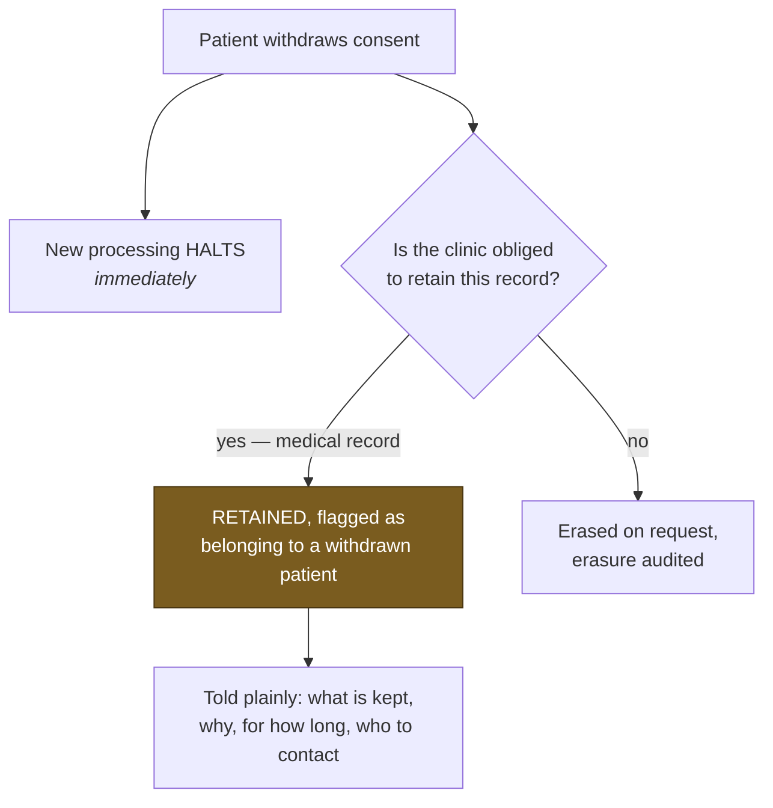
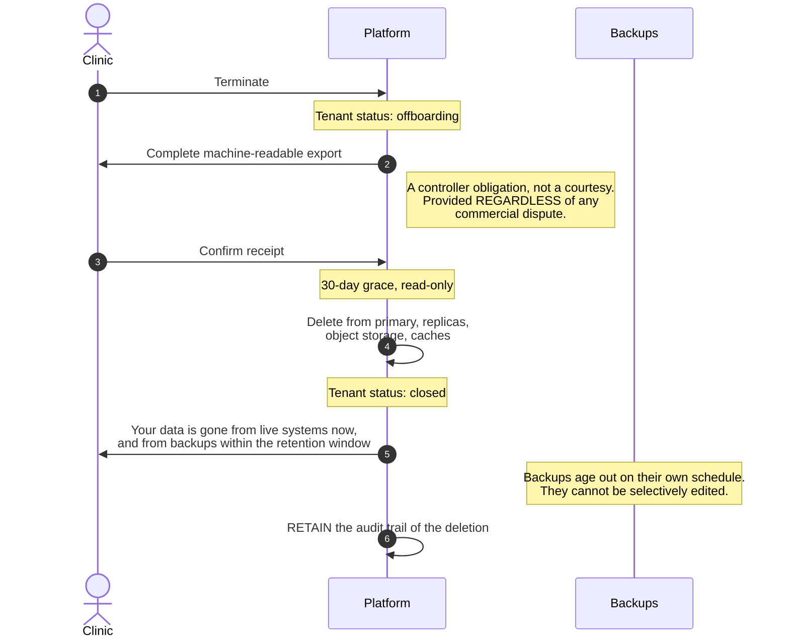

# Retention & Deletion

> **Status:** Draft
> **Last reviewed:** 2026-08-13
> **Derives from:** Business Plan §H7.4, §I; [Data Protection](data-protection-dppa.md)

How long data lives, when it goes, and how the genuine conflict between a patient's right to erasure and a clinic's duty to retain gets resolved.

## Who decides

**The clinic is the data controller.** Retention of a medical record is the clinic's legal obligation, not ours. Carevelo provides configurable retention tooling and sensible defaults; it does not decide how long a clinic keeps its records, and it must not silently delete something the clinic is obliged to hold.

Equally, we do not hold data indefinitely because deletion is inconvenient. Data minimisation is an obligation under DPPA 2019 in its own right.

## Schedule

Defaults, configurable per tenant within lawful bounds.

| Data | Default | Reasoning |
|---|---|---|
| Clinical records — consultations, notes, prescriptions, dispensing | **Clinic-configured, default 7 years** | Medical-record obligation. The clinic's call |
| Consent records | **Life of the record plus statutory period** | The evidence that processing was lawful. Deleting it destroys the defence |
| Payment records | 7 years | Tax and financial expectations |
| Delivery records | 2 years | Operational; the clinical fact lives in the dispense order |
| Audit — clinical access | 7 years | Matches the record it concerns |
| Audit — break-glass, tenant lifecycle | **Permanent** | Proof the obligations were discharged |
| Authentication events | 2 years | Security investigation window |
| Application logs | 90 days | Diagnosis only |
| Webhook raw payloads | 2 years | Payment dispute window |
| Notification delivery records | 1 year | "Did the patient get the reminder?" |
| **Patients discarded at consent decline** | **30 days** | Minimal contact detail only; no clinical data ([H2](../10-product/prd-h2-patient-registration-consent.md)) |
| Unprovisioned tenants | 30 days | Abandoned onboarding |
| Idempotency keys | 24 hours | Longer than any mobile-money window |
| Consultation media | **Never stored** | Not recorded at all |

## Erasure versus medical-record retention

The real conflict, and it must not be papered over.

A patient may withdraw consent and request erasure. The clinic may simultaneously be obliged to retain the medical record. Both are legitimate. **The clinic, as controller, resolves it** — but our design and our wording must be honest about it.

**Never promise erasure the clinic cannot lawfully perform.** A promise we cannot keep converts a compliance question into a complaint.

How the platform behaves:

1. **Withdrawal halts new processing immediately.** No new consultations, no notifications, no further use.
2. **Existing clinical records are retained** where the clinic's obligation requires it, and flagged as belonging to a withdrawn patient so staff can see the status.
3. **Non-clinical data is erased on request** — marketing preferences, optional demographics, contact details not needed for the retained record.
4. **The patient is told plainly** what is retained, why, for how long, and who to contact.

The wording rule: **never promise erasure the clinic cannot lawfully perform.** A promise we cannot keep is worse than an honest explanation, and it converts a compliance question into a complaint.

Where erasure *is* lawful — a patient with no retained clinical record, or a record past its retention period — the clinic has tooling to perform it, and the erasure itself is audited.

## Clinic offboarding

§H7.4, and the point at which our processor obligations are most visible.

The last two notes are the honest part. Claiming immediate total erasure while backups still hold the data would be false, so we say what is actually true.

**The export is a controller obligation we enable, not a courtesy.** The clinic is the controller of its patients' data; it must leave with it. Machine-readable, complete, and covering patients, consents, consultations, notes, prescriptions, dispensing, deliveries, payment records and the tenant's audit trail.

A clinic that leaves in a commercial dispute still gets its data. **Withholding it to secure payment would be unlawful and would harm patients** — this is stated explicitly because the temptation is foreseeable.

After the grace period, tenant data is deleted from primary storage, replicas, object storage and caches. **Backups age out on their own schedule** — they cannot be selectively edited, and pretending otherwise would be false. The clinic is told this plainly: their data is gone from live systems now, and from backups within the backup retention window.

**Retained after deletion:** the audit trail of the offboarding itself, and the tenant register entry. Proof that the obligation was discharged.

## Deletion in practice

| Store | Method |
|---|---|
| PostgreSQL | Hard delete within the tenant, in dependency order |
| Object storage | Delete the tenant's partition |
| Redis | Flush the tenant's namespace |
| Search or derived stores | Delete the tenant's documents |
| Application logs | Age out on their own schedule |
| Backups | **Age out.** Cannot be selectively edited |
| Audit — the deletion itself | **Retained** |

Soft deletion is used **within** the platform for recoverability — an accidentally deleted appointment should be recoverable ([Disaster Recovery](../30-architecture/disaster-recovery.md)). It is **not** a substitute for erasure when erasure is required: a soft-deleted row is still stored personal data.

## Automated enforcement

A daily retention job, per tenant, per data class:

1. Identify records past their retention period.
2. Check for a legal hold — an active dispute or investigation suspends deletion.
3. Delete, in dependency order.
4. Write an audit event recording what class and how many, never what content.

The job runs with tenant context restored like any other ([Multi-Tenancy](../30-architecture/multi-tenancy.md)). Failures alert; a retention job silently not running is a compliance failure that surfaces years later, in the worst possible setting.

## Legal hold

Where a dispute, investigation or regulatory request requires preservation, a hold suspends automated deletion for the affected scope. Placing and lifting a hold is an audited platform action with a recorded reason.

## Acceptance criteria

1. Retention periods are configurable per tenant within lawful bounds, with documented defaults.
2. A patient in `discarded` retains no clinical data and is purged within 30 days.
3. Consent records are never deleted while the record they concern exists.
4. Consent withdrawal halts new processing without deleting lawfully-retained clinical records.
5. Patient-facing wording does not promise erasure the clinic cannot lawfully perform.
6. Tenant offboarding produces a complete, machine-readable export before any deletion.
7. Offboarding export is provided regardless of commercial dispute.
8. Deletion covers primary storage, replicas, object storage and caches; backup ageing is disclosed rather than claimed as deletion.
9. The audit trail of a deletion survives the deletion.
10. The retention job runs per tenant with restored context, and its failure alerts.
11. A legal hold suspends automated deletion and is audited.
