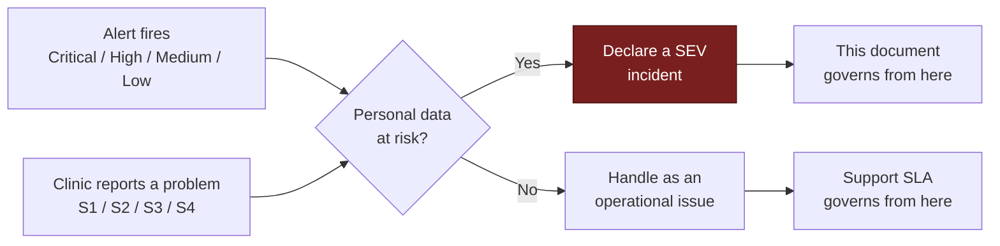
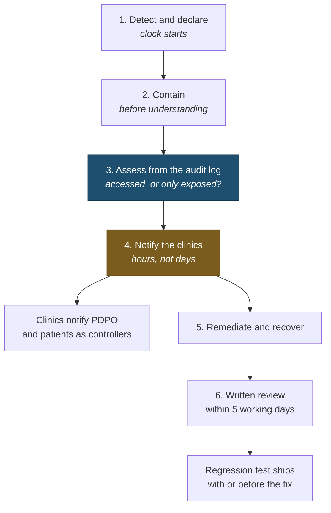

# Incident Response

> **Status:** Draft
> **Last reviewed:** 2026-08-13
> **Derives from:** Business Plan §J.5, §I; [Threat Model](threat-model.md)

What happens when something goes wrong with data or security. Written for a small team — realistically the founder alone at first (§M) — so the procedure has to be executable by one person under pressure at an inconvenient hour.

## Severity

| Severity | Definition | Examples |
|---|---|---|
| **SEV-1** | Confirmed or suspected unauthorised access to personal data; platform-wide outage | **Any cross-tenant data exposure**; database compromise; aggregator credentials leaked |
| **SEV-2** | Serious risk, no confirmed exposure | RLS misconfiguration found; a vulnerability exploitable against patient data; one tenant fully down |
| **SEV-3** | Contained security issue | Vulnerable dependency in production; suspicious sign-in pattern; webhook signature failures |
| **SEV-4** | Hygiene | Vulnerability in a non-production path; expiring certificate |

**Any suspected cross-tenant exposure is SEV-1 regardless of scale.** One record is a notifiable breach affecting two controllers at once. There is no "only one patient" version of this incident, and the instinct to downgrade it is exactly what must be resisted.

### Three scales, and how they relate

Carevelo uses three severity scales because there are three different things being triaged. They are deliberately separate — conflating them would mean either paging someone for a cosmetic bug or ticketing a data breach.

| Scale | Governs | Defined in |
|---|---|---|
| **SEV-1…4** | Security and data incidents | This document |
| **S1…S4** | Support tickets raised by clinics | [Support & SLA](../60-operations/support-and-sla.md) |
| **Critical / High / Medium / Low** | Automated alerts | [Observability](../30-architecture/observability.md) |

They map, but they are not interchangeable:

**The rule that resolves any ambiguity: the moment personal data may have been exposed, the security scale takes over and this document governs — whatever the alert or the ticket originally said.** A `Critical` alert and an `S1` ticket are inputs; a `SEV` is a declaration, and only a human makes it.

A `Critical` alert for "API down" is not a SEV — no data is at risk. An `S3` ticket describing "a patient saw someone else's name" **is a SEV-1**, despite arriving through the lowest-urgency channel. Severity travels with the data risk, not with the reporting route.

## Response

The whole flow, before the detail. Note that containment precedes assessment — you stop the bleeding before you understand it.

Step 4 is highlighted because it is the one with a legal deadline attached and the one most likely to be delayed by a wish to have better answers first. **Notify with what you know.**

### 1. Detect and declare
From alerting ([Observability](../30-architecture/observability.md)), a clinic report, a researcher, or during routine work.

**Declare early.** A SEV-1 later downgraded costs an hour. A SEV-1 declared late costs the notification deadline — and, more to the point, costs the clinics the time they needed to respond.

Record the time of detection. It starts the notification clock.

### 2. Contain
Stop the bleeding before understanding it fully.

- Cross-tenant exposure: disable the affected path — a feature flag, a route, or the endpoint entirely. Degraded service beats continued exposure.
- Credential compromise: revoke and rotate immediately, including every affected tenant's aggregator credentials.
- Account compromise: invalidate sessions, force re-authentication.
- Active intrusion: isolate, **preserve evidence** — snapshot before remediating. The audit log is append-only and cannot be tampered with ([Audit Logging](audit-logging.md)), which is why it is the first thing to read.

### 3. Assess
The questions the PDPO and every affected clinic will ask, in this order:

1. **What data?** Categories, and whether special-category health data was involved.
2. **Whose?** Which tenants, which patients, how many.
3. **Accessed, or merely exposed?** The audit log distinguishes these, which is the reason it records reads and not only writes.
4. **When did it start, and when did it stop?**
5. **Is it still happening?**
6. **What is the risk to the individuals?**

Scope from the audit log, not from assumption. **Do not understate.** An initial assessment that is later revised upward destroys the trust the notification was meant to preserve.

### 4. Notify

**The clinics first, and quickly.** Each clinic is the **data controller** ([Data Protection](data-protection-dppa.md)); the notification obligation to the PDPO and to patients is legally theirs. They cannot discharge it if we have not told them.

| Who | When | What |
|---|---|---|
| **Affected clinics** | **Without undue delay — hours, not days** | What happened, what data, whose, what we have done, what they must do |
| **PDPO** | Per DPPA 2019 requirements, coordinated with the clinics | As required |
| **Patients** | **By the clinic**, as controller. We provide the facts and support the wording | |
| **Bank of Uganda** | If aggregator credentials or payment integrity are implicated | |
| **Aggregator** | Immediately if their credentials are involved | |

Notification content: what happened, what data, how many affected, when, what we have done, what they should do, and who to contact. **No minimising, no hedging, no passive voice designed to obscure agency.** A clinic that discovers the scope was understated will not stay a customer, and should not.

### 5. Remediate and recover
Fix the root cause rather than the symptom. Verify the fix in staging. Deploy. Confirm the exposure is closed. Restore full service.

Where recovery requires restoring data, follow [Disaster Recovery](../30-architecture/disaster-recovery.md).

### 6. Review
Within five working days, a written post-incident review: timeline, root cause, why detection took as long as it did, what mitigated the impact, and concrete actions with owners and dates.

**Blameless on people, unforgiving on systems.** The useful question is never "who made the mistake" but "what allowed a single mistake to become an incident". A control that depends on nobody ever making a mistake is not a control.

The review goes to affected clinics. It is uncomfortable and it is the right thing to do.

## Specific playbooks

### Cross-tenant data exposure — the one that matters most

1. **Declare SEV-1.** No debate.
2. Disable the affected path immediately.
3. Query the audit log: which tenants, which records, which actors, over what period.
4. Determine whether data was **accessed** or merely **exposed** — the audit log's record of reads is what makes this answerable, and it is the difference between two very different notifications.
5. Notify every affected clinic within hours.
6. Root cause. Almost always one of the three highest-consequence failures in the [Threat Model](threat-model.md): the application role owning the tables, a job without tenant context, or an unprefixed cache key.
7. Add the regression test **before** the fix ships. This class of bug recurs.

### Aggregator credentials compromised

1. SEV-1. Notify the affected tenants and the aggregator immediately.
2. The clinic revokes and reissues at the aggregator; we store the new credentials.
3. Assess whether any fraudulent collection occurred — the clinic checks its own dashboard, since we cannot see their balance and never could.
4. Root cause. Credentials leak most often through logs and exception traces ([Observability](../30-architecture/observability.md)).

### Suspected RLS misconfiguration

1. SEV-2 until exposure is ruled out; SEV-1 the moment it is not.
2. Run `/health/isolation`. Check role ownership and `NOBYPASSRLS`.
3. If the application role could bypass RLS, treat **all** access during that window as potentially cross-tenant. This is why the boot-time check exists — without a known-good window, the assessment is unbounded.
4. Fix, verify, add the regression test.

### Ransomware or destructive compromise

1. SEV-1. Isolate. **Preserve evidence.**
2. Restore to a clean environment from a pre-compromise backup — immutable and separately credentialed, so an attacker with production access could not delete them ([Disaster Recovery](../30-architecture/disaster-recovery.md)).
3. Rotate **every** credential, including every tenant's aggregator credentials.
4. Full breach assessment and notification. Assume exfiltration until the evidence says otherwise.

## Roles

With a team of one, one person holds all of these. Naming them separately still helps, because it makes explicit what is being deprioritised while you do something else.

| Role | Responsibility |
|---|---|
| Incident lead | Decisions, severity, coordination |
| Technical lead | Containment, root cause, fix |
| **Data Protection Officer** | Notification obligations, PDPO liaison, assessment |
| Communications | Clinics, status page, patients via clinics |

The DPO is a named, registered individual under our PDPO registration ([Data Protection](data-protection-dppa.md)) and must be reachable during an incident.

## Preparation

| Item | Status |
|---|---|
| Contact list — every clinic admin, aggregator, hosting provider | Maintained, kept **offline** as well |
| Notification templates, pre-drafted | Written in advance; nobody writes well at 3am |
| PDPO contact and procedure | Documented before it is needed |
| Break-glass procedure | [RBAC Matrix](rbac-matrix.md) |
| Backup restore verified | Monthly ([Backup & Restore](../60-operations/backup-and-restore.md)) |
| Tabletop exercise | Annually |

Offline contacts matter: an incident that takes out the platform may take out the contact list stored in it.

## Reporting a vulnerability

A published security contact and a commitment to respond within two working days. Good-faith researchers are not pursued.

A researcher's report is a gift. The response to one determines whether the next finding comes to us or goes somewhere worse.

## Acceptance criteria

1. Any suspected cross-tenant exposure is SEV-1 regardless of scale.
2. Affected clinics are notified within hours, not days.
3. Scope is determined from the audit log, distinguishing access from exposure.
4. The audit log cannot be tampered with during an incident.
5. Notification templates and an offline contact list exist before they are needed.
6. Every SEV-1 and SEV-2 produces a written review within five working days, shared with affected clinics.
7. Every cross-tenant incident produces a regression test that ships with or before the fix.
8. A named DPO is registered and reachable.
