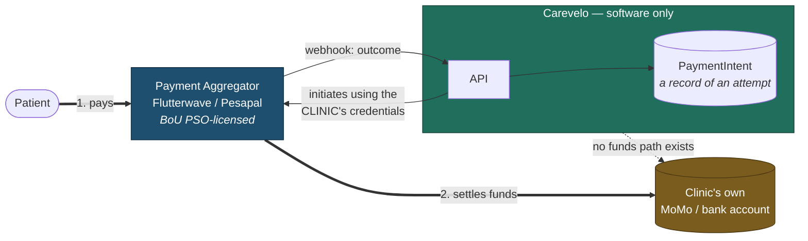
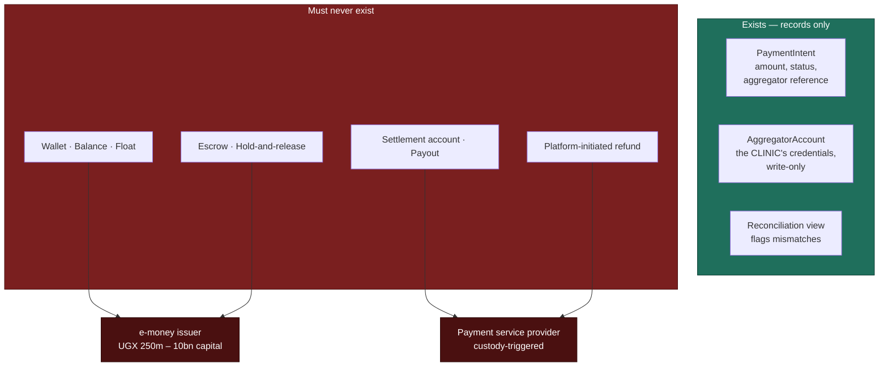

# Payments Regulatory Boundary

> **Status:** Draft
> **Last reviewed:** 2026-08-13
> **Derives from:** Business Plan §F, §H5, §I, §J.6; [ADR-0003](../70-decisions/0003-non-custodial-payment-architecture.md)

This is the document a Bank of Uganda reviewer, an auditor or an acquirer's counsel would read. It states what Carevelo does with money, what it deliberately does not, and how the architecture makes the second part true rather than merely promised.

## The statement

> **Carevelo never takes custody of patient funds.**
>
> Payment is initiated against the **clinic's own** merchant account at a Bank of Uganda-licensed aggregator, using the **clinic's own** credentials. Funds move from the patient to the aggregator to the clinic's own mobile-money or bank account. At no point do they rest in an account Carevelo owns, controls, or can instruct.
>
> Carevelo records that an attempt was made and what the aggregator reported about it. **It reconciles records, not money.**

## Why it matters

The National Payment Systems Act 2020 licenses payment activity. The categories that turn on **custody** — payment service provider and e-money issuer — carry capital requirements of UGX 250 million to 10 billion (§I). A small software business cannot meet them, and a design that drifted into custody would end the company rather than merely inconvenience it.

Non-custodial design keeps Carevelo outside those categories. The licensed party is the aggregator: **Flutterwave**, granted a Payment System Operator licence by the Bank of Uganda (announced 28 August 2024), and **Pesapal**, likewise PSO-licensed. Both are licensed to collect on merchants' behalf. The merchant is the clinic. Carevelo is the software that calls their API.

## The architecture

The claim above, drawn. **Follow the thick line: it never enters the Carevelo box.**



The thick arrows are money. The thin arrows are instructions and records. **The dotted line is the most important element in the diagram, and it is an absence** — there is no path by which funds reach a Carevelo-controlled account, because no such account exists.

Concretely:

1. Each tenant stores its **own** aggregator credentials in `AggregatorAccount` — envelope-encrypted, write-only through the API, never returned in any response, never written to any log including exception traces ([Domain Model](../20-domain/domain-model.md)).
2. Every collection call **for a patient's payment** uses **that tenant's** credentials. **There is no platform-level merchant account in that path**, and none can be reached from it. Carevelo does hold one Pesapal merchant account, for one purpose: collecting a clinic's **subscription to the software**, which is our own revenue rather than anybody's funds in transit ([ADR-0003 §The one merchant account Carevelo does hold](../70-decisions/0003-non-custodial-payment-architecture.md)). It is a separate table, separate credentials from config, a separate resolver and a separate notification endpoint, and a patient's payment cannot reach it.
3. Settlement targets the clinic's own account, configured by the clinic at the aggregator. Carevelo has no visibility of, and no claim on, settled funds.
4. `PaymentIntent` stores the amount, the aggregator's transaction reference and the reported status. Nothing more ([Ubiquitous Language](../20-domain/ubiquitous-language.md)).
5. Receipts name **the clinic** as payee. Carevelo appears nowhere as a payee.

The entity is called `PaymentIntent` rather than `Payment` or `Transaction` deliberately: anyone reading the class name should be reminded that we record an attempt rather than effect a payment.

## What must never be built

Enumerated so that no future engineer adds one helpfully. Each of these would, on its own, constitute custody:

| Forbidden | Why |
|---|---|
| **Wallet** — any stored patient or clinic balance | Stored value; e-money issuance |
| **Float** — funds held pending disbursement | Custody |
| **Escrow** — funds held pending an event | Custody |
| **Hold-and-release** — collect now, release on delivery | Custody, however brief |
| **Platform settlement account** — collect to us, pay out to clinics | Custody, and the clearest possible PSP activity |
| **Payout** — any instruction moving funds to a clinic | Presupposes we held them |
| **Platform-initiated refund** — refunding from our funds | We hold nothing to refund from |
| **Balance query on a Carevelo account** | There is no such account |
| **Aggregating collections across tenants into one merchant account** | Custody plus a cross-tenant commingling problem |

**These entities do not exist in the schema, and their absence is a compliance control.**

What exists versus what must never exist, and which licence category each forbidden thing would trigger:



### The forbidden identifiers

This list is **normative**. Other documents cite it; none should restate it, or the copies will drift.

```
wallet   balance   float   escrow   payout   settlement
```

Enforced mechanically: a CI check fails the build on any of these appearing in migrations, models or the payments module ([Environments & Deployment](../30-architecture/environments-and-deployment.md)). A blunt instrument, deliberately — it forces a conversation, and that conversation is exactly the control.

**Renaming a variable to pass the check is not compliance.** If the check fires, the question is whether the thing being built is custody, not what to call it.

## Refunds

Carevelo cannot refund. It holds nothing to refund from.

A `refund_pending` state exists on `DispenseOrder` and a refund request can be recorded — but these make the *obligation visible*, they do not discharge it. **The clinic executes the refund through its own aggregator**, and Carevelo records the outcome ([H5](../10-product/prd-h5-payments-non-custodial.md)).

The interface must say this plainly rather than appear broken. A clinic administrator hunting for a refund button that does not exist will assume a defect; a clear sentence explaining that refunds happen in their own aggregator dashboard turns a support call into a fact about how the product works.

## Cash

`cash_at_clinic` involves no aggregator and no Carevelo involvement whatsoever. A staff member attests receipt; the attestation writes an `AuditEvent` naming them. That is the clinic's own internal control, not ours, and we should not pretend otherwise.

## Card data

Never reaches Carevelo. 3-D Secure is handled entirely by the aggregator, keeping PCI DSS scope with the licensed party where it belongs ([Integrations](../30-architecture/integrations.md)).

## The Phase 2 platform fee — and why it is not switched on

§F contemplates a platform fee of roughly 1–1.5% on top of the aggregator's 3–3.5%, and §L identifies transaction economics as the only credible route to venture scale. So the question is real.

**Two mechanisms are compatible with non-custody:**

1. **Aggregator-side sub-merchant split** — the licensed aggregator deducts the fee at settlement and remits it. Carevelo never holds the gross.
2. **Separate monthly invoice** to the clinic for accrued fees, paid like any other supplier invoice.

**Both stay off until a written no-objection is obtained from the Bank of Uganda National Payment Systems Department.**

The reasoning is worth stating precisely, because it is counter-intuitive and the temptation to skip the step is real (§J.6):

> Non-custodial design defeats the **PSP** and **e-money issuer** categories, which turn on custody.
>
> It does **not** automatically defeat the **PSO** category. The NPS Act's "aggregator", "integrator" and "third-party system" definitions are **activity-based, not custody-based** — the lowest PSO threshold being UGX 100 million in capital.
>
> Non-custodial is therefore **necessary but possibly not sufficient**. Charging a percentage of payment flow is precisely the activity those definitions describe, whoever holds the money. The only way to know is to ask, in writing, before doing it.

§ Caveats notes an additional wrinkle: the capital and fee figures commonly cited derive from FSD Uganda / FITSPA guidance reproducing the NPS Regulations 2021, and the General Regulations were **amended in 2022**. Any figure used in a decision must be re-verified against the current amended regulations rather than the secondary source.

**Until the no-objection is in hand, payments are a pure convenience feature with no platform cut** (§F). Revenue comes from subscriptions.

## If the no-objection is declined

Nothing architectural changes, because the architecture was never custodial. Transaction fees simply never switch on, and the business stays subscription-only — a strong bootstrapped business rather than a venture one, which §L already identifies as an acceptable outcome ([Roadmap](../00-overview/roadmap.md)).

This is worth noting because it means the regulatory question, though important, is not existential. We are not betting the architecture on a favourable answer.

## Verification

An auditor should be able to confirm the claim without reading every line of code:

1. **Schema:** no balance, wallet, float, escrow, payout or settlement table or column exists. CI-enforced.
2. **Credentials:** every aggregator call resolves credentials from the calling tenant's `AggregatorAccount`. No platform-level credential exists in configuration.
3. **Settlement:** the aggregator's own merchant configuration shows settlement to the clinic's account. Carevelo does not appear.
4. **Receipts:** name the clinic as payee.
5. **No refund path** exists that could disburse funds.
6. **Audit log:** every payment state transition is recorded ([Audit Logging](audit-logging.md)).
7. **Amount validation:** callback amounts are checked against the stored intent and mismatches flagged, never auto-accepted ([Webhooks](../40-api/webhooks.md)).

## Related

- [H5 — Payments PRD](../10-product/prd-h5-payments-non-custodial.md) — product behaviour and failure states
- [ADR-0003](../70-decisions/0003-non-custodial-payment-architecture.md) — the decision record
- [Compliance Responsibility Matrix](compliance-responsibility-matrix.md) — who owns what
- [Non-Goals](../10-product/non-goals.md) — the permanent exclusions
