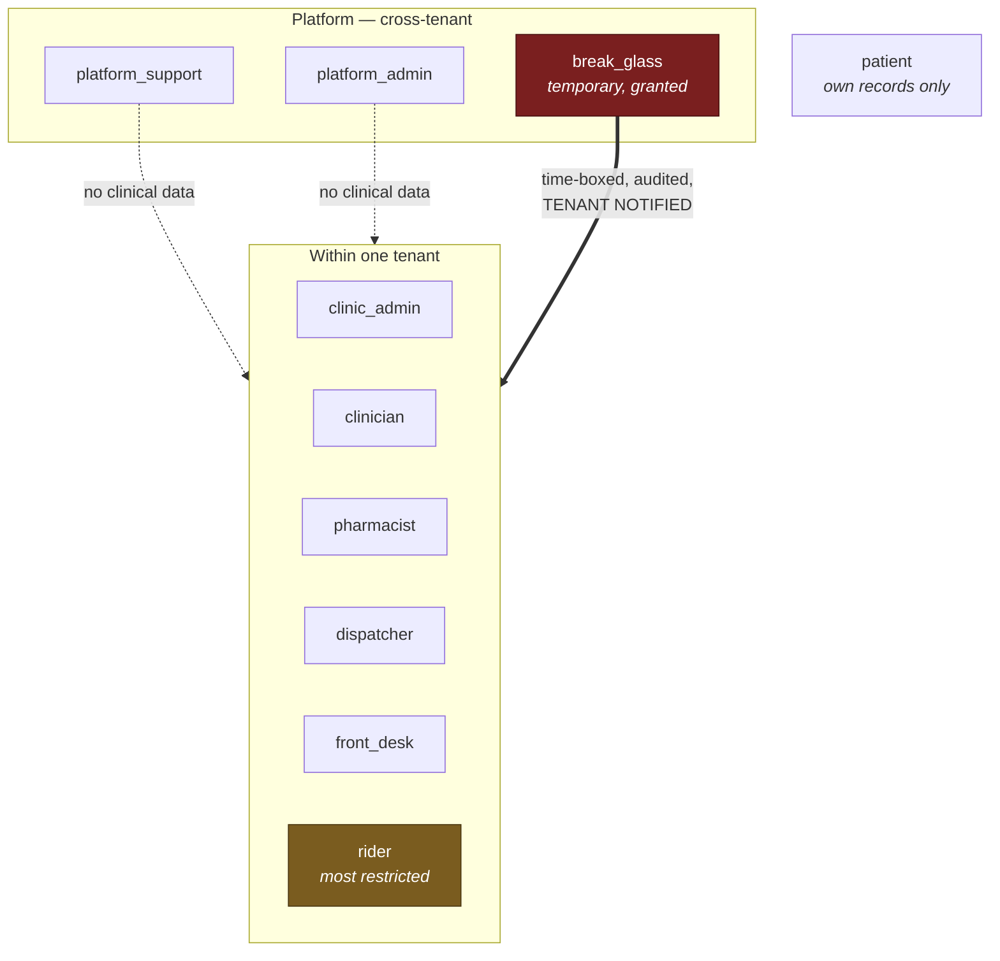
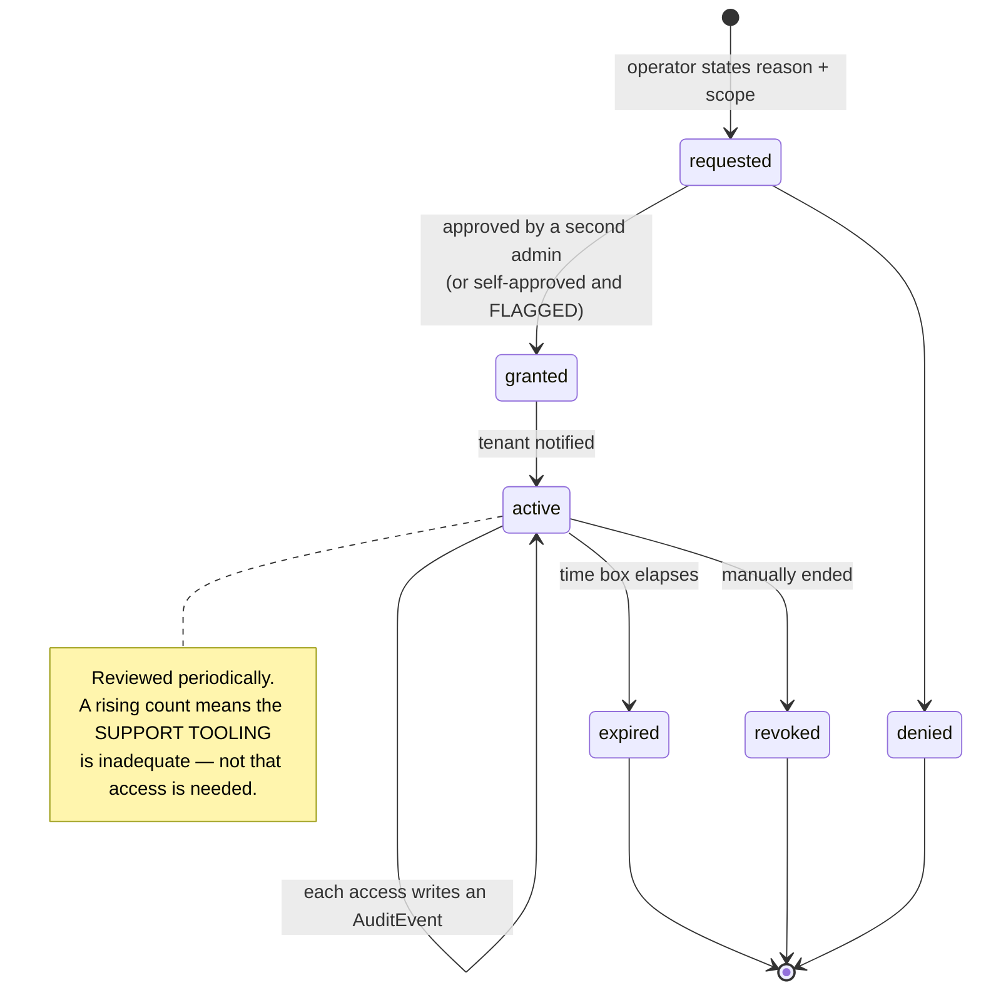

# RBAC Matrix

> **Status:** Draft
> **Last reviewed:** 2026-08-13
> **Derives from:** Business Plan §H7.2; [Personas & Actors](../00-overview/personas-and-actors.md)

Who may do what. Three enforcement layers, each able to deny independently ([Auth](../40-api/authentication-and-sessions.md)):

1. **Ability** — the session's scope.
2. **Policy** — Laravel policies, per resource and action.
3. **RLS** — the database returns nothing outside the tenant regardless of what the first two concluded ([Multi-Tenancy](../30-architecture/multi-tenancy.md)).

Layer 3 is the control. Layers 1 and 2 produce good errors and enforce intra-tenant rules the database cannot express.

## Roles

**Tenant roles** — always scoped to one tenant. A user may hold several; in a five-person clinic, one person is frequently admin, front desk and dispatcher at once.

| Role | Purpose |
|---|---|
| `clinic_admin` | Runs the tenant: staff, services, prices, branding, aggregator credentials |
| `clinician` | Consults, records notes, prescribes, approves substitutions |
| `pharmacist` | Reviews, prices, substitutes, dispenses |
| `dispatcher` | Assigns riders, manages the dispatch board |
| `front_desk` | Registers patients, books, takes cash |
| `rider` | Delivers. The most restricted role in the system |
| `patient` | Own records only |

The two dotted arrows are the point: platform roles reach tenant *administration* but not tenant *clinical data*. Only the break-glass grant crosses that line, and it is the solid arrow because it is the exception that must be visible.

**Platform roles** — cross-tenant, and deliberately weak on clinical data.

| Role | Purpose |
|---|---|
| `platform_support` | Tenant administration, diagnosis from metadata. **No clinical data** |
| `platform_admin` | Provisioning, suspension, offboarding. **No clinical data** |
| `break_glass` | Temporary, granted, time-boxed clinical access. See below |

## Matrix

`✓` permitted · `—` denied · `own` own records only · `⚑` audited as a first-class event

### Patients and consent

| Resource · action | admin | clinician | pharmacist | dispatcher | front_desk | rider | patient | platform |
|---|---|---|---|---|---|---|---|---|
| Patient — create | ✓ | ✓ | — | — | ✓ | — | own | — |
| Patient — read | ✓ | ✓ | name/contact | name/contact | ✓ | name/contact | own | — |
| Patient — update demographics | ✓ | ✓ | — | — | ✓ | — | own | — |
| Patient — merge (within tenant) ⚑ | ✓ | — | — | — | ✓ | — | — | — |
| Consent — read | ✓ | ✓ | — | — | ✓ | — | own | — |
| Consent — grant / withdraw ⚑ | — | — | — | — | — | — | ✓ | — |

Consent is granted by the patient or guardian only. Staff may facilitate in person, but the record names who attested.

### Clinical

| Resource · action | admin | clinician | pharmacist | dispatcher | front_desk | rider | patient | platform |
|---|---|---|---|---|---|---|---|---|
| Appointment — book | ✓ | ✓ | — | — | ✓ | — | own | — |
| Appointment — cancel | ✓ | ✓ | — | — | ✓ | — | own | — |
| Appointment — confirm deferred payment ⚑ | ✓ | — | — | — | — | — | — | — |
| Consultation — conduct | — | ✓ | — | — | — | — | — | — |
| Consultation — read ⚑ | ✓ | ✓ | — | — | — | — | own | break-glass |
| Clinical note — write | — | ✓ | — | — | — | — | — | — |
| Clinical note — addendum | — | ✓ | — | — | — | — | — | — |
| Clinical note — **delete** | — | — | — | — | — | — | — | — |
| Prescription — issue | — | ✓* | — | — | — | — | — | — |
| Prescription — read | ✓ | ✓ | ✓ | — | — | — | own | break-glass |
| Prescription — **edit** | — | — | — | — | — | — | — | — |
| Prescription — cancel | — | ✓ | — | — | — | — | — | — |

\* Requires `can_prescribe = true` **and** a registration number, on a consultation whose outcome is not `converted_to_in_person` ([Domain Model](../20-domain/domain-model.md)).

**Nobody can delete a clinical note or edit a prescription. Not the clinician, not the administrator, not Carevelo.** Corrections are addenda and supersessions ([Ubiquitous Language](../20-domain/ubiquitous-language.md)). This is the deliberate absence of a capability, not an oversight.

A `clinic_admin` who is not also a clinician can read consultations — administrators of small clinics genuinely need this — but every such read is audited.

### Dispensing and delivery

| Resource · action | admin | clinician | pharmacist | dispatcher | front_desk | rider | patient | platform |
|---|---|---|---|---|---|---|---|---|
| Dispense order — read | ✓ | ✓ | ✓ | ref only | — | — | own | — |
| Dispense order — price | ✓ | — | ✓ | — | — | — | — | — |
| Substitution — propose | — | — | ✓ | — | — | — | — | — |
| **Substitution — approve** | — | **✓** | — | — | — | — | — | — |
| Dispense order — dispense | — | — | ✓ | — | — | — | — | — |
| Delivery — create | ✓ | — | ✓ | ✓ | — | — | — | — |
| Delivery — assign rider | ✓ | — | — | ✓ | — | — | — | — |
| Delivery — read (full) | ✓ | — | ✓ | ✓ | — | — | — | — |
| **Delivery — read (rider view)** | — | — | — | — | — | **✓ own** | — | — |
| Delivery — update status | — | — | — | ✓ | — | ✓ own | — | — |
| Delivery — track | ✓ | — | ✓ | ✓ | ✓ | — | own | — |

**Only a clinician approves a substitution.** Not the pharmacist who proposed it, not the administrator. It is a clinical decision ([H4](../10-product/prd-h4-prescription-dispensing-delivery.md)).

**The rider view is a separate resource class** with no clinical fields on it, not the dispatcher resource with fields hidden ([Data Protection](data-protection-dppa.md)). A rider can read only their own assignments.

### Payments

| Resource · action | admin | clinician | pharmacist | dispatcher | front_desk | rider | patient | platform |
|---|---|---|---|---|---|---|---|---|
| Payment intent — create | ✓ | — | ✓ | — | ✓ | — | own | — |
| Payment intent — read | ✓ | — | own orders | — | ✓ | — | own | — |
| Cash attestation ⚑ | ✓ | — | ✓ | — | ✓ | — | — | — |
| Reconciliation — read | ✓ | — | — | — | — | — | — | — |
| **Aggregator credentials — write** ⚑ | **✓** | — | — | — | — | — | — | — |
| **Aggregator credentials — read** | **—** | — | — | — | — | — | — | **—** |

**Nobody can read aggregator credentials — not even the administrator who entered them, and not Carevelo.** They are write-only, envelope-encrypted, and decrypted only in memory at the moment of an outbound call ([Payments Regulatory Boundary](payments-regulatory-boundary.md)). Only the status and provider are readable.

There is no refund permission because there is no refund capability. Carevelo holds nothing to refund from.

### Realtime channel subscription

Subscription is authorised by the **same policies** as the equivalent REST read, plus a tenant-prefix check ([Realtime Broadcasting](../30-architecture/realtime-broadcasting.md)). A channel name is not a permission.

| Channel | admin | clinician | pharmacist | dispatcher | front_desk | rider | patient |
|---|---|---|---|---|---|---|---|
| `tenant.{id}.pharmacy-queue` | ✓ | — | ✓ | — | — | — | — |
| `tenant.{id}.dispatch-board` | ✓ | — | — | ✓ | — | — | — |
| `tenant.{id}.user.{userId}` | own | own | own | own | own | own | — |
| `tenant.{id}.rider.{userId}` | — | — | — | — | — | **own only** | — |
| `tenant.{id}.patient.{patientId}` | — | — | — | — | — | — | **own only** |
| `tenant.{id}.consultation.{id}` | — | own | — | — | — | — | own |
| Any channel of another tenant ⚑ | — | — | — | — | — | — | — |

A cross-tenant subscription attempt is a hard 403 **and an audit event** — like a session/host mismatch, it means a bug or an attack.

**Payloads carry identifiers and state only, never clinical content**, so even a correctly-authorised subscriber receives a signal rather than data. The client then re-fetches through the API, where these same permissions apply again.

### Administration

| Resource · action | admin | others | platform_support | platform_admin |
|---|---|---|---|---|
| Staff — invite / manage roles ⚑ | ✓ | — | — | — |
| Services and prices | ✓ | — | — | — |
| Branding | ✓ | — | — | — |
| Notification templates | ✓ | — | — | — |
| Audit log — read | ✓ | — | metadata | metadata |
| Audit log — **write / delete** | — | — | — | — |
| Tenant — provision / suspend ⚑ | — | — | — | ✓ |
| Tenant — data export ⚑ | ✓ | — | — | ✓ |
| **Break-glass — request** ⚑ | — | — | ✓ | ✓ |

The audit log is append-only and written by the system. **Nobody can write or delete an entry** ([ADR-0006](../70-decisions/0006-audit-log-immutability.md)).

The last active `clinic_admin` cannot be deactivated — locking a clinic out of its own tenant is a support incident and a controller problem at once.

## Break-glass

The only route by which a Carevelo operator reaches tenant clinical data. Each clinic is the controller; we process on instruction, and reading their records without a reason is processing without one.

**Procedure**

1. Operator requests access, stating a **reason** and a **scope** — which tenant, which records, why.
2. Approval by a second platform administrator where staffing allows. Where it does not — realistically, early on with a solo founder — the grant is self-approved and **flagged for later review**, which is a weaker control and should be named as such rather than dressed up.
3. Grant is **time-boxed** and automatically revoked.
4. **The tenant is notified.** The clinic is the controller and has a right to know when its processor read its records.
5. Every access under the grant writes an `AuditEvent`.
6. Grants are reviewed periodically. **A rising count means the support tooling is inadequate**, not that access is needed — the correct response is to build better metadata-based diagnosis ([Observability](../30-architecture/observability.md)).

Ordinary support tooling exposes no clinical data. Diagnosis works from identifiers, states and audit trails.

## Acceptance criteria

1. Every endpoint has an explicit policy. A resource without one is denied by default.
2. A rider cannot reach any endpoint outside their own assigned deliveries.
3. No rider-facing response contains a clinical field. Covered by test.
4. Aggregator credentials are unreadable by every role including platform roles.
5. No role can edit a prescription or delete a clinical note.
6. No role can write or delete an audit event.
7. Only a clinician can approve a substitution.
8. Platform roles reach no clinical data without an active break-glass grant.
9. Break-glass grants are time-boxed, reason-recorded, tenant-notified and audited.
10. Sessions invalidate on role change so a revoked permission does not survive.
