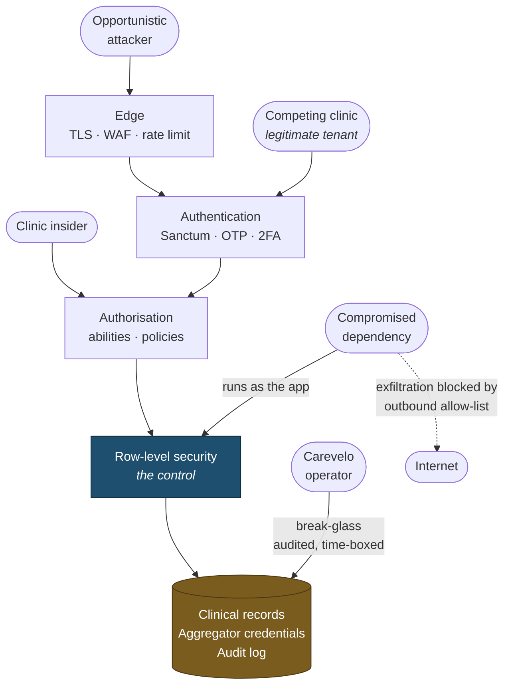
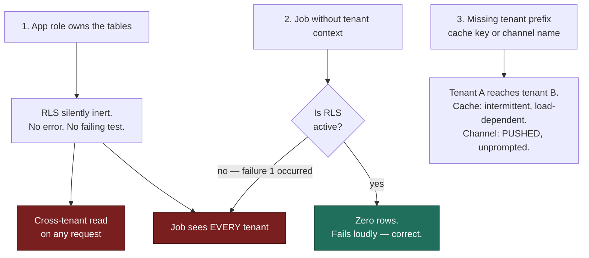

# Threat Model

> **Status:** Draft
> **Last reviewed:** 2026-08-13
> **Derives from:** Business Plan §J.5, §J.6; [Multi-Tenancy](../30-architecture/multi-tenancy.md)

STRIDE across the three boundaries that matter: **tenant isolation**, **payments**, and **health data**.

## What we are protecting

| Asset | Why it is attractive | Worst case |
|---|---|---|
| **Patient clinical records** | Special-category data; extortion, stigma, targeting | Notifiable breach affecting many controllers at once |
| **Aggregator credentials** | Direct financial value — a clinic's merchant account | Theft of a clinic's revenue; our credibility gone |
| **Tenant isolation** | Tenants are each other's local competitors | Cross-tenant leak: regulatory breach plus commercial disclosure |
| **Prescription integrity** | Forged prescriptions have street value | Controlled substances obtained on a forged document |
| **Patient identity** | The fact of being a patient is itself sensitive | Disclosure of a person's clinic attendance |
| **Audit log** | Attackers cover tracks | Breach becomes unprovable and unscoped |

## Adversaries

| Adversary | Capability | Motivation |
|---|---|---|
| **Opportunistic attacker** | Automated scanning, credential stuffing | Data for resale, ransomware |
| **A competing clinic** | A legitimate tenant account | Patient lists, pricing, volumes of a local rival |
| **A malicious insider at a clinic** | Valid credentials, a real role | Data theft on leaving; prescription fraud |
| **A malicious Carevelo insider** | Infrastructure access | Everything. Mitigated by break-glass and audit, not eliminated |
| **A compromised dependency** | Code execution in our runtime | Exfiltration. The realistic supply-chain scenario for PHP/Node |
| **A rider** | Physical possession of medicines, minimal data | Diversion. Constrained by minimal disclosure |

The competing tenant deserves particular attention because it is the adversary most people forget: **a legitimate, paying, authenticated user whose interest is another tenant's data.** They can afford a subscription, they will look at URLs, and they have specific knowledge of which local clinic they want to read.

## Attack surface and boundaries

Where each adversary meets the system, and what stands between them and the assets:

Two things to read from this. **The competing tenant enters at authentication as a legitimate user** — every layer above RLS treats them as valid, which is precisely why RLS and not authorisation is the control. And **a compromised dependency runs as the application**, so it inherits whatever the application can reach; the outbound allow-list exists because containing exfiltration is more achievable than preventing the compromise.

## Spoofing

| Threat | Mitigation |
|---|---|
| Credential stuffing | Rate limiting per number and IP; OTP; second factor for admin and platform roles |
| SIM swap defeating SMS OTP | TOTP required for platform operators; SMS OTP acknowledged as weak and compensated by short sessions and audit |
| Session hijacking | HTTP-only, Secure, SameSite cookies; short idle timeouts; invalidation on role change |
| **Forged payment webhook** | **Signature verification against the tenant's own secret, on the raw body, constant-time.** The tenant path segment is untrusted until it verifies ([Webhooks](../40-api/webhooks.md)) |
| Impersonating a clinician to prescribe | Prescribing requires `can_prescribe` plus a registration number; the PDF snapshots the clinician's identity; issuance is audited |
| Phishing a clinic admin for aggregator credentials | Credentials are **write-only and unreadable by anyone** — phishing the UI yields nothing to read ([RBAC Matrix](rbac-matrix.md)) |

## Tampering

| Threat | Mitigation |
|---|---|
| **Altering a prescription after issue** | Immutable; correction is cancel-and-replace; `document_hash` verifies the PDF against the record |
| Rewriting a clinical note | Append-only; corrections are addenda with `supersedes_note_id`. **No role can delete one** |
| Editing the audit log | Append-only at the database: the application role holds INSERT and SELECT, and is denied UPDATE and DELETE ([ADR-0006](../70-decisions/0006-audit-log-immutability.md)) |
| **Manipulating a payment amount via callback** | **Never trust the callback amount.** Validate against the stored intent; mismatch is flagged and applies no state change |
| Injecting a row into another tenant | RLS `WITH CHECK` blocks the write; composite foreign keys make a cross-tenant reference structurally impossible |
| Tampering with consent records | Immutable; withdrawal is a new record with a policy hash |

## Repudiation

| Threat | Mitigation |
|---|---|
| "I never prescribed that" | Prescription snapshots the clinician's identity at issue; issuance audited |
| "I never approved that substitution" | Approval is an audited event naming the clinician |
| "The clinic never received my payment" | Aggregator reference stored against the payable; reconciliation view; the clinic can verify on its own dashboard |
| "Carevelo read our patients" | Break-glass grants are audited **and the tenant is notified** |
| "I never consented" | Immutable `ConsentRecord` with the policy version and the hash of the exact text shown |

## Information disclosure

The largest category, and the one with the most specific mitigations.

| Threat | Mitigation |
|---|---|
| **Cross-tenant read** | **RLS.** Application scoping is convenience; the database is the control. Isolation tests per model block release ([Multi-Tenancy](../30-architecture/multi-tenancy.md)) |
| ID enumeration | ULIDs, not sequential integers. A guessed URL fails before authorisation is consulted |
| Cross-tenant existence disclosure via 403 | Cross-tenant resources return **404**, never 403 |
| Tenant enumeration by subdomain | Unknown host returns a neutral 404 revealing nothing |
| Patient existence disclosure at sign-in | Identical response and timing whether or not a number is registered |
| **Clinical data to a rider** | **Distinct resource class with no clinical fields**, not hidden UI fields. Covered by test |
| **Clinical data over SMS** | Content rule: no diagnosis, medicine, result or reason. Covered by a template test |
| Clinical data in logs | Identifiers only; **exception traces scrubbed of argument values** ([Observability](../30-architecture/observability.md)) |
| Aggregator secrets in a stack trace | Envelope-encrypted, decrypted only in memory at call time, scrubbed from traces. This is where secrets most often escape |
| Prescription PDF via a guessable URL | Tenant-partitioned storage, unguessable names, short-lived signed URLs issued after authorisation |
| **Cache key without a tenant prefix** | Tenant-namespaced keys. **An unprefixed key is a cross-tenant leak with a time delay** — intermittent and load-dependent, therefore hard to find |
| **Broadcast channel without a tenant prefix** | Tenant-aware channel helper. Worse than the cache case — it **pushes** another tenant's data to a subscriber unprompted ([Realtime Broadcasting](../30-architecture/realtime-broadcasting.md)) |
| Subscribing to another tenant's channel | Two checks at `/broadcasting/auth`: tenant prefix against the session tenant, then the same policy as the REST read. Mismatch is 403 plus an audit event |
| Clinical data in a broadcast frame | Payloads carry identifiers and state only. Covered by test |
| A revoked role retaining a live socket | Role change and deactivation terminate the connection, not only the next request |
| Production data in staging | Prohibited. Debug from logs and synthetic reproduction |
| Debug page in production | `APP_DEBUG=false` asserted at boot. A Laravel debug page renders request payloads — here, patient data |

## Denial of service

| Threat | Mitigation |
|---|---|
| One tenant's runaway integration | Per-tenant rate limits contain the blast radius |
| Expensive unindexed queries | Allow-listed filter and sort fields; cursor pagination |
| Queue flooding | Separate queues by urgency; per-tenant job limits |
| SMS cost exhaustion | Per-tenant balance and rate limits |
| Aggregator outage | Fall back to pay-at-clinic; never fail silently |
| Video provider outage | Fall back to chat, which we serve ourselves |

## Elevation of privilege

| Threat | Mitigation |
|---|---|
| Rider reaching clinical endpoints | Narrowest ability scope; separate namespace; policies |
| Staff self-elevating a role | Roles are fixed at invitation; changes are admin-only and audited |
| Client-asserted tenant | **Tenant never comes from client input.** Host or session only |
| Platform operator reading clinical data | Break-glass: time-boxed, reason-recorded, tenant-notified, audited |
| **Application role bypassing RLS** | **The application role is not the table owner and holds `NOBYPASSRLS`.** Asserted at boot and in CI |
| Compromised dependency exfiltrating data | **Outbound allow-list** at the network layer; dependency scanning; secret scanning |

## The three highest-consequence failures

Ranked by consequence rather than likelihood. These are the ones to re-check before every release that touches them.

What makes them dangerous is not that they are likely — it is that **all three are silent**, and two of them compound:

**Failure 2 is survivable on its own and catastrophic combined with failure 1** — which is the argument for asserting the role configuration at boot rather than trusting it. Failure 3 is independent of both and is the hardest to find, because it only appears under concurrency.

### 1. The application role owns the tables

Every RLS policy becomes **silently inert**. PostgreSQL exempts a table's owner from RLS by default, so the system works perfectly and protects nothing — and no test that only checks application behaviour would notice.

Mitigated by the boot-time check and `/health/isolation` ([Observability](../30-architecture/observability.md)). This is the single most dangerous misconfiguration in the platform.

### 2. Tenant context missing in a queued job

The request context is gone by the time a job runs. With RLS the job sees zero rows and fails loudly — the correct failure — but only if RLS is actually active. If failure 1 has occurred, a job without tenant context sees **everything**.

Mitigated by `TenantAwareJob`, a queue middleware assertion, and an architecture test ([Multi-Tenancy](../30-architecture/multi-tenancy.md)).

### 3. A missing tenant prefix — cache key or broadcast channel

Tenant A's data reaching tenant B. Two variants of one mistake.

**Cache key:** intermittent and load-dependent. It passes every functional test, appears only in production, and is extremely hard to reproduce.

**Broadcast channel:** worse, because the data is *pushed* to the wrong subscriber without anyone requesting it — and it surfaces the moment two clinics have a pharmacist online at once ([Realtime Broadcasting](../30-architecture/realtime-broadcasting.md)).

Mitigated by namespaced abstractions for both, and a review rule that any manually constructed key or channel name is a defect on sight.

## Security in the development process

| Control | Where |
|---|---|
| Dependency vulnerability scanning | CI, blocking |
| Secret scanning on the diff | CI, blocking |
| Static analysis (PHPStan level 8) | CI, blocking |
| Isolation and architecture tests | CI, blocking |
| Security review of changes touching auth, tenancy or payments | [Definition of Done](../80-quality/definition-of-done.md) |
| Annual penetration test | Once revenue supports it. Named honestly as a gap until then |

## Accepted risks

Stating these plainly is more useful than implying complete coverage.

| Risk | Why accepted | Revisit |
|---|---|---|
| SMS OTP is vulnerable to SIM swap | The only universally available factor in this market. Requiring TOTP from patients would prevent care | If account-takeover incidents occur |
| Self-approved break-glass early on | A solo founder cannot have a second approver. Compensated by audit, notification and review | At the first support hire (§K) |
| No penetration test before revenue | Cost. §M makes willingness-to-pay the binding constraint | At UGX 10m/month MRR |
| Single region | Data residency is a compliance requirement and a sales asset (§I, §E) | If a regional failure occurs |
| A malicious clinic insider can exfiltrate their own tenant's data | They are the controller's own staff; the clinic's internal control | Not ours to solve; noted in the processor agreement |
