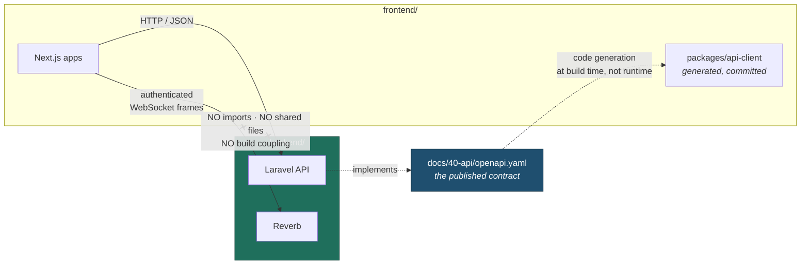

# ADR-0007 — Separate `backend/` and `frontend/` trees, API-only boundary

> **Status:** Accepted
> **Date:** 2026-08-13
> **Derives from:** [ADR-0001](0001-laravel-nextjs-stack.md); Business Plan §M

## Context

[ADR-0001](0001-laravel-nextjs-stack.md) chose Laravel for the API and Next.js for the frontends but said nothing about where each physically lives. Laravel actively invites blurring: Blade views, a Vite asset pipeline, Inertia, Livewire — all first-party, all reasonable in other projects, and all of which would make the frontend an appendage of the backend rather than an independent consumer.

Three forces make the boundary worth enforcing rather than merely preferring.

**Blast radius.** The backend enforces tenant isolation, the non-custodial payment boundary and the clinical-record invariants. Those are legal boundaries ([Non-Goals](../10-product/non-goals.md)). A frontend change must be structurally incapable of altering them — not merely unlikely to.

**The patient portal's weight budget.** It must load on a mid-range Android phone over Ugandan mobile data ([Frontend](../30-architecture/frontend-nextjs.md)). Anything that couples it to the staff console's dependency tree is a direct cost to the patient who most needs the page to load.

**Replaceability.** A native app, a USSD gateway (§ Phase 3) or a rewritten portal should each be a new consumer of the same API, not a fork of the application.

## Options considered

### A. Blade or Livewire inside one Laravel application

One language, one deployment, fastest to first screen.

**Against:** the consultation surface needs real client-side state — WebRTC, live note drafting that survives a disconnection, reconnection handling — and Livewire's server round-trips are poorly suited to it on exactly the connections our patients have. Already rejected in [ADR-0001](0001-laravel-nextjs-stack.md); this ADR records the structural consequence.

### B. Inertia — Laravel-served React, shared routing

Genuinely pleasant, and it removes the separate API. But it makes the frontend a rendering layer *of* the backend, coupled at the route and controller level. A second consumer — mobile, USSD — would then need the API built anyway, so the API is not avoided, only deferred.

### C. Two git repositories

Total independence, independently versioned.

**Against:** a contract change and its consumer update would land in two pull requests in two repositories, reviewed separately, deployable out of order. At this team size that buys independence we do not need and costs us the ability to review a change end to end. It also splits `docs/`, which describes the system rather than either half.

### D. One repository, two top-level trees, API-only contract — chosen

`backend/` and `frontend/` as siblings, with `docs/` above both. The only contract is HTTP/JSON over the versioned API, plus authenticated WebSocket frames ([Realtime Broadcasting](../30-architecture/realtime-broadcasting.md)).

## Decision

**One repository. Two top-level trees. Neither may reach into the other.**

```
carevelo/
  docs/        # describes the system — belongs to neither half
  backend/     # Laravel. Never contains frontend code
  frontend/    # Next.js workspace. Never contains PHP
```

What may cross the boundary, and what may not:



**The dotted generation arrow is deliberately not a dependency.** `openapi.yaml` is a document that both sides read; the generated client is committed into `frontend/`, so `frontend/` builds with no knowledge that `backend/` exists.

### Explicitly forbidden

- Any import, `require`, or relative path escaping either tree.
- Blade views serving a product surface. Laravel may render an email or a prescription PDF — those are documents, not UI.
- Vite, Mix, Inertia or Livewire in `backend/`.
- PHP anywhere in `frontend/`.
- A shared `lib/`, `common/` or `types/` directory at repository root.
- An API endpoint existing solely to serve a frontend rendering concern.

**If a change seems to need a shared file, it does not.** It needs an API field, or a regenerated client.

## Consequences

**Accepted costs.** Two toolchains, two dependency trees, two CI pipelines, two deployables. The generated client must be regenerated when the contract changes, enforced by a CI check that it is in sync — a small, mechanical tax on every contract change, paid deliberately. Some validation logic is expressed twice; the backend's is authoritative and the frontend's exists only to give a fast, friendly error.

**Benefits.** A frontend change cannot alter tenant isolation, payment behaviour or clinical invariants. The patient portal carries only its own weight. Either half can be replaced or added to — a native app, USSD — without touching the other. Independent deployment and independent rollback. Clear ownership when the first engineering hire arrives (§K).

**Forecloses.** Server-driven UI patterns, and the convenience of sharing a validation rule or a type definition directly. Both are real losses and both are the price of the boundary.

## Revisit when

- A second consumer arrives that the API genuinely cannot serve — which would indicate the API is wrong, not the structure.
- The repository grows large enough that CI cost demands splitting into two repositories. Path-filtered pipelines postpone this well past our expected scale.

**Not** because sharing a type would be convenient. That convenience is exactly what the boundary spends.

## Related

[Backend](../30-architecture/backend-laravel.md) · [Frontend](../30-architecture/frontend-nextjs.md) · [API Conventions](../40-api/api-conventions.md) · [Realtime Broadcasting](../30-architecture/realtime-broadcasting.md) · [ADR-0001](0001-laravel-nextjs-stack.md) · [ADR-0005](0005-modular-monolith-over-microservices.md)
