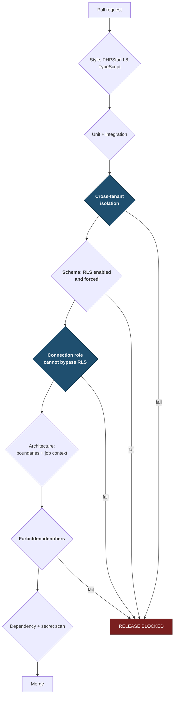

# Test Strategy

> **Status:** Draft
> **Last reviewed:** 2026-08-13
> **Derives from:** [Multi-Tenancy](../30-architecture/multi-tenancy.md), [Threat Model](../50-security-compliance/threat-model.md)

What we test, how deeply, and which tests are non-negotiable.

The governing constraint is that a solo or small team cannot maintain a huge test suite. So the suite must be **small and pointed at the things that would actually hurt**: cross-tenant leaks, money, and clinical-record integrity. Coverage percentage is not a goal and should not be reported as one.

## Non-negotiable tests

These block release. No severity discussion, no "we'll fix it next sprint".



The four gates wired to `RELEASE BLOCKED` are the ones with no negotiable path. Gate 5 in particular catches a failure no behavioural test can see — see failure mode 1 in the [Threat Model](../50-security-compliance/threat-model.md).

### 1. Cross-tenant isolation — per model

Every tenant-scoped model gets a test that creates data in tenant A and attempts to reach it from tenant B through **every** access path:

```php
it('cannot reach another tenant\'s patients', function () {
    $a = Tenant::factory()->create();
    $b = Tenant::factory()->create();
    $patient = Tenancy::run($a->id, fn () => Patient::factory()->create());

    Tenancy::run($b->id, function () use ($patient) {
        expect(Patient::find($patient->id))->toBeNull();
        expect(Patient::withoutGlobalScopes()->find($patient->id))->toBeNull();
        expect(DB::table('patients')->find($patient->id))->toBeNull();
        expect(DB::select('select * from patients where id = ?', [$patient->id]))->toBeEmpty();
    });
});
```

All four paths matter. The first three bypass Eloquent scopes; **only RLS defeats them** ([ADR-0002](../70-decisions/0002-postgresql-rls-shared-schema-tenancy.md)). A test that only exercises `Patient::find()` proves the convenience layer works and says nothing about the control.

### 2. Schema conformance

Every table either carries `tenant_id` with RLS **enabled and forced**, or appears on the platform-scoped list in [Multi-Tenancy](../30-architecture/multi-tenancy.md). The test reads `pg_tables` and `pg_policies` rather than trusting the migrations.

This catches the commonest real mistake: a new table shipped without RLS.

### 3. Connection role

The application role **cannot bypass RLS and does not own the tables**.

This is the highest-consequence test in the suite. If the application connects as the table owner, PostgreSQL exempts it and **every policy becomes silently inert** — the system works perfectly and protects nothing ([Threat Model](../50-security-compliance/threat-model.md)). No behavioural test would notice.

Runs in CI **and** at boot in every environment, and is exposed as `/health/isolation`.

### 4. `WITH CHECK` — writes

A write cannot place a row in another tenant. Without `WITH CHECK`, an attacker could insert into a tenant they cannot read.

### 5. Architecture — jobs restore tenant context

Every class implementing `ShouldQueue` extends `TenantAwareJob` or carries `#[PlatformScoped]`. A job running without tenant context is failure mode 2 in the [Threat Model](../50-security-compliance/threat-model.md).

### 6. Architecture — module boundaries

No module references another's `Domain` or `Infrastructure`; `Domain` contains no framework code ([Backend](../30-architecture/backend-laravel.md)).

### 7. Forbidden identifiers

No `wallet`, `balance`, `float`, `escrow`, `payout` or `settlement` in migrations, models or the payments module. A blunt instrument that forces a conversation — and the conversation is the control ([Payments Regulatory Boundary](../50-security-compliance/payments-regulatory-boundary.md)).

### 8. Data-minimisation boundaries

Two tests protecting the two sharpest disclosure boundaries:

- **No rider-facing response contains a clinical field.** Assert against the serialised output, not the UI ([Data Protection](../50-security-compliance/data-protection-dppa.md)).
- **No notification template contains clinical content** — asserted against a prohibited-content list ([Notifications](../10-product/notifications-sms-whatsapp.md)).

### 9. No PII in logs

Representative flows are exercised and the captured log output is asserted against a prohibited-pattern list: patient names, phone numbers, clinical terms, secret prefixes. Includes **exception traces**, which is where secrets most often escape ([Observability](../30-architecture/observability.md)).

## Layers

### Domain unit tests — no database
`Domain` is framework-free precisely so invariants can be tested in isolation and fast ([Backend](../30-architecture/backend-laravel.md)).

Test the invariants from [Domain Model](../20-domain/domain-model.md) and the transitions from [State Machines](../20-domain/state-machines.md) — including that **illegal transitions throw**. A state machine whose illegal transitions are untested is a suggestion.

Highest-value examples:

- A prescription cannot be issued without `can_prescribe` and a registration number.
- A prescription cannot be issued on a consultation with outcome `converted_to_in_person`.
- Dispensing is rejected while a substitution is pending.
- A delivery cannot be created for an order containing a controlled item.
- `timed_out` can transition to `succeeded`.

### Integration tests — with a database
Persistence, RLS behaviour, transactions, queued jobs. Real PostgreSQL with real policies — SQLite would silently skip every RLS test, which would be worse than having none.

### API tests
Request to response, including authorisation. Every endpoint tested for the **denied** cases as well as the permitted ones, from the [RBAC Matrix](../50-security-compliance/rbac-matrix.md). Denial tests are the ones that catch privilege escalation, and they are the ones usually skipped.

Also: cross-tenant access returns **404, not 403** ([API Conventions](../40-api/api-conventions.md)).

### Idempotency tests
The mechanism preventing a double charge, so it earns dedicated coverage:

- Same key, same body → stored response, no second effect.
- Same key, different body → 409.
- Concurrent identical requests → one effect.
- Duplicate webhook → no-op.
- Webhook and reconciliation poll racing → one resolution.

### Frontend tests
Component tests for the parts with real logic. End-to-end for the critical paths only: book → pay → consult → prescribe, and prescription → dispense → deliver.

Plus two specific behaviours from the PRDs:

- **Consultation notes survive a deliberate mid-session disconnection** ([H3](../10-product/prd-h3-teleconsultation.md)).
- **No tenant-supplied branding value can inject markup, style or script** — tested with hostile inputs ([White-Labeling](../10-product/white-labeling-and-branding.md)).

### Performance
The patient booking path meets its budget on a throttled 3G profile ([Frontend](../30-architecture/frontend-nextjs.md)). This is a competitive property in this market, not an engineering nicety, so it is asserted rather than hoped for.

## External services

Never called in tests. Adapters are contract-tested against recorded responses, including the failure shapes that matter operationally:

- Aggregator: pending, success, failure, timeout, reversal, late confirmation.
- SMS: accepted, rejected, delivery receipt.
- Video: token issuance, provider unavailable.

**Test the failure paths harder than the happy path.** §H5's exception list is where the real complexity lives, and a payment integration that only handles success is not an integration.

## What we do not test

Being explicit prevents guilt-driven busywork:

- Framework behaviour. Laravel's own tests cover Eloquent.
- Trivial getters, generated code, configuration.
- **Coverage percentage as a goal.** A suite at 90% that misses the isolation tests is worse than one at 40% that has them.

## In CI

All of the above, all blocking ([Release Process](../60-operations/release-process.md)).

Suite runtime should stay under ten minutes. Beyond that people start skipping it locally, and a test suite that is not run is not a test suite.

## After an incident

**Every cross-tenant incident produces a regression test that ships with or before the fix** ([Incident Response](../50-security-compliance/incident-response.md)). This class of bug recurs, and the test is the only thing that stops the recurrence.
